If you sell with FBA, some days your inventory numbers just don't add up. Fewer units get received than you shipped, a unit you had yesterday is written off as lost, or a customer gets a refund and the item never comes back.

Amazon reimburses most of this automatically, but some cases slip through, and once the deadline passes the money is gone. This post follows the whole process on my own Seller Central account:

1. See where and how many units went missing
2. Check whether they were already reimbursed or found again
3. File a claim only for what is left
4. Confirm the payout and any later reversal

> Screens are from US Seller Central with the display language set to Korean, so the labels below give the English menu names. SKUs, ASINs, FNSKUs, order IDs and product names are masked.

## First: the deadline depends on where the units went missing

Amazon's FBA inventory reimbursement policy splits losses into four places, each with its own window and filing method.

| Where it went missing | Claim window | How to file |
|---|---|---|
| Shipments to Amazon (inbound) | Within 9 months of delivery, once the shipment shows "eligible for investigation" | Shipments → the shipment's **Contents** tab |
| Fulfillment center operations | **Within 60 days** of the date it was reported lost or damaged | Inventory Defect and Reimbursement portal, or the FNSKU / transaction ID tool in Help |
| FBA customer returns | 60 to 120 days after the refund or replacement | Enter the customer order ID in the Help tool |
| Removal orders | See the policy page | Enter the removal order ID in the Help tool |

The warehouse window used to be 18 months. It is now 60 days, so check at least once a month ([Fulfillment center operations claims](https://sellercentral.amazon.com/help/hub/reference/external/GGEV4254LJJ9BAEG)).

Payout matters too. Units lost before a customer ordered them are reimbursed at **sourcing cost**, not your selling price, capped at \$5,000 per unit ([FBA inventory reimbursement policy](https://sellercentral.amazon.com/help/hub/reference/external/G200213130)).

## Step 1: Get the big picture in the Inventory Defect and Reimbursement portal

Start in the **Inventory Defect and Reimbursement** portal. In the FBA dashboard's top menu, go to **Inventory → Inventory Defect and Reimbursement**.

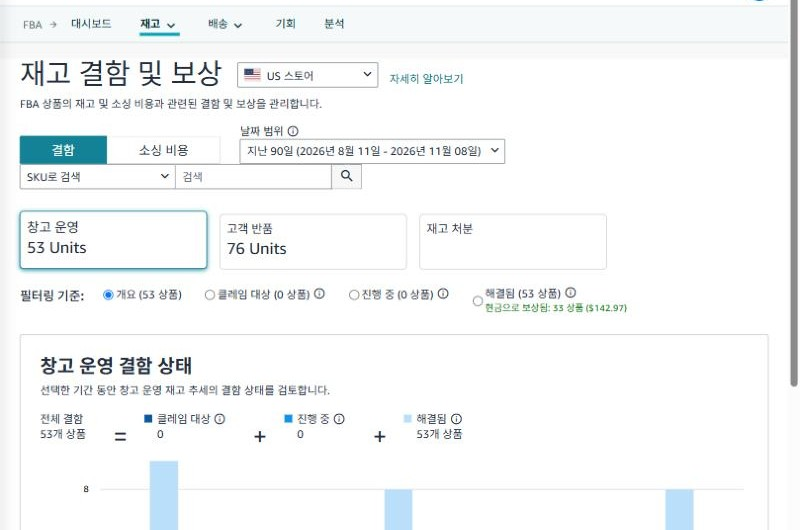

*The portal shows defect counts for warehouse operations, customer returns and removals, plus status filters below.*

The cards at the top show where units went missing. The filter shows the status of each defect:

- **Eligible for claims**: not yet reimbursed, so **you can file for these yourself**
- **In progress**: Amazon is investigating
- **Resolved**: reimbursed or adjusted, with the cash total shown next to it

On my account, the last 90 days had 53 warehouse defects, all of them resolved. Thirty-three units were paid in cash, \$142.97 in total. **If "Eligible for claims" is 0, there is nothing for you to file.**

Click Resolved to see how the cases were settled.

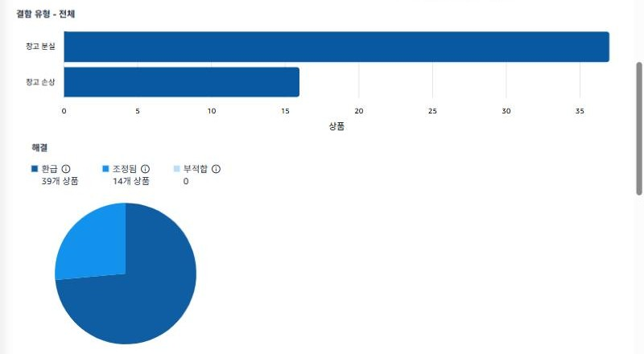

*Of the 53 resolved units, 37 were warehouse lost and 16 warehouse damaged. Results: 39 reimbursed, 14 adjusted, 0 ineligible.*

"Adjusted" mostly means **the unit was found later**. It goes back into your inventory instead of being reimbursed.

## Step 2: Check each case

The list below shows each case's event date, defect type, transaction ID and result.

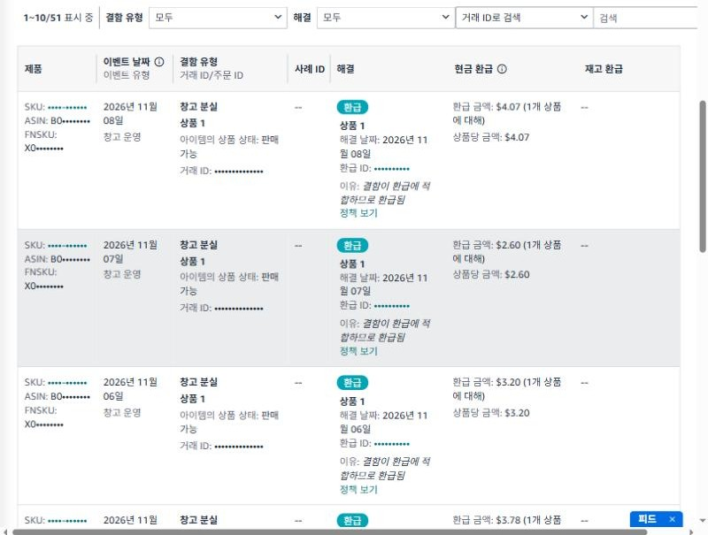

*Warehouse-lost units marked "Reimbursed" the same day, each with a reimbursement ID and per-unit amount (\$4.07, \$2.60, and so on).*

There are three kinds of result:

| Result | Meaning | What to do |
|---|---|---|
| Reimbursed + cash | You were paid | Check the amount against your cost |
| Reimbursed + inventory | Amazon replaced the unit instead of paying | Check your stock count |
| Adjusted | Found later or re-graded | Nothing (the unit is back) |

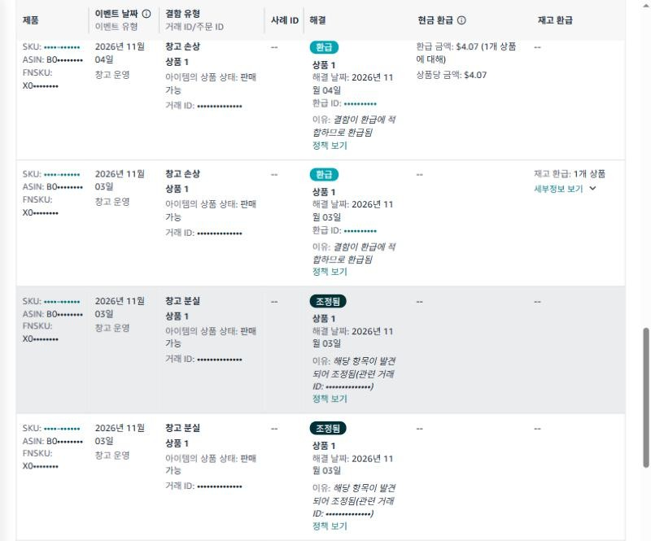

*Row two was reimbursed with 1 unit of inventory instead of cash. The next two rows say "Adjusted: the item was found," with the related transaction ID.*

The customer returns card shows refunds where the item hasn't come back yet.

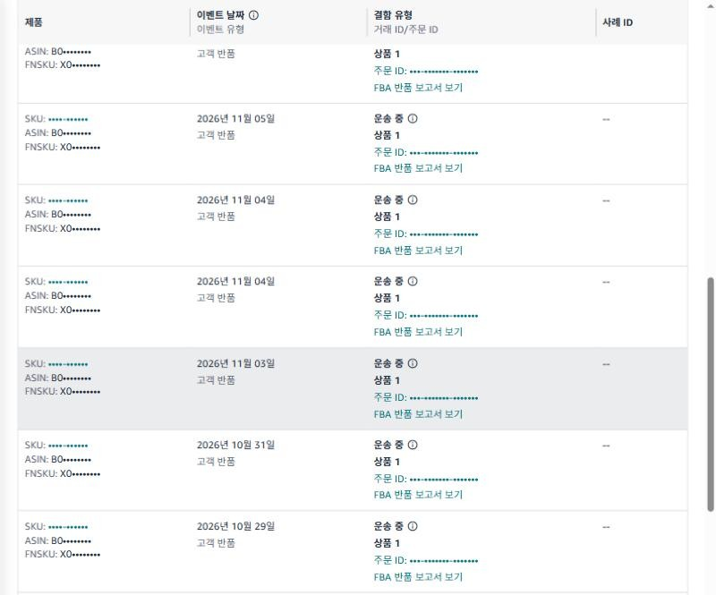

*Customer-return defects in progress. Most are "in transit," so the return is on its way or Amazon is still waiting.*

You can only file for customer returns **60 days after the refund**, so at this point you just wait. If the item isn't returned within 60 days, Amazon usually charges the customer and reimburses you.

## Step 3: Match lost and found events in the Inventory Ledger

If the portal shows claimable cases, or the numbers look off, check the actual stock movements in the **Inventory Ledger** report: **Supply Chain → Supply Chain Reports → Inventory Ledger**.

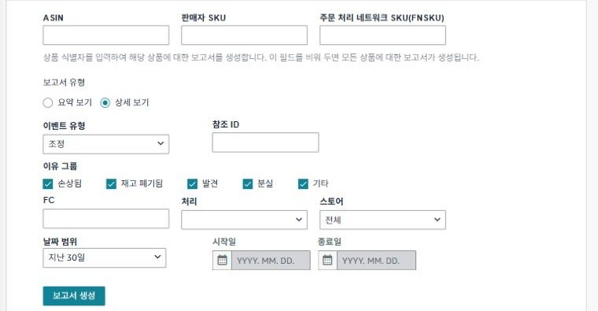

*Choose "Detailed view" and the event type "Adjustments," then filter by reason group: damaged, disposed, found, lost, other.*

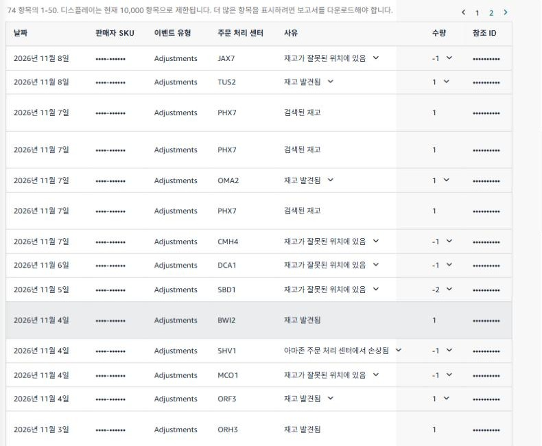

*Adjustment events: "Misplaced -1" (written off as lost) mixed with "Found +1" and "Inventory found in search +1."*

Here's how to read the reasons:

- **Misplaced / Lost (−)**: the warehouse couldn't find the unit and removed it
- **Found (+)**: it was found and added back
- **Damaged at Amazon fulfillment center (−)**: broken in the warehouse

Net the minus and plus events for each FNSKU. Whatever is still missing and hasn't been reimbursed is a claim candidate. Lost units often come back as "Found" within days, which is why claims should wait until Amazon finishes its own search.

## Step 4: Remove what's already paid, using the Reimbursements report

Before filing, take out anything already reimbursed. On the same Fulfillment Reports page, open **Reimbursements** from the left-hand list (under Payments → "More...").

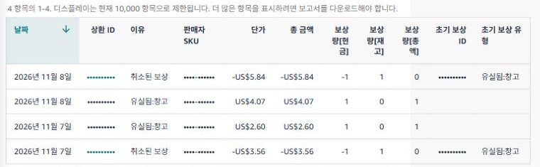

*Two "Lost: Warehouse" payouts of \$4.07 and \$2.60, and two "Reimbursement reversal" rows taking back \$5.84 and \$3.56 while returning 1 unit each.*

Look at the reversal rows. When Amazon finds a unit it already paid you for, it **takes the money back and returns the unit**: cash quantity −1, inventory quantity +1. The policy says Amazon may reverse the credit if a reimbursed item is found later. So count reversals too, not just payouts, to see what you actually received.

## Step 5: Check the sourcing cost that sets the payout

The portal's **Sourcing cost** tab shows the cost used to reimburse each product.

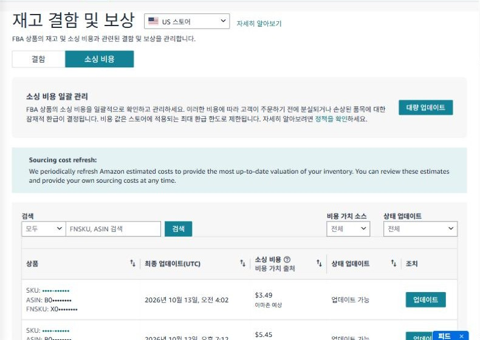

*Sourcing cost tab. "Amazon estimate" means Amazon's estimated cost is used. Click "Update" to enter your real cost.*

If you don't enter a cost, Amazon estimates one from similar products. If your real cost is higher, have an invoice ready and update it. Shipping and duties are not part of sourcing cost.

## Step 6: File claims only for what's left

If anything survives steps 1 to 4, file for it.

**Lost or damaged in the warehouse**

- Cases under **Eligible for claims** can be filed straight from the portal, using the transaction ID, FNSKU and quantity shown there.
- For cases you found in the ledger but not in the portal, use the tools at the bottom of the "Fulfillment center operations claims" help page. Enter a **transaction ID (TRID)** for damaged units or an **FNSKU** for lost units, up to 25 at a time.

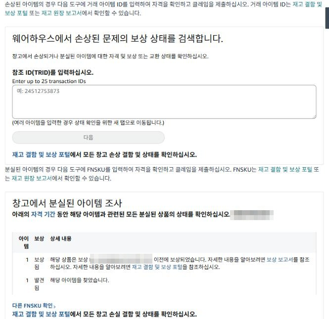

*The Help page tools. Enter an FNSKU and click Next to see the status of its lost units. In this example one unit was "Reimbursed" and one "Found," so there is nothing to file.*

If a unit is eligible, the tool takes you straight to filing. You may be asked for extra details such as the date or the fulfillment center ID.

**Inbound shipment shortages**

- Open the shipment's **Contents** tab under Shipments to see shipped vs. received quantities.
- Once the status shows "eligible for investigation," open the lost-units claim from that tab.
- You'll need the shipment ID, proof of ownership (an invoice with purchase date, product name and quantity) and proof of delivery. For small parcels that means tracking IDs; for LTL or FTL, a delivery document with Amazon's receiving stamp.
- **Only one claim per shipment** is accepted, so gather all the evidence first.

**Customer returns not returned**

- Between 60 and 120 days after the refund, enter the **customer order ID** shown in the portal into the Help tool.

> Amazon prohibits claims filed without enough investigation, filed too early, or filed in bulk over a short period. Repeating this can delay support or lead to account action, so only file what made it through the steps above.

## Step 7: Confirm the outcome

Track filed claims in **Help (?) → Case Log** (shown as "Support case management").

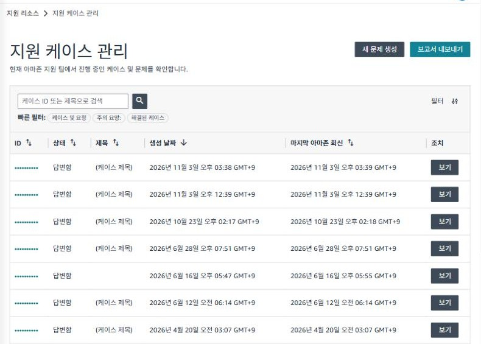

*The case log shows each case ID, status and Amazon's latest reply (case IDs and titles masked).*

Then cross-check three places:

1. **Inventory Defect and Reimbursement → Resolved**: the result (reimbursed, adjusted, ineligible) and the amount
2. **Reimbursements report**: the actual payout, and any later reimbursement reversal
3. **Inventory Ledger**: whether a "Found" event appeared for the same FNSKU

If you disagree with a decision, you can file again using the details on the Resolved tab. If you disagree with the payout amount, raise it within 60 days of the reimbursement.

## Cheat sheet

| What to check | Where |
|---|---|
| Anything to file? | Inventory Defect and Reimbursement → Eligible for claims |
| Is Amazon investigating? | Inventory Defect and Reimbursement → In progress |
| Reimbursed or found? | Inventory Defect and Reimbursement → Resolved |
| Actual stock movements (lost, found, damaged) | Supply Chain Reports → Inventory Ledger (Detailed, Adjustments) |
| Money paid and taken back | Fulfillment Reports → Reimbursements |
| Cost used for payouts | Inventory Defect and Reimbursement → Sourcing cost |
| Claim progress | Help → Case Log |

Warehouse losses have a 60-day window, and customer returns run until 120 days after the refund. **Checking "Eligible for claims" once a month** catches almost everything.

## Automating the check with SellerMorning

I built [SellerMorning](../amazon-seller-15-safe-automation/) to run this check every morning. It pulls the Inventory Ledger and Reimbursements report through the official API, nets lost against found and payouts against reversals, and puts only unreimbursed cases on the daily summary with their deadlines. You still file the claims yourself, as in step 6.

Interested in SellerMorning? Email [toolbox@toolboxnotes.com](mailto:toolbox@toolboxnotes.com).

---

**Related reading**

- [How to Claim FBA Reimbursements for Lost or Damaged Inventory](../amazon-seller-12-fba-reimbursement/) (policy summary)
- [FBA inventory without stock-outs or overstock](../amazon-seller-7-fba-inventory/)
- [Finding problems in orders and returns](../amazon-seller-8-orders-returns/)
- [Check profit before you change a price](../amazon-seller-13-fees-profit/)

*Based on personal experience. Not affiliated with or endorsed by Amazon.com, Inc. or its affiliates. Policies and fees are as of the time of writing — check Seller Central for the latest.*
