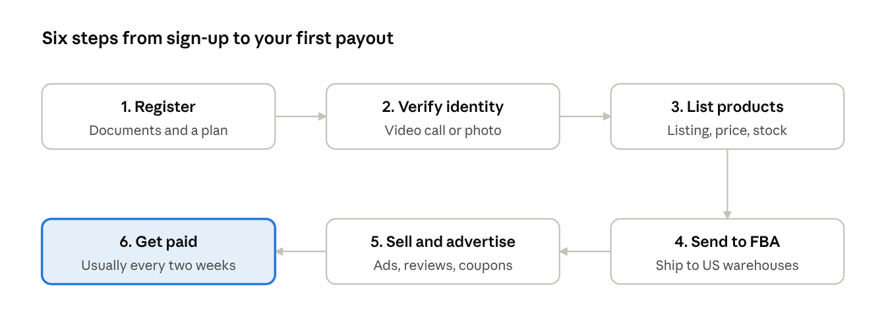
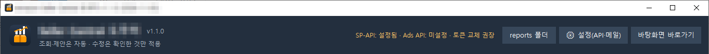

## No factory, no warehouse required

To become an Amazon seller you need an ID, a bank account, a credit card and one product you want to sell. Amazon can store and ship it for you (FBA), and it handles payment, delivery and much of the customer service.

That is why office workers now sell as a side business, small workshops build their own brands, and manufacturers in Korea sell straight to US customers. You can open an Amazon.com seller account and sell from outside the US.

This series has five parts.

1. Anyone can become an Amazon seller — registering, listing and starting to sell (this post)
2. [The real challenge after you start](../amazon-seller-2-real-challenge/) — you can't watch every product, and Seller Central is complex
3. [Your sales data at a glance](../amazon-seller-3-sales-data/) — inventory, orders and revenue
4. [Your ads at a glance](../amazon-seller-4-ads/) — ad analysis and suggested actions
5. [Your listings at a glance](../amazon-seller-5-listings/) — checks and edits

*Getting started as an Amazon seller · 6 steps*

This post groups that flow into three stages: register, list, sell.

## Step 1: Create your seller account

Registration happens online. With your documents ready, the application takes about an hour; the review takes a few days.

**What you need** ([Amazon FAQ](https://sell.amazon.com/learn/faq))

- Government-issued ID (such as a passport)
- A credit card that can be charged internationally
- A bank account to receive payouts
- A phone number and email address
- Business registration documents (if you have them)
- Proof of address dated within the last 180 days (a bank or card statement)
- Tax information

**Choose a plan** ([Amazon pricing](https://sell.amazon.com/pricing))

| Plan         | Cost                 | Best for                                             |
|--------------|----------------------|------------------------------------------------------|
| Individual   | \$0.99 per item sold | Testing with fewer than 40 sales a month             |
| Professional | \$39.99 per month    | Serious selling with ads, Brand Registry and reports |

On both plans Amazon also takes a referral fee on each sale, usually around 15% with a \$0.30 minimum. Brands new to Amazon can get over \$50,000 in benefits, including first-year referral-fee waivers.

**Identity verification**

You upload your ID and proof of address, then either send a photo of yourself holding the ID or schedule a video call with an Amazon associate. If a name or address differs by even one letter from your application, it can be rejected, so keep the English spelling identical everywhere.

## Step 2: List your products

On Amazon, one product is one listing. A listing is its title, images, bullet points (five key features), description, search terms, price and stock.

1. **Find the product or create a new one** — if the product already exists on Amazon, you join its page as a seller; for your own brand, you create a new page. New products need a barcode (UPC/GTIN), unless Brand Registry exempts you.
2. **Pick a category** — it decides the fields you fill in and your fees. Some categories need approval.
3. **Write the listing** — put brand, product name and key features in the title, and the words customers actually search for in the bullets and search terms. The main image must be the product on a white background.
4. **Set price and stock** — check with the [FBA Revenue Calculator](https://sell.amazon.com/blog/how-to-use-fba-calculator) that the price still leaves a profit after fees, shipping and ads.
5. **Choose how to fulfill** — one of the two below.

| Method                      | Who stores and ships | Upside                                                             | Burden                                                            |
|-----------------------------|----------------------|--------------------------------------------------------------------|-------------------------------------------------------------------|
| FBA (Fulfillment by Amazon) | Amazon's warehouses  | Prime badge; Amazon handles shipping, returns and customer service | Storage and fulfillment fees; stock must be sent to US warehouses |
| FBM (fulfilled by merchant) | You                  | No storage fees; full control of stock                             | You must meet shipping deadlines and answer customers             |

Most sellers shipping into the US from abroad use FBA, because international shipping for each order makes deadlines hard to meet.

## Step 3: Start selling

With FBA, there is little for you to touch between an order and your payout. When a customer orders, Amazon ships from its warehouse, and the sale minus fees is paid to your bank account, usually every two weeks.

The first order rarely comes on its own, though. A new product has no reviews and no sales history, so it sits low in search results. Most sellers start like this:

- **Sponsored ads** — put your product near the top of search results. Start with an automatic-targeting campaign to learn which searches sell.
- **Reviews** — request reviews after purchase, and use Amazon's new-product review program (Vine).
- **Promotions and coupons** — build early sales to lift your search ranking.

At this point you are an Amazon seller. But once you have 10 or 50 products, new problems appear. The next post covers the management struggles every seller runs into.

From part 3 on, we introduce the program we built and use ourselves to take over that work: **SellerMorning**. Its rule is simple: checks and suggestions run automatically, and edits apply only after the seller reviews them.

*The top of the SellerMorning window, showing the Amazon API connection status and settings (the program's screens are in Korean).*

---

**Amazon seller series**

1. **Anyone Can Become an Amazon Seller** — registering, listing and starting to sell (this post)
2. [The Real Challenge After You Start Selling](../amazon-seller-2-real-challenge/) — you can't watch every product, and Seller Central is complex
3. [Your Amazon Sales Data at a Glance](../amazon-seller-3-sales-data/) — inventory, orders and revenue
4. [Your Amazon Ads at a Glance](../amazon-seller-4-ads/) — ad analysis and suggested actions
5. [Your Amazon Listings at a Glance](../amazon-seller-5-listings/) — checks and edits
