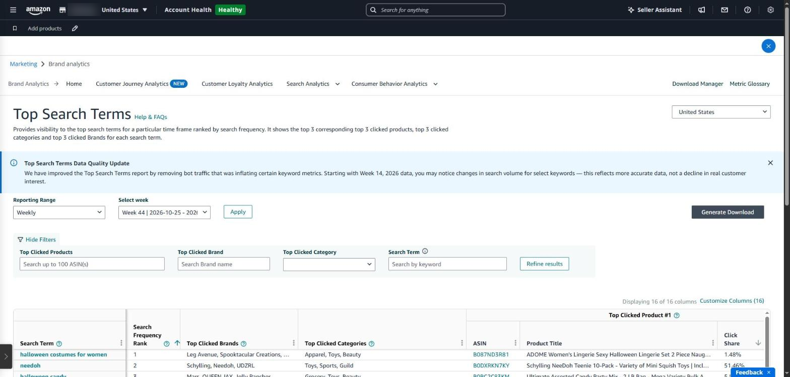
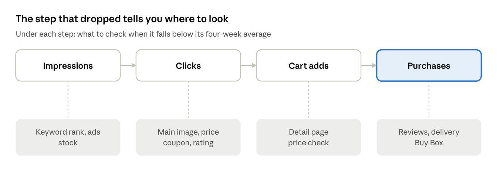
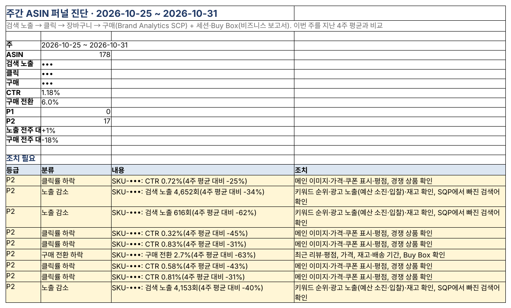

## From search to purchase: where do shoppers leak?

A shopper sees your product in search (impression), opens it (click), adds it to the cart, then buys. Brand Analytics is Amazon's built-in tool that puts numbers on those four steps.

### Brand Analytics in Seller Central

Available to brand representatives of brands enrolled in Brand Registry, on a Professional account. Menu → **Marketing → Brand analytics** ([Amazon overview](https://sell.amazon.com/blog/brand-analytics)).

| Report                           | What it shows                                                                                                   |
|----------------------------------|-----------------------------------------------------------------------------------------------------------------|
| Search Query Performance (SQP)   | Impressions, clicks, cart adds and purchases per search query that led to your products, and your brand's share |
| Search Catalog Performance (SCP) | The search funnel per ASIN: impressions, clicks, cart adds, purchases                                           |
| Top Search Terms (TST)           | Each search term's rank and its top clicked products                                                            |
| Others                           | Customer Journey Analytics, Customer Loyalty Analytics, Consumer Behavior Analytics and more (the menu changes often)                                             |

Data comes by week (Sunday to Saturday). To download, you generate it and then wait in the Download Manager.

In 2026 Amazon improved the Top Search Terms report by removing bot traffic that was inflating some keyword metrics. According to Amazon's notice, **starting with Week 14, 2026 data**, search volume for some keywords may look lower; that reflects more accurate data, not a drop in real customer interest. Keep it in mind when comparing before and after.

*Brand Analytics → Top Search Terms in Seller Central. The menu at the top leads to Search Query Performance, Customer Journey Analytics and the other reports.*

*Four-step search funnel and what to check at each step*

### Weekly ASIN funnel in SellerMorning

- Pulls SCP every week and compares each ASIN's four steps with its four-week average.
- Tells you what to check at each step: **fewer impressions** → keyword rank, ad exposure, stock; **lower click rate** → main image, price, coupon, rating; **lower purchase rate** → reviews, price, delivery time, Buy Box.
- Shows an eight-week trend, and a before-and-after comparison of two weeks around a listing edit.
- Brings in sessions and Buy Box from the business report, so drops caused by losing the Buy Box stand apart.

*The weekly ASIN funnel Summary: this week's overall funnel and actions for ASINs below their four-week average (some figures and SKUs masked; the program's reports are in Korean).*

---

**Amazon seller series**

1. [Anyone can become an Amazon seller](../amazon-seller-1-getting-started/)
2. [The real challenge after you start](../amazon-seller-2-real-challenge/)
3. [Sales data at a glance](../amazon-seller-3-sales-data/)
4. [Ads at a glance](../amazon-seller-4-ads/)
5. [Listings at a glance](../amazon-seller-5-listings/)
6. [Keeping your account healthy](../amazon-seller-6-account-health/)
7. [FBA inventory without stock-outs or overstock](../amazon-seller-7-fba-inventory/)
8. [Finding problems in orders and returns](../amazon-seller-8-orders-returns/)
9. [Reading conversion in business reports](../amazon-seller-9-business-reports/)
10. **Finding drop-offs with Brand Analytics** (this post)
11. [Guarding your Buy Box from hijackers](../amazon-seller-11-buy-box/)
12. [Getting reimbursed for lost FBA inventory](../amazon-seller-12-fba-reimbursement/)
13. [Check profit before you change a price](../amazon-seller-13-fees-profit/)
14. [A 15-minute morning routine](../amazon-seller-14-daily-routine/)
15. [Safe automation with the official API](../amazon-seller-15-safe-automation/)

*Based on personal experience. Not affiliated with or endorsed by Amazon.com, Inc. or its affiliates. Policies and fees are as of the time of writing — check Seller Central for the latest.*
