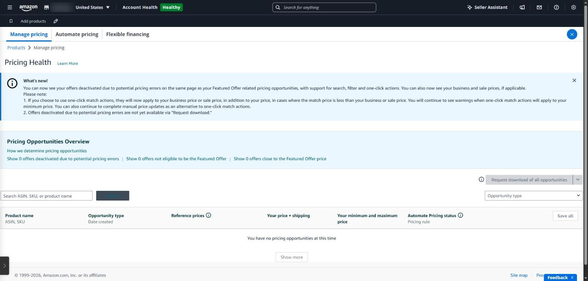
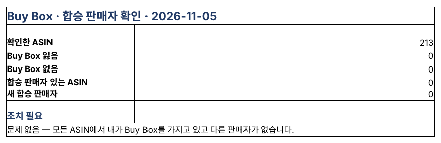

## Who holds the buy button?

The ‘Add to Cart’ and ‘Buy Now’ box on the right of a detail page is the Buy Box (Amazon now calls it the Featured Offer). When several sellers sell the same product, only one gets it. Most sales go through this box, so even on your own brand's product, losing it cuts sales sharply ([Featured Offer guide](https://www.repricer.com/blog/amazon-featured-offer-sellers-guide/)).

### What decides it

- **A Professional account** — Individual plans can't win the Buy Box.
- **Price** — item price plus shipping; an offer priced far above others can drop out entirely.
- **Fulfillment** — delivery speed and Prime eligibility; FBA has the edge.
- **Seller trust** — Order Defect Rate under 1%, account health, track record.
- **Stock** — when you run out, it goes to another seller.

### Hijackers

A hijacker joins your brand's page and sells at a lower price. It may not be genuine or even the same product, which hurts your reviews too. If you are in Brand Registry, you can respond with ‘Report a violation’.

### When a hijacker joins

1. **Check the offer** — in the ‘Other sellers’ list on the detail page, note the seller name, price and fulfillment (FBA or FBM).
2. **Check it's genuine** — if in doubt, buy from that seller (a test buy), compare the product and packaging, and take photos.
3. **Report it** — use ‘Report a Violation’ in Brand Registry for counterfeit or trademark infringement, with the test-buy evidence attached.
4. **Check your own offer** — make sure your price, stock and delivery keep you competitive for the Buy Box meanwhile.

A seller who legitimately resells genuine products may not be a violation, though. Confirm with a test buy before reporting.

### Where to see it in Seller Central

- **Business reports** — Featured Offer (Buy Box) percentage by ASIN
- **Manage products** — number of sellers and Featured Offer status per product

But the percentage only drops after a few days, and there is no record of which seller joined when.

*Pricing Health in Seller Central lists offers that are not eligible for the Featured Offer or are priced close to it.*

### Buy Box check in SellerMorning

- Every day it reads the offers on all selling ASINs through the official API and checks who holds the Buy Box.
- A seller **who wasn't there yesterday** is flagged as a new hijacker.
- ASINs where you lost the Buy Box, or where no one has it, go to P1 in Today's Summary and to the ads feature for an ad review.

*The Buy Box check Summary. On this day all 213 ASINs were clear (the program's reports are in Korean).*

---

**Amazon seller series**

1. [Anyone can become an Amazon seller](../amazon-seller-1-getting-started/)
2. [The real challenge after you start](../amazon-seller-2-real-challenge/)
3. [Sales data at a glance](../amazon-seller-3-sales-data/)
4. [Ads at a glance](../amazon-seller-4-ads/)
5. [Listings at a glance](../amazon-seller-5-listings/)
6. [Keeping your account healthy](../amazon-seller-6-account-health/)
7. [FBA inventory without stock-outs or overstock](../amazon-seller-7-fba-inventory/)
8. [Finding problems in orders and returns](../amazon-seller-8-orders-returns/)
9. [Reading conversion in business reports](../amazon-seller-9-business-reports/)
10. [Finding drop-offs with Brand Analytics](../amazon-seller-10-brand-analytics/)
11. **Guarding your Buy Box from hijackers** (this post)
12. [Getting reimbursed for lost FBA inventory](../amazon-seller-12-fba-reimbursement/)
13. [Check profit before you change a price](../amazon-seller-13-fees-profit/)
14. [A 15-minute morning routine](../amazon-seller-14-daily-routine/)
15. [Safe automation with the official API](../amazon-seller-15-safe-automation/)

*Based on personal experience. Not affiliated with or endorsed by Amazon.com, Inc. or its affiliates. Policies and fees are as of the time of writing — check Seller Central for the latest.*
