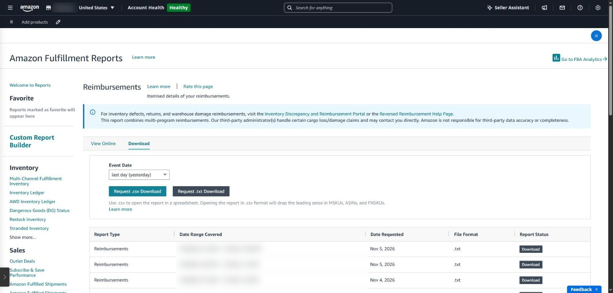
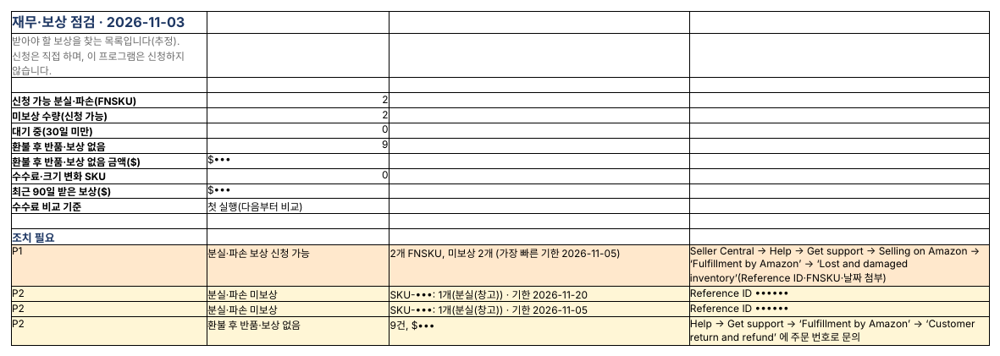

## Amazon loses inventory too

In FBA warehouses, stock gets lost or damaged, and sometimes a customer is refunded but never returns the item. Amazon reimburses most of this automatically, but some cases slip through, and then the seller has to file a claim within the deadline.

> This post covers the **rules**: what is eligible, the claim windows and how the payout is calculated. To actually find missing units and file a claim step by step with real Seller Central screens, see [Amazon FBA lost inventory: find, claim and confirm payouts](../amazon-fba-lost-inventory-claim/).

### The updated reimbursement policy

| Item             | Details                                                                                                                  |
|------------------|--------------------------------------------------------------------------------------------------------------------------|
| Claim window     | Cut sharply from October 23, 2024 (previously up to 18 months); warehouse loss or damage must be claimed within 60 days of being reported                 |
| Customer returns | Between 60 and 120 days after the refund or replacement                                                                  |
| Amount           | From March 31, 2025, based on **manufacturing cost**, not sale price (loss after a customer order: sale price less fees) |
| Evidence         | Invoices, proof of purchase and shipping records may be required                                                         |

Windows and terms can change, so also check the FBA reimbursement policy in Seller Central Help ([summary of the changes](https://www.ecomengine.com/blog/fba-reimbursement-policy)).

### Where to see it in Seller Central

- **Supply chain reports → Inventory Ledger** — receipts, shipments, lost, found and damaged events
- **Supply chain reports → Reimbursements** — reimbursements already paid
- **Help → Get support** — claims for missing reimbursements

The hard part: a ‘lost’ event is often offset by a later ‘found’, or reimbursed on another day, so you must match both reports over a long period to see what is truly unpaid.

*The Reimbursements page in Amazon Fulfillment Reports. You pick a date range and download a file before you can see anything.*

### Finance and reimbursements in SellerMorning

- Pulls 18 months of inventory ledger, reimbursements, returns, refunds and FBA fees through the official API and matches them.
- Nets losses against later finds, and reimbursements against reversals, leaving **only what is still unreimbursed**. Cases under 30 days old are marked ‘waiting’.
- Finds orders that were refunded with neither a return nor a reimbursement.
- Lists each case with its deadline, Reference ID and the menu path to file it; cases near their deadline go to P1 in Today's Summary.
- The seller files the claims. The program only finds them.

*The finance and reimbursements Summary: claimable lost or damaged units and refunds without returns, with deadlines and how to file (SKUs, amounts and Reference IDs masked; the program's reports are in Korean).*

---

**Amazon seller series**

1. [Anyone can become an Amazon seller](../amazon-seller-1-getting-started/)
2. [The real challenge after you start](../amazon-seller-2-real-challenge/)
3. [Sales data at a glance](../amazon-seller-3-sales-data/)
4. [Ads at a glance](../amazon-seller-4-ads/)
5. [Listings at a glance](../amazon-seller-5-listings/)
6. [Keeping your account healthy](../amazon-seller-6-account-health/)
7. [FBA inventory without stock-outs or overstock](../amazon-seller-7-fba-inventory/)
8. [Finding problems in orders and returns](../amazon-seller-8-orders-returns/)
9. [Reading conversion in business reports](../amazon-seller-9-business-reports/)
10. [Finding drop-offs with Brand Analytics](../amazon-seller-10-brand-analytics/)
11. [Guarding your Buy Box from hijackers](../amazon-seller-11-buy-box/)
12. **Getting reimbursed for lost FBA inventory** (this post)
13. [Check profit before you change a price](../amazon-seller-13-fees-profit/)
14. [A 15-minute morning routine](../amazon-seller-14-daily-routine/)
15. [Safe automation with the official API](../amazon-seller-15-safe-automation/)

*Based on personal experience. Not affiliated with or endorsed by Amazon.com, Inc. or its affiliates. Policies and fees are as of the time of writing — check Seller Central for the latest.*
