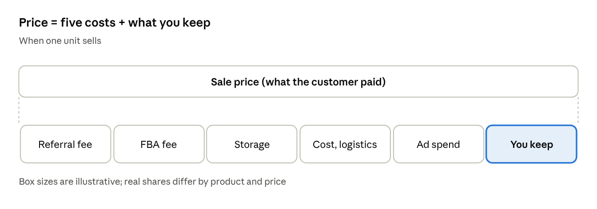
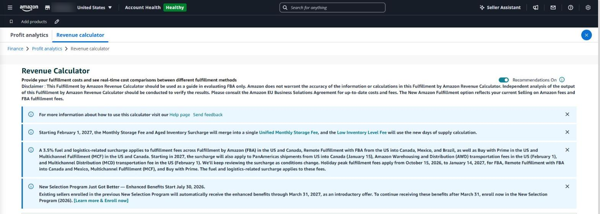

## How much of the price do you keep?

Cut the price by a dollar and you may sell more, but what you keep after fees shrinks more than you expect. Five things come out of every Amazon sale.

*What a sale price is made of*

| Item                | Details                                                     |
|---------------------|-------------------------------------------------------------|
| Referral fee        | A share of the sale price (usually around 15%, by category) |
| FBA fulfillment fee | A per-unit fee by size and weight                           |
| Storage             | Monthly storage, plus surcharges for aged stock (part 7)    |
| Cost and logistics  | Manufacturing cost and shipping to the US                   |
| Ad spend            | The cost of orders that came through ads                    |

### Example: cutting a \$25 product to \$23

These figures are an example to show the math. Real fees vary by category, size and weight.

| Item | Price \$25 | Price \$23 |
|---|---|---|
| Referral fee (15%) | \$3.75 | \$3.45 |
| FBA fulfillment fee | \$4.50 | \$4.50 |
| Storage (per unit) | \$0.30 | \$0.30 |
| Cost and logistics | \$7.00 | \$7.00 |
| **Left per unit before ads** | **\$9.45** | **\$7.75** |
| Break-even ACoS | 37.8% | 33.7% |

An 8% price cut takes 18% off what you keep per unit, and shrinks the room for ad spend with it. To keep the same profit, you would need to sell about 22% more units.

### Check the 2026–2027 fee changes too

These come from notices in Seller Central (as of November 2026). Factor them in before setting a price.

- A **3.5% fuel and logistics surcharge** applies to FBA fulfillment fees and related fees in the US and Canada.
- **Holiday peak fulfillment fees** apply **from October 15, 2026 to January 14, 2027**.
- Amazon has announced referral and FBA fee changes **starting January 15, 2027**, so recalculate with the new fees.

### Seller Central's built-in tools

- **Finance → Profit analytics → Revenue calculator** — enter a price to see fees and what's left per product.
- **Finance → Profit analytics** — cost and profit trends per product.
- **Products → Manage pricing → Automate pricing** — adjusts prices by rules; always set a minimum price.

The calculator works one product at a time, though, and you enter ad spend and your own costs yourself.

*The Revenue Calculator in Seller Central works out fees and profit for one product at a time.*

### In SellerMorning

- **Price change preview** — when a price row is checked in listing and price edits (part 5), it fetches Amazon's fees for the new price (referral and FBA) through the official API and shows what's left per unit.
- **With your costs entered** — it adds profit, margin and the change from today's price; a price that loses money applies only with separate approval.
- **Guard on big changes** — a change of more than 30% from the current price also needs separate approval.
- **Break-even ACoS** — from the same costs it works out how much ad spend each product can bear and uses it as the ad target (part 4).

> **Break-even ACoS = (price − Amazon fees − cost and logistics) ÷ price**
>
> If ad spend goes above this share of ad sales, orders that came through ads lose money.

---

**Amazon seller series**

1. [Anyone can become an Amazon seller](../amazon-seller-1-getting-started/)
2. [The real challenge after you start](../amazon-seller-2-real-challenge/)
3. [Sales data at a glance](../amazon-seller-3-sales-data/)
4. [Ads at a glance](../amazon-seller-4-ads/)
5. [Listings at a glance](../amazon-seller-5-listings/)
6. [Keeping your account healthy](../amazon-seller-6-account-health/)
7. [FBA inventory without stock-outs or overstock](../amazon-seller-7-fba-inventory/)
8. [Finding problems in orders and returns](../amazon-seller-8-orders-returns/)
9. [Reading conversion in business reports](../amazon-seller-9-business-reports/)
10. [Finding drop-offs with Brand Analytics](../amazon-seller-10-brand-analytics/)
11. [Guarding your Buy Box from hijackers](../amazon-seller-11-buy-box/)
12. [Getting reimbursed for lost FBA inventory](../amazon-seller-12-fba-reimbursement/)
13. **Check profit before you change a price** (this post)
14. [A 15-minute morning routine](../amazon-seller-14-daily-routine/)
15. [Safe automation with the official API](../amazon-seller-15-safe-automation/)

*Based on personal experience. Not affiliated with or endorsed by Amazon.com, Inc. or its affiliates. Policies and fees are as of the time of writing — check Seller Central for the latest.*
