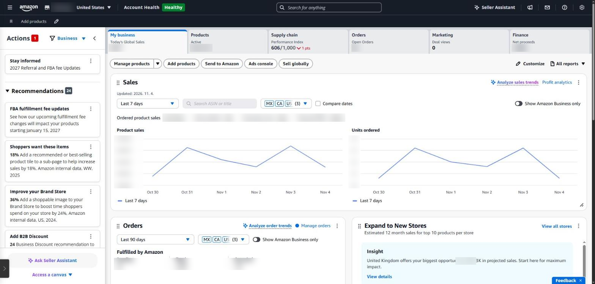
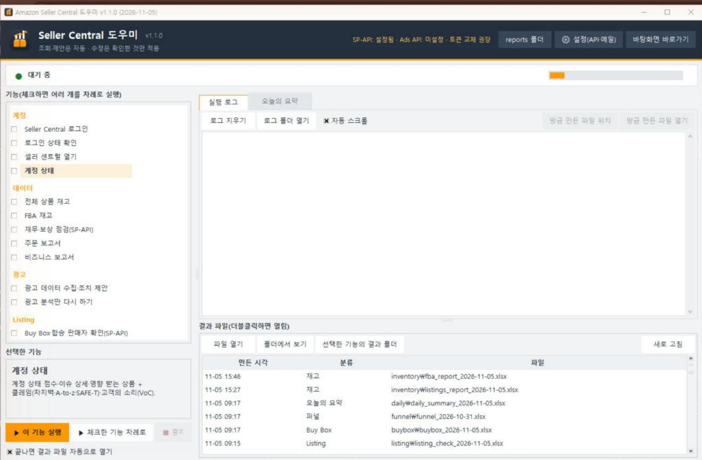
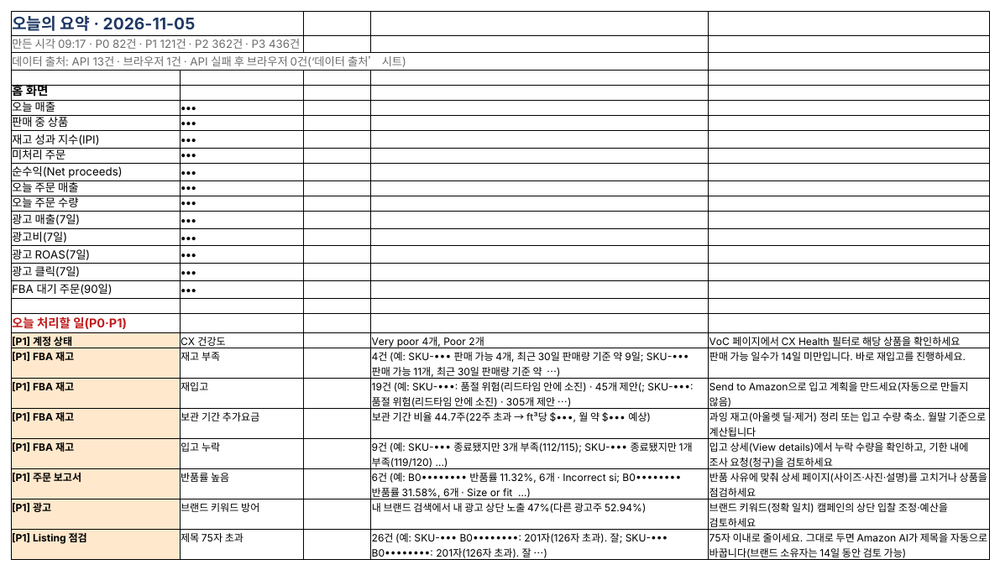

## The program works overnight; you just decide in the morning

There's no need to run each feature by hand every day. Schedule a time and the program runs them in order; in the morning you read one page, Today's Summary.

*The Seller Central home page. Sales, orders, inventory and finance figures sit under separate tabs, so a morning check means clicking through several places. Figures are masked.*

### Setting up the daily run

- Pick a time (for example 08:10) under ‘Daily auto-run’ in the desktop program; it registers with Windows Task Scheduler (launchd on Mac).
- The PC must be on at that time.
- It runs home → action items → account health → all listings → FBA → orders → business → ads → listings → Buy Box → funnel → finance (weekly). Ad reports are requested first and waited on while the rest runs.
- When it finishes, a desktop notification shows the most urgent item and the P0 and P1 counts.

*The desktop program: tick features to run them in order, or see results right away in the Today's Summary tab (the program's screens are in Korean).*

### A 15-minute morning routine

1. **Check the notification (1 min)** — just see whether there is a P0.
2. **Handle P0 (5 min)** — things for today, like a policy violation or a stock-out while selling. The summary's ‘how’ column has the menu path.
3. **Scan P1 (5 min)** — Buy Box, reimbursement deadlines, low stock; decide what to do this week.
4. **L1 ad suggestions (4 min)** — apply only the reversible ones, like negatives and small bid changes, in the Ads console.

*Part of a real Today's Summary (sales, SKUs and ASINs masked).*

### Weekly and monthly

| When    | What                                                                                  |
|---------|---------------------------------------------------------------------------------------|
| Weekly  | Review the funnel, file reimbursement claims, check the effect of past ad suggestions |
| Monthly | Clear aged stock, update costs, apply title drafts, check API token renewal reminders |

---

**Amazon seller series**

1. [Anyone can become an Amazon seller](../amazon-seller-1-getting-started/)
2. [The real challenge after you start](../amazon-seller-2-real-challenge/)
3. [Sales data at a glance](../amazon-seller-3-sales-data/)
4. [Ads at a glance](../amazon-seller-4-ads/)
5. [Listings at a glance](../amazon-seller-5-listings/)
6. [Keeping your account healthy](../amazon-seller-6-account-health/)
7. [FBA inventory without stock-outs or overstock](../amazon-seller-7-fba-inventory/)
8. [Finding problems in orders and returns](../amazon-seller-8-orders-returns/)
9. [Reading conversion in business reports](../amazon-seller-9-business-reports/)
10. [Finding drop-offs with Brand Analytics](../amazon-seller-10-brand-analytics/)
11. [Guarding your Buy Box from hijackers](../amazon-seller-11-buy-box/)
12. [Getting reimbursed for lost FBA inventory](../amazon-seller-12-fba-reimbursement/)
13. [Check profit before you change a price](../amazon-seller-13-fees-profit/)
14. **A 15-minute morning routine** (this post)
15. [Safe automation with the official API](../amazon-seller-15-safe-automation/)
