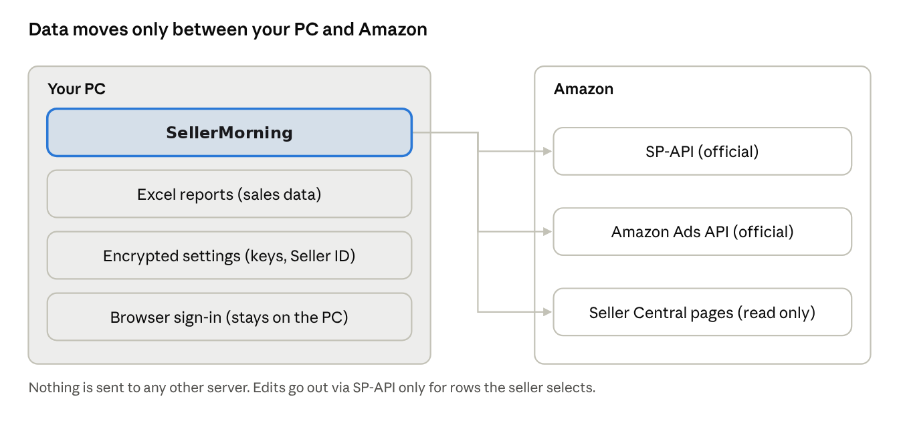

## In automation, safety comes first

A seller account is the business itself. That's why SellerMorning was built from the start on one principle: the official way, on your own PC, applying only what you approve.

### SP-API: Amazon's official channel

SP-API (Selling Partner API) is the official channel Amazon opens so programs can read a seller's inventory, orders, finance and listing data. You register a developer app on your own account and get approval only for the roles you need (inventory, orders, pricing, listings, Brand Analytics and so on). Ad data uses the separate Amazon Ads API.

Only pages the API can't provide are opened in a browser, just to read them, with generous pauses between clicks so it never puts load on Amazon's site.

*The top of the program shows the SP-API and Ads API connection status. On this day only SP-API was connected, with a reminder to renew the token (the program's screens are in Korean).*

*How data flows in SellerMorning*

### Safeguards

| What                    | How                                                                                                                |
|-------------------------|--------------------------------------------------------------------------------------------------------------------|
| API keys, sign-in       | Stored with Windows account encryption (DPAPI) or the Mac Keychain; they can't be decrypted on another PC          |
| Seller details          | Seller ID, email and brand live only in settings, not in code; a release package is refused if they appear in it   |
| Sales data              | Saved only as Excel on your PC; never sent to any server other than Amazon's                                       |
| Edits                   | Check → apply only the rows the seller selects → log the original and allow revert (part 5); ads are never changed |
| Excel formula injection | Customer search terms or product names starting with ‘=’ are saved as text, never run as formulas                  |

### Versions

The program carries a version number (MAJOR.MINOR.PATCH), and each version is kept as a package. If a new version has a problem you can roll back at once, and your sales data, settings and sign-in stay as they are.

### Wrapping up

Over 15 parts, this series went from becoming an Amazon seller to the daily checks on account health, inventory, orders, ads and listings, and to SellerMorning, which does that work for you.

We still use SellerMorning every day and keep improving it. New features and what we learn along the way will keep showing up here.

---

**Amazon seller series**

1. [Anyone can become an Amazon seller](../amazon-seller-1-getting-started/)
2. [The real challenge after you start](../amazon-seller-2-real-challenge/)
3. [Sales data at a glance](../amazon-seller-3-sales-data/)
4. [Ads at a glance](../amazon-seller-4-ads/)
5. [Listings at a glance](../amazon-seller-5-listings/)
6. [Keeping your account healthy](../amazon-seller-6-account-health/)
7. [FBA inventory without stock-outs or overstock](../amazon-seller-7-fba-inventory/)
8. [Finding problems in orders and returns](../amazon-seller-8-orders-returns/)
9. [Reading conversion in business reports](../amazon-seller-9-business-reports/)
10. [Finding drop-offs with Brand Analytics](../amazon-seller-10-brand-analytics/)
11. [Guarding your Buy Box from hijackers](../amazon-seller-11-buy-box/)
12. [Getting reimbursed for lost FBA inventory](../amazon-seller-12-fba-reimbursement/)
13. [Check profit before you change a price](../amazon-seller-13-fees-profit/)
14. [A 15-minute morning routine](../amazon-seller-14-daily-routine/)
15. **Safe automation with the official API** (this post)
