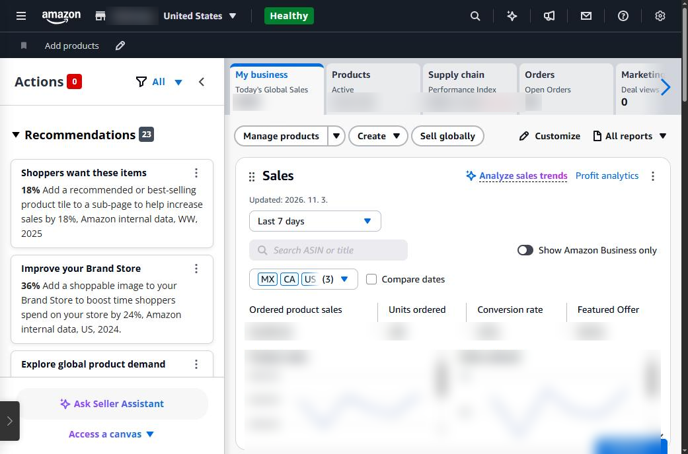
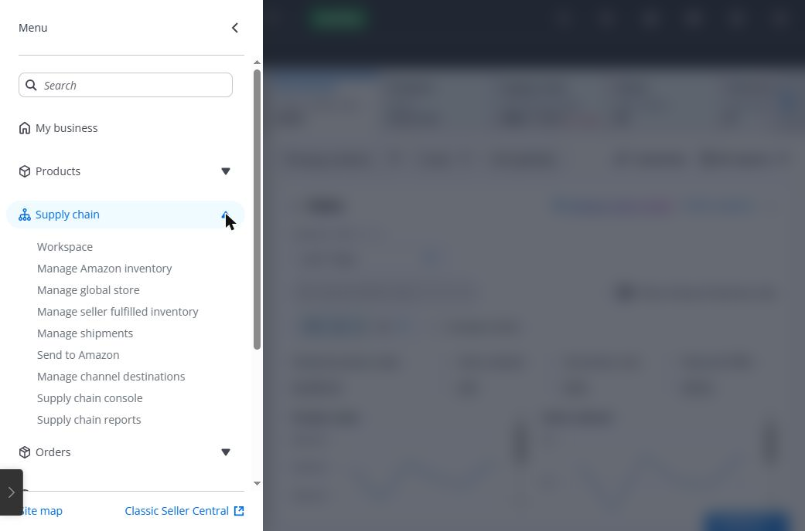
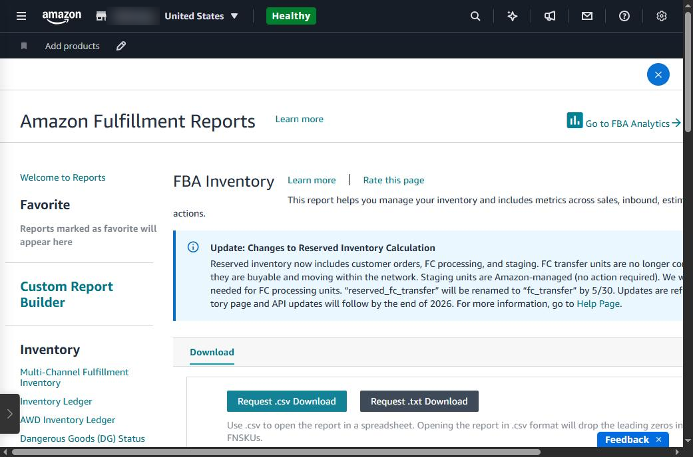
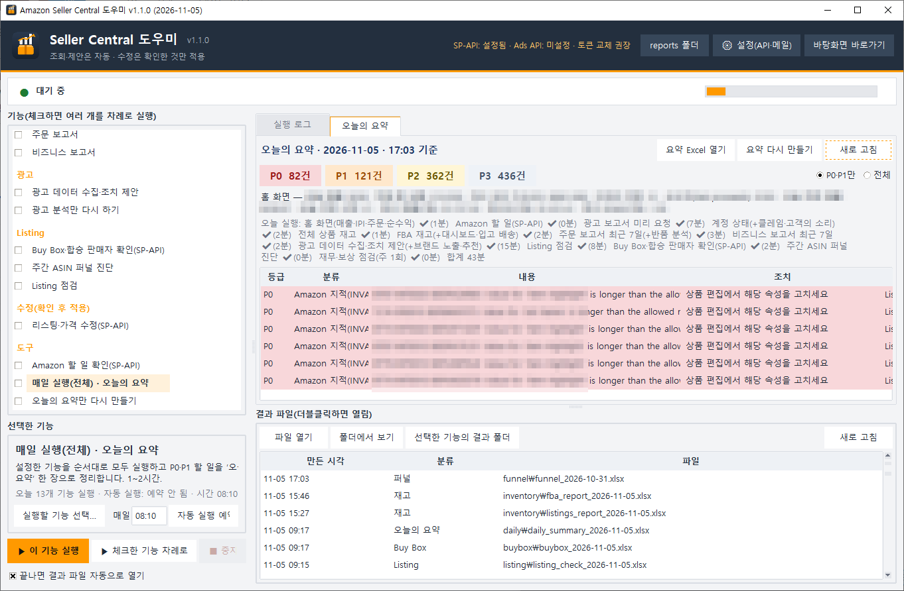

## More products means more management than selling

With three products, a quick look at Seller Central each morning is enough. With dozens of products, and hundreds of colour and size variations, it is a different job.

One day an out-of-stock product keeps spending ad budget, a listing that broke a title rule drops out of search, and another seller joins your page at a lower price and takes the sale. These things happen quietly, without an alert.

This post sums up the management problems we ran into while running hundreds of products on Amazon.com.

## You need to check it daily, and you can't check it all

A seller has at least six things to check every day, each in a different part of Seller Central.

| What to check                     | Where                                | If you miss it                                                                |
|-----------------------------------|--------------------------------------|-------------------------------------------------------------------------------|
| Inventory                         | Supply chain → FBA inventory reports | Stock-outs drop your search rank; aged stock adds long-term storage fees      |
| Orders and returns                | Orders → Order reports               | Returns rise and nobody knows why                                             |
| Traffic and conversion            | Business reports                     | Conversion falls from a title or image problem, unnoticed                     |
| Ads                               | Marketing → Ads console              | Budget keeps going to searches that don't sell                                |
| Listings and Buy Box              | Products → Manage products           | Search suppression; a hijacker takes your sales                               |
| Account health and reimbursements | Account health, Finance              | Policy issues pile up; you miss reimbursement for stock lost in the warehouse |

Going through six menus and comparing hundreds of products every day is hard to keep up. So most sellers find out only after something has gone wrong.

## Seller Central is big and complex

The Seller Central site map lists about 100 pages under 10 groups: 22 under Products, 17 under Settings, 16 under Supply chain, 15 under Orders and 13 under Finance.

Even reports live in different places. Product reports, supply chain reports, order reports, business reports and Brand Analytics each sit in their own menu, and ad reports are on a separate site, the Ads console. The screens change often, too.

*Seller Central home. Sales, products, supply chain, orders and ads cards share one screen with recommendations (figures and store name masked).*

*The main menu (☰). Supply chain alone opens nine sub-pages.*

## One report takes 7 steps and up to 45 minutes of waiting

Here is what it takes to get the FBA inventory report.

1. Open the main menu (☰)
2. Supply chain → Supply chain reports
3. Under Inventory in the left list, click ‘Show more...’
4. Choose FBA Inventory
5. Click ‘Request .txt Download’
6. Refresh until the report is ready (Amazon says up to 45 minutes)
7. Download it and sort it by product in Excel

Only after you do this for inventory, all listings, orders, returns, business and ad reports, and line them up, can you see what needs doing. Downloading is just the start.

*The FBA Inventory page in Supply chain reports (the report center): a report list on the left, ‘Request Download’ buttons in the middle.*

## So we built a tool for it

Instead of doing this by hand every day, we built a program. **Seller Central Helper** gathers the reports above, lines them up, and lists today's to-dos in order of urgency.

*The Seller Central Helper main window. Pick features on the left; Today's Summary on the right ranks the to-dos from P0 to P3. On this day, listing attribute errors flagged by Amazon came up as P0 (sales figures, SKUs and ASINs masked; the program's screens are in Korean).*

From the next post on, we go through its features one by one. First up: pulling inventory, order and sales data together in one place.

---

**Amazon seller series**

1. [Anyone Can Become an Amazon Seller](../amazon-seller-1-getting-started/) — registering, listing and starting to sell
2. **The Real Challenge After You Start Selling** — you can't watch every product, and Seller Central is complex (this post)
3. [Your Amazon Sales Data at a Glance](../amazon-seller-3-sales-data/) — inventory, orders and revenue
4. [Your Amazon Ads at a Glance](../amazon-seller-4-ads/) — ad analysis and suggested actions
5. [Your Amazon Listings at a Glance](../amazon-seller-5-listings/) — checks and edits
