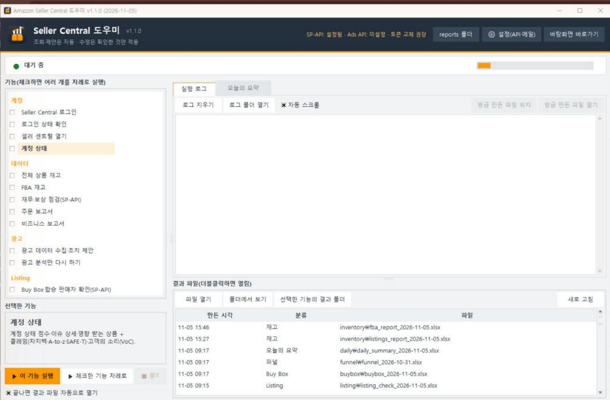
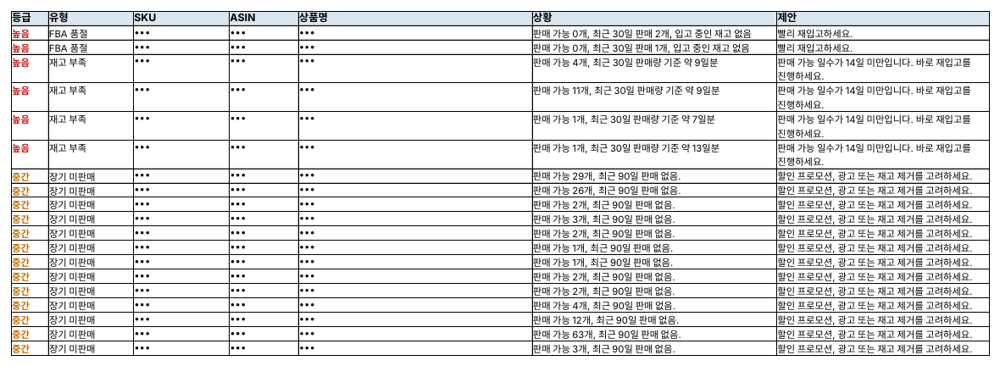
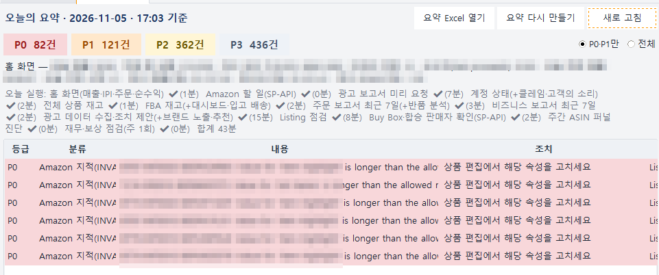
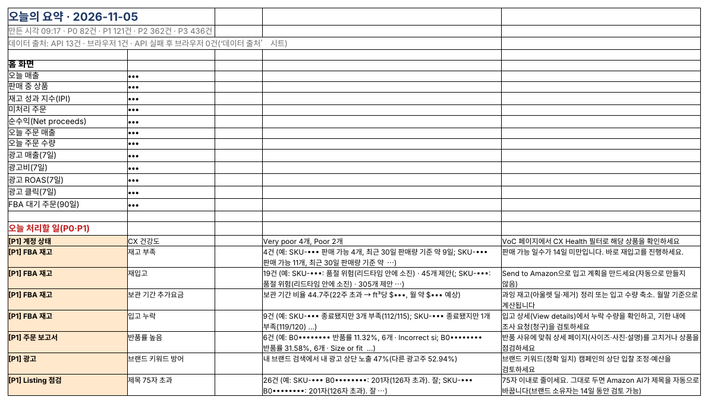

## SellerMorning: your morning to-do list on one page

This is the program that replaces the ‘six menus, many reports, long waits’ from the last post. It runs on your own PC, gathers the reports into Excel, and tells you what needs doing now, ranked P0 to P3.

It works in two ways.

- **Amazon's official API (SP-API) first** — inventory, orders, finance and Buy Box data come straight from the API, without opening a page.
- **A browser for pages the API doesn't cover** — for pages such as the report center, it downloads reports in the browser, the same way a seller would, with generous pauses between clicks so it never puts load on Amazon's site.

*The SellerMorning main window. Pick a feature on the left, or tick several to run in order; the run log and result files appear on the right (the program's screens are in Korean).*

## The data features at a glance

Each feature produces one Excel report, with a ‘Needs attention’ sheet up front so you can act right away.

| Feature                    | What it gathers                                                                    | What it tells you                                                                       |
|----------------------------|------------------------------------------------------------------------------------|-----------------------------------------------------------------------------------------|
| Account health             | Account Health score, metrics and policy compliance, claims, Voice of the Customer | Only new issues (an issue register removes repeats), score trend                        |
| All listings               | All Listings Report                                                                | Inactive, incomplete and unpriced listings                                              |
| FBA inventory              | FBA inventory report, FBA dashboard, inbound shipments                             | Stock-outs, low stock, restock needs, aged-inventory surcharges, short inbound receipts |
| Order report               | Orders (US Central time), returns                                                  | Change vs the previous period, SKUs with high returns, orders near their ship-by date   |
| Business report            | Sessions, conversion and Buy Box by child ASIN                                     | High-traffic, low-conversion ASINs; drops of 30% or more                                |
| Finance and reimbursements | 18 months of inventory ledger, reimbursements, refunds, FBA fees                   | Lost or damaged stock never reimbursed; refunds never returned                          |

Each report is fetched once a day. If Seller Central already has today's report, the program downloads it instead of requesting a new one.

*The ‘Needs attention’ sheet of the FBA inventory report: stock-outs, low stock and slow movers ranked by priority, with the action in the right-hand column. The program's reports are in Korean (SKU, ASIN and product names masked).*

## Daily auto-run and Today's Summary

Schedule a time, and every day the program runs the features above in order and wraps the results into one page, Today's Summary. If one feature fails the rest still run, and a desktop notification shows the most urgent item when it finishes.

| Level | Meaning            | Examples                                                       |
|-------|--------------------|----------------------------------------------------------------|
| P0    | Today              | Policy violation; out of stock while selling                   |
| P1    | This week          | Buy Box lost; lost stock eligible for reimbursement; low stock |
| P2    | When you have time | Falling conversion; aged inventory                             |
| P3    | For reference      | Token renewal reminder; improvement ideas                      |

Items of the same kind are grouped into one line, such as ‘12 SKUs low on stock’, so this one page is all you read in the morning. The same summary also appears on the program's Today's Summary tab.

*The program's Today's Summary tab: counts by level, the features run today and how long each took (43 minutes in total), and the to-dos with how to handle them (sales figures, SKUs and ASINs masked).*

*Part of Today's Summary as saved to Excel: home-screen figures at the top, today's to-dos and how to handle them below (sales, SKUs and ASINs masked).*

## Your data stays on your PC

- **Runs only on your PC** — sales data is saved only as Excel files on your computer and is never sent to any server other than Amazon's.
- **Secrets are encrypted** — API keys and sign-in data are stored with Windows account encryption or in the Mac Keychain.
- **Read-only** — the data features change nothing. Listing and price edits apply only what the seller reviews and selects (covered in part 5).
- **Windows and Mac** — double-click the setup file to install what it needs; it works whether Seller Central is in English, Korean or Chinese.

The next post covers where money leaks fastest: advertising.

---

**Amazon seller series**

1. [Anyone can become an Amazon seller](../amazon-seller-1-getting-started/)
2. [The real challenge after you start](../amazon-seller-2-real-challenge/)
3. **Sales data at a glance** (this post)
4. [Ads at a glance](../amazon-seller-4-ads/)
5. [Listings at a glance](../amazon-seller-5-listings/)
6. [Keeping your account healthy](../amazon-seller-6-account-health/)
7. [FBA inventory without stock-outs or overstock](../amazon-seller-7-fba-inventory/)
8. [Finding problems in orders and returns](../amazon-seller-8-orders-returns/)
9. [Reading conversion in business reports](../amazon-seller-9-business-reports/)
10. [Finding drop-offs with Brand Analytics](../amazon-seller-10-brand-analytics/)
11. [Guarding your Buy Box from hijackers](../amazon-seller-11-buy-box/)
12. [Getting reimbursed for lost FBA inventory](../amazon-seller-12-fba-reimbursement/)
13. [Check profit before you change a price](../amazon-seller-13-fees-profit/)
14. [A 15-minute morning routine](../amazon-seller-14-daily-routine/)
15. [Safe automation with the official API](../amazon-seller-15-safe-automation/)
