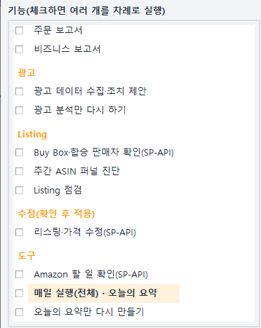
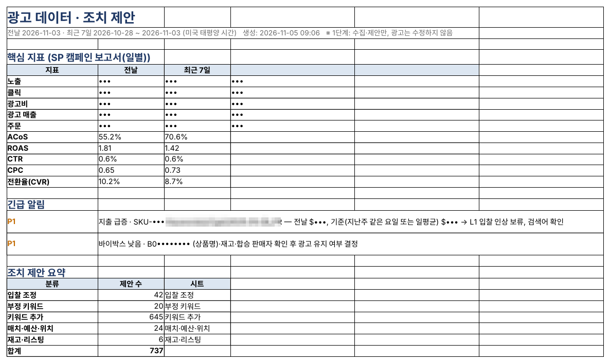
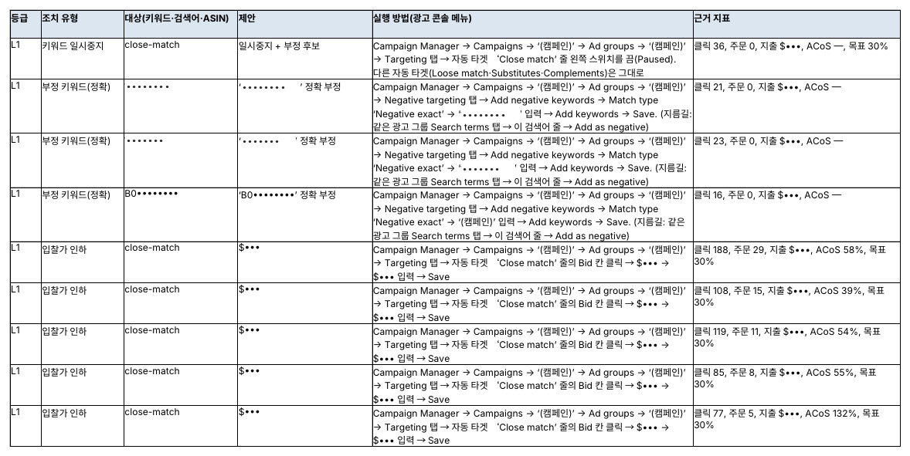

## Ad budget leaks quietly

Amazon ads cost money on every click. With dozens of campaigns and thousands of keywords and search terms, nobody can check one by one which clicks sell and which are wasted.

Most of the leaks come from four places.

- **Searches that don't sell** — clicks keep coming, orders don't
- **Bids that don't fit** — the keyword sells, but ad cost eats the profit
- **Missed chances** — a search term sells well in an auto campaign but was never moved to an exact-match keyword
- **Ads out of step with stock** — ads keep running for a product that is almost out of stock or has lost the Buy Box

The ads feature of SellerMorning finds these four every day and suggests what to change, where, and by how much.

*The feature list on the left of the program. The ads features are 'Collect ad data and suggest actions' and 'Re-run ad analysis only', which reuses data already downloaded (the program's screens are in Korean).*

## Ads are judged together with everything else

Ad reports alone are not enough to judge ads, so the program gathers four sources and lines them up.

| Source                 | Contents                                                                                                                       |
|------------------------|--------------------------------------------------------------------------------------------------------------------------------|
| Ad reports             | Search terms, targeting, campaigns (with placements), advertised products, Sponsored Brands search terms (last 30 days, daily) |
| Brand Analytics        | Search Query Performance (SQP), Search Catalog Performance (SCP), Top Search Terms (TST)                                       |
| Inventory and products | FBA inventory, all listings (titles and prices)                                                                                |
| Business reports       | Buy Box percentage; total sales including non-ad sales                                                                         |

Ad reports take 20 to 40 minutes to generate, so the daily run requests them first and waits while other features run. With the Amazon Ads API connected it uses the API; otherwise it downloads them from the Ads console.

*The Summary sheet of the ad report: key metrics, urgent alerts and suggestion counts by group (amounts, impressions, clicks and orders masked; the program's reports are in Korean).*

## Every suggestion says where to click and what to change

Suggestions fall into five groups.

| Group                    | Examples                                                                                                             |
|--------------------------|----------------------------------------------------------------------------------------------------------------------|
| Bid changes              | Lower the bid where ACoS is over 1.3 times the target; pause a target with 30 clicks and no orders                   |
| Negative keywords        | Add a search term with 15+ clicks and no orders as a negative exact                                                  |
| New keywords             | Harvest search terms that sold in auto or broad campaigns into exact match; add missing Brand Analytics top searches |
| Match, budget, placement | Adjust by placement (top of search, product pages); campaigns running out of budget                                  |
| Stock and listing        | Lower bids for products with under 14 days of stock; review ads for products that lost the Buy Box                   |

Each suggestion carries the evidence (clicks, orders, spend, ACoS), the period, the rule applied and a **How to do it** column. That column uses the Ads console's own English menu names — which campaign, which ad group, which tab, what to type — so you can simply follow it.

*The Suggested actions sheet: each row gives the Ads console menu path and the evidence (campaign names and amounts masked).*

Each suggestion is also graded: L1 is a small, reversible change; L2 needs approval; L3 is a call for a person to make.

## Targets from your own costs, and a check on the results

- **Target ACoS per product** — enter cost and logistics per product in the settings file, and the program works out each product's break-even ACoS and judges against a lower target. Products without costs use a default target (for example 30%).
- **Protected keywords and campaign roles** — list words that must never be suggested as negatives, such as your brand name, and set each campaign's role (research, performance, defense and so on).
- **Results of past suggestions** — for the last 30 days of suggestions, it estimates whether each was carried out and compares spend, orders and ACoS for the 7 days before and after, including spend saved.
- **It never changes your ads** — this feature gathers data and makes suggestions only. The seller changes bids, keywords and budgets after reviewing them.

The next post covers listing checks, and listing and price edits that apply only what you approve.

---

**Amazon seller series**

1. [Anyone can become an Amazon seller](../amazon-seller-1-getting-started/)
2. [The real challenge after you start](../amazon-seller-2-real-challenge/)
3. [Sales data at a glance](../amazon-seller-3-sales-data/)
4. **Ads at a glance** (this post)
5. [Listings at a glance](../amazon-seller-5-listings/)
6. [Keeping your account healthy](../amazon-seller-6-account-health/)
7. [FBA inventory without stock-outs or overstock](../amazon-seller-7-fba-inventory/)
8. [Finding problems in orders and returns](../amazon-seller-8-orders-returns/)
9. [Reading conversion in business reports](../amazon-seller-9-business-reports/)
10. [Finding drop-offs with Brand Analytics](../amazon-seller-10-brand-analytics/)
11. [Guarding your Buy Box from hijackers](../amazon-seller-11-buy-box/)
12. [Getting reimbursed for lost FBA inventory](../amazon-seller-12-fba-reimbursement/)
13. [Check profit before you change a price](../amazon-seller-13-fees-profit/)
14. [A 15-minute morning routine](../amazon-seller-14-daily-routine/)
15. [Safe automation with the official API](../amazon-seller-15-safe-automation/)

*Based on personal experience. Not affiliated with or endorsed by Amazon.com, Inc. or its affiliates. Policies and fees are as of the time of writing — check Seller Central for the latest.*
