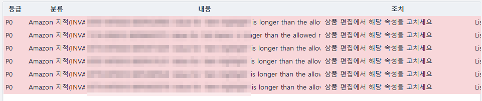
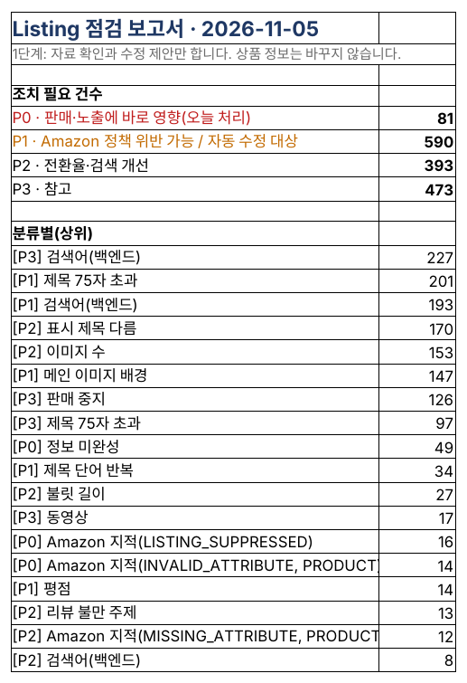
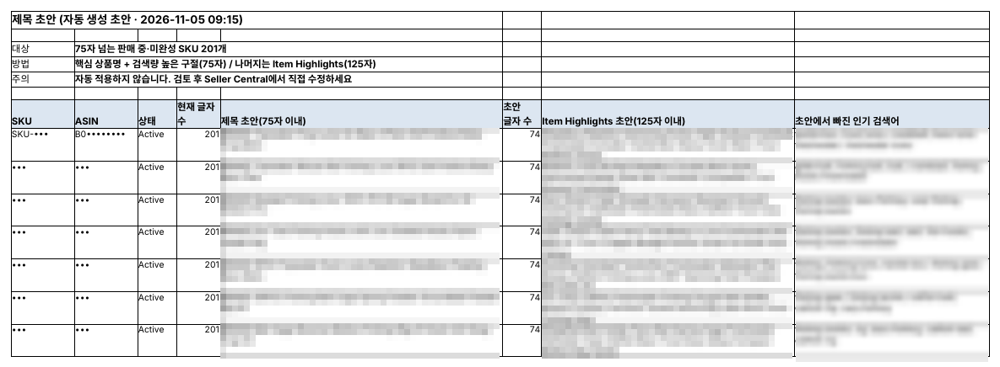
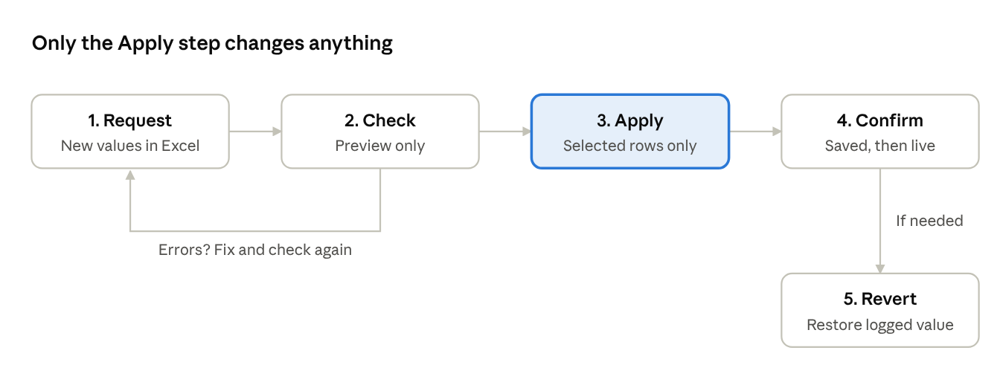
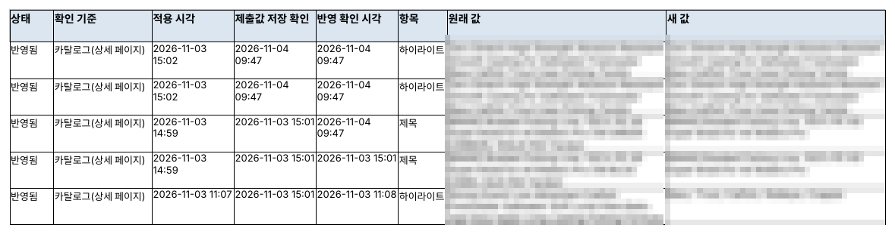

## Listing rules keep changing

Since July 27, 2026, Amazon has required product titles of 75 characters or fewer, spaces included, in every category except media. Extra detail moves to a new field, Item Highlights (125 characters), and titles that are still too long are gradually rewritten by Amazon's AI. Brand owners enrolled in Brand Registry get 14 days to review the change first.

Titles are not the only rule. Bullets, search terms, Item Highlights and images all have length, character and background rules, and breaking them can drop a product from search or stop its sales. In our own store, 201 of 262 active or incomplete listings were over 75 characters.

This last post shows how to check listings, then apply fixes safely after reviewing them.

## Listing check: hundreds of listings against the rules at once

The listing check only reads and compares four sources: the All Listings Report (titles, status), the Category Listings Report (bullets, search terms, Item Highlights), Seller Central's Manage products pages (search suppression, fixes needed), and the amazon.com detail pages customers see.

| Item                          | Rule checked                                                                                                       |
|-------------------------------|--------------------------------------------------------------------------------------------------------------------|
| Title                         | 75 characters or fewer; no word more than twice; no banned characters (! \$ ? \_ { } ^ ¬ ¦) or promotional phrases |
| Bullets                       | Five, each 10 to 255 characters; no emoji, ™, ®, links or unsupported claims                                       |
| Search terms, Item Highlights | Search terms within 249 bytes; Item Highlights within 125 characters                                               |
| Detail page                   | At least 7 images; white-background main image of 1000 px or more; A+; rating 4.0 or higher                        |
| Status                        | Incomplete; inactive with stock; search suppressed; detail page removed                                            |

Results are ranked from P0 (hurts sales or visibility now) to P3 (for reference), and detail pages are checked starting with the products that spend the most on ads. Problems Amazon itself flags, such as an attribute value over its allowed length, come up as P0 at the top of Today's Summary.

*P0 items in Today's Summary: Amazon's notice that an attribute such as Item Highlight is over the allowed length, next to the action to fix that attribute in Edit product (SKU and ASIN masked; the program's screens are in Korean).*

*The Summary of the listing check report: counts by level and the top problem types (the program's reports are in Korean).*

## Features that draft the fix for you

- **Title drafts** — for every title over 75 characters, it drafts a 75-character title from the core product name and high-volume search phrases, and moves the rest into an Item Highlights draft (125 characters). It also lists popular search terms the draft left out.
- **Buy Box and hijackers** — every day, for each selling ASIN, it checks who holds the Buy Box and whether a seller who wasn't there yesterday has joined your page.
- **Weekly ASIN funnel** — it compares Brand Analytics search impressions, clicks, add-to-carts and purchases with the last four weeks' average to find the stage where customers drop off, and compares two weeks before and after an edit to show its effect.

*The Title drafts sheet: a 75-character title draft, an Item Highlights draft and missing popular searches side by side (brand, SKU and ASIN masked).*

## Edits apply only after review, and can be undone

Titles, bullets, search terms, descriptions, Item Highlights and prices are edited through Amazon's official API. Nothing changes right away, though; every edit goes through five steps.

*Listing and price edit flow · 5 steps*

1. **Request** — write SKU, field and new value in an Excel request sheet. Title drafts from the listing check can be filled in for you.
2. **Check** — the edit is sent to Amazon as a preview only, to catch errors. Nothing actually changes. Price rows also show Amazon's fees at the new price and what is left per unit.
3. **Apply** — only the rows the seller selects are applied, after one more confirmation.
4. **Confirm** — even when Amazon answers ‘accepted’, the change takes minutes to hours to show. So the program reads it back in two stages: saved to your listing, then visible on the detail page customers see.
5. **Revert** — every change is logged with its original value; pick one in the log to restore it.

There are safeguards too. A price change over 30% or a price that loses money needs separate approval, at most 50 rows apply at once, and applied rows are marked ‘done’ so they never apply twice.

*A real change log: applied time, saved-value check, detail-page confirmation time, and the original and new values (brand, SKU and ASIN masked).*

## Wrapping up parts 1–5

Anyone can become an Amazon seller, but as your catalog grows, success comes down to how fast you find problems each day. SellerMorning checks your data, ads and listings every day, so each morning you read one page, Today's Summary, and simply decide.

| Built for                                    | Why                                                        |
|----------------------------------------------|------------------------------------------------------------|
| Sellers with dozens to hundreds of products  | The more products, the more problems slip through          |
| Overseas sellers shipping to the US with FBA | The program handles US time zones and report waits for you |
| Brands with a large ad budget                | Daily ad suggestions and tracking of their results         |

SellerMorning is the program we use every day and keep improving. We will keep writing up new features and what we learn along the way here. From part 6 on, we go deeper into each daily check: account health, FBA inventory, orders and returns, and more.

---

**Amazon seller series**

1. [Anyone can become an Amazon seller](../amazon-seller-1-getting-started/)
2. [The real challenge after you start](../amazon-seller-2-real-challenge/)
3. [Sales data at a glance](../amazon-seller-3-sales-data/)
4. [Ads at a glance](../amazon-seller-4-ads/)
5. **Listings at a glance** (this post)
6. [Keeping your account healthy](../amazon-seller-6-account-health/)
7. [FBA inventory without stock-outs or overstock](../amazon-seller-7-fba-inventory/)
8. [Finding problems in orders and returns](../amazon-seller-8-orders-returns/)
9. [Reading conversion in business reports](../amazon-seller-9-business-reports/)
10. [Finding drop-offs with Brand Analytics](../amazon-seller-10-brand-analytics/)
11. [Guarding your Buy Box from hijackers](../amazon-seller-11-buy-box/)
12. [Getting reimbursed for lost FBA inventory](../amazon-seller-12-fba-reimbursement/)
13. [Check profit before you change a price](../amazon-seller-13-fees-profit/)
14. [A 15-minute morning routine](../amazon-seller-14-daily-routine/)
15. [Safe automation with the official API](../amazon-seller-15-safe-automation/)
