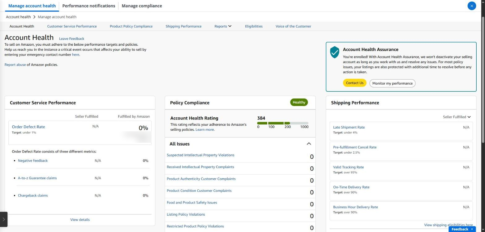
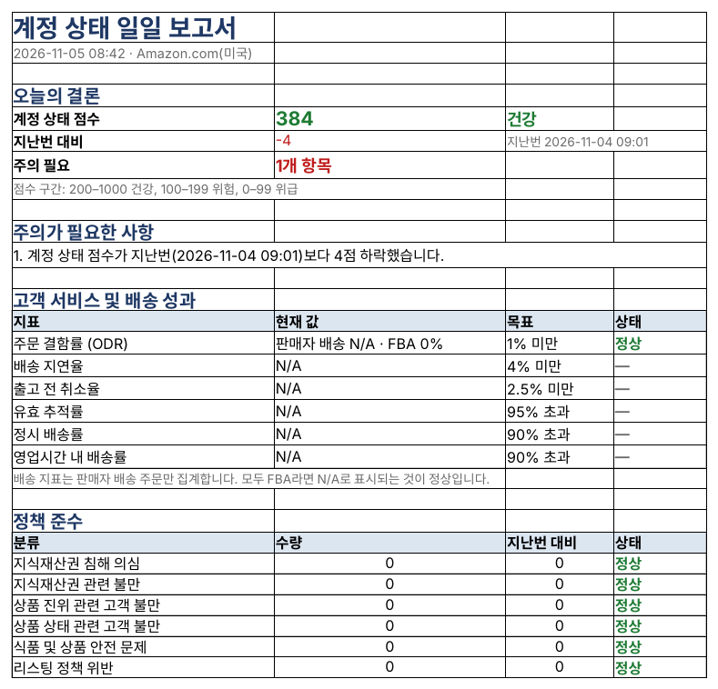

## If your account stops, everything stops

Amazon rates every seller account with an **Account Health Rating (AHR)** from 0 to 1000. If it drops too low the account can be deactivated, and sales, ads and payouts all stop ([AHR guide](https://www.sellersprite.com/en/blog/amazon-account-health-rating-2026)).

| Score    | Status    | Meaning                             |
|----------|-----------|-------------------------------------|
| 200–1000 | Healthy   | Normal; new accounts start at 200   |
| 100–199  | At risk   | Deactivation may come soon          |
| 0–99     | Unhealthy | Eligible for immediate deactivation |

### Where to see it in Seller Central

Menu (☰) → **Account health → Manage account health** shows three groups.

- **Customer service performance** — Order Defect Rate (negative feedback, A-to-z claims, chargebacks) under 1%
- **Policy compliance** — intellectual property, authenticity, product condition, listing policy and more; each new item lowers the score
- **Shipping performance** — late shipment, cancellation and tracking rates for seller-fulfilled (FBM) orders; N/A is normal if you only use FBA

The hard part is opening this page every day and spotting what changed since yesterday. A new policy violation simply adds one more line, and many come with a response deadline.

*The Account Health page in Seller Central: the Account Health Rating, order defect rate and policy issues in one place. Order counts are masked.*

Also check **Account Health Assurance** at the top right. Eligible sellers are enrolled in it, and Amazon won't deactivate the account as long as you work with Amazon to resolve any issues. If you're enrolled, it says ‘You're enrolled!’.

### Account health in SellerMorning

- Reads the score and metrics daily and shows the **change since last time**.
- Keeps policy issues in an issue register, so only new ones are reported and nothing is collected twice.
- Puts affected products, claims (chargebacks, A-to-z, SAFE-T) and Voice of the Customer in the same file.
- A falling score or a new violation goes to the top of Today's Summary (P0).

*The daily account health report: score and change, each metric's target and status, and counts by policy category (the program's reports are in Korean).*

### What to do when the score drops

1. **Find what's new** — check All Issues for the items that went up and the products they affect.
2. **Check the deadline** — many policy issues come with a response deadline, and missing it can mean suppressed listings or a further drop.
3. **Fix the cause and respond** — edit the listing or gather evidence such as invoices, then appeal or submit a plan of action from that issue's page.
4. **Watch for a few days** — confirm the resolved issue leaves the list and the score recovers.

---

**Amazon seller series**

1. [Anyone can become an Amazon seller](../amazon-seller-1-getting-started/)
2. [The real challenge after you start](../amazon-seller-2-real-challenge/)
3. [Sales data at a glance](../amazon-seller-3-sales-data/)
4. [Ads at a glance](../amazon-seller-4-ads/)
5. [Listings at a glance](../amazon-seller-5-listings/)
6. **Keeping your account healthy** (this post)
7. [FBA inventory without stock-outs or overstock](../amazon-seller-7-fba-inventory/)
8. [Finding problems in orders and returns](../amazon-seller-8-orders-returns/)
9. [Reading conversion in business reports](../amazon-seller-9-business-reports/)
10. [Finding drop-offs with Brand Analytics](../amazon-seller-10-brand-analytics/)
11. [Guarding your Buy Box from hijackers](../amazon-seller-11-buy-box/)
12. [Getting reimbursed for lost FBA inventory](../amazon-seller-12-fba-reimbursement/)
13. [Check profit before you change a price](../amazon-seller-13-fees-profit/)
14. [A 15-minute morning routine](../amazon-seller-14-daily-routine/)
15. [Safe automation with the official API](../amazon-seller-15-safe-automation/)
