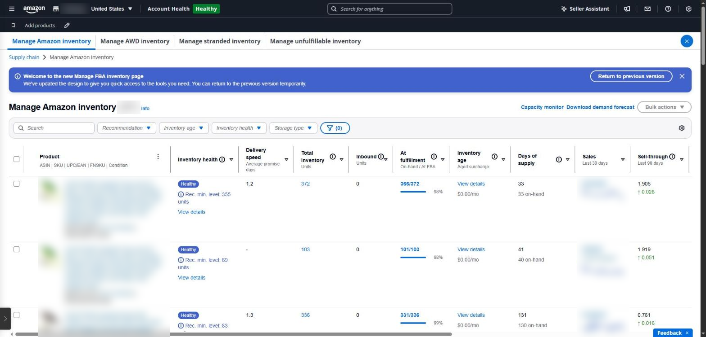
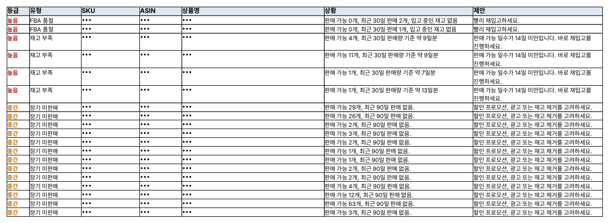

## Too little or too much stock both cost money

FBA inventory costs you on both sides. A stock-out loses sales and search rank; stock that sits too long adds surcharges ([2026 aged inventory surcharge guide](https://www.inventoryhero.ai/guides/amazon-aged-inventory-surcharge-2026)).

| Cost                     | When it applies                                                                                   |
|--------------------------|---------------------------------------------------------------------------------------------------|
| Monthly storage fee      | Every month, by volume (higher in October–December)                                               |
| Aged inventory surcharge | Units stored more than 181 days; rises in steps as stock ages                                     |
| Low-inventory-level fee  | Stock too low for the sales pace (under about 28 days of supply)                                  |
| Capacity limits          | A cap on how much you can send (based on forecast sales and the Inventory Performance Index, IPI) |

According to a notice in Seller Central (as of November 2026), **from February 1, 2027** the monthly storage fee and the aged inventory surcharge merge into a single Unified Monthly Storage Fee, and the low-inventory-level fee switches to a new days-of-supply calculation. Exact rates and bands change often, so check the fee pages in Seller Central.

### Where to see it in Seller Central

- **Supply chain → Manage Amazon inventory** — available, inbound and reserved units per SKU
- **FBA dashboard** — IPI and its drivers, storage utilization, expected aged-inventory surcharges
- **Manage shipments** — units received per inbound shipment
- **Supply chain reports → FBA inventory reports** — all of the above as an SKU table to download

There are plenty of screens, but working out which SKU to send, when and how many is still left to you.

*Manage Amazon inventory in Seller Central: inventory health, total units, days of supply and inventory age per product. Product names, ASINs and sales are masked.*

### FBA inventory in SellerMorning

- Pulls the FBA inventory report once a day and works out **days of supply** for every SKU: under 14 days is ‘restock now’, under 30 days is ‘restock soon’ (both adjustable).
- Ranks stock-outs, stock that can't sell (inactive), slow movers, unfulfillable units and short inbound receipts.
- Reads IPI, utilization and surcharge estimates from the FBA dashboard into the summary.
- Passes near-stock-out products to the ads feature, which suggests lower bids so you don't pay for ads on products you can't ship.

*The ‘Needs attention’ sheet of the FBA inventory report (SKU, ASIN and product names masked; the program's reports are in Korean).*

### When and how much to send

You can set the restock point with simple arithmetic.

- **Daily sales** = units sold in the last 30 days ÷ 30
- **Days of supply** = (available + inbound units) ÷ daily sales
- **Send when** days of supply is about to fall below ‘production, shipping and check-in time + a buffer’

For example, if you sell 4 units a day, it takes 35 days from dispatch until the stock is checked in at an FBA warehouse, and you keep a 14-day buffer, send the next batch before stock falls below 196 units (4 × 49 days).

On the other side, a SKU whose current stock would take more than 180 days to sell will leave units that hit the aged inventory surcharge. Send less, or move it with a discount or promotion.

---

**Amazon seller series**

1. [Anyone can become an Amazon seller](../amazon-seller-1-getting-started/)
2. [The real challenge after you start](../amazon-seller-2-real-challenge/)
3. [Sales data at a glance](../amazon-seller-3-sales-data/)
4. [Ads at a glance](../amazon-seller-4-ads/)
5. [Listings at a glance](../amazon-seller-5-listings/)
6. [Keeping your account healthy](../amazon-seller-6-account-health/)
7. **FBA inventory without stock-outs or overstock** (this post)
8. [Finding problems in orders and returns](../amazon-seller-8-orders-returns/)
9. [Reading conversion in business reports](../amazon-seller-9-business-reports/)
10. [Finding drop-offs with Brand Analytics](../amazon-seller-10-brand-analytics/)
11. [Guarding your Buy Box from hijackers](../amazon-seller-11-buy-box/)
12. [Getting reimbursed for lost FBA inventory](../amazon-seller-12-fba-reimbursement/)
13. [Check profit before you change a price](../amazon-seller-13-fees-profit/)
14. [A 15-minute morning routine](../amazon-seller-14-daily-routine/)
15. [Safe automation with the official API](../amazon-seller-15-safe-automation/)

*Based on personal experience. Not affiliated with or endorsed by Amazon.com, Inc. or its affiliates. Policies and fees are as of the time of writing — check Seller Central for the latest.*
