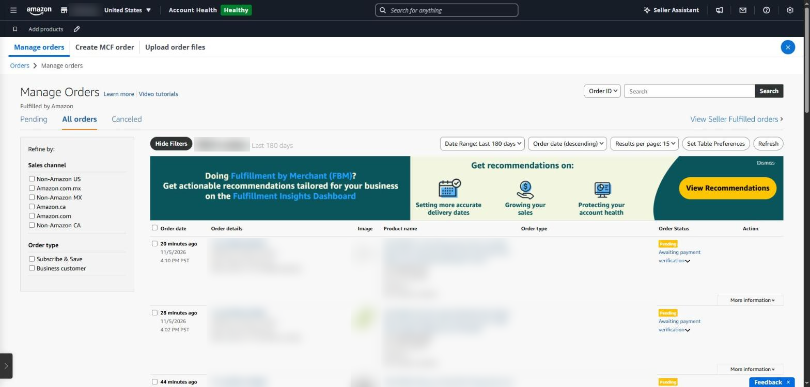
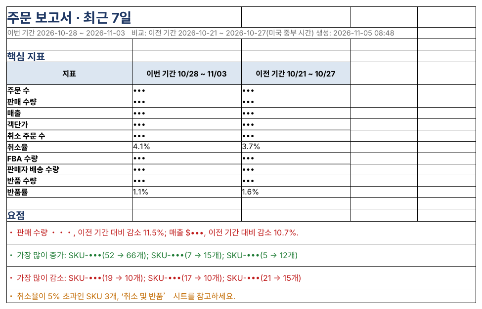

## Not ‘how much sold yesterday’ but ‘what changed’

When sales drop, the total alone doesn't help. You need to know which SKU, from which day and in which region. Returns work the same way: a SKU with a high return rate signals a problem with its description or quality.

### Where to see it in Seller Central

- **Orders → Manage orders** — check orders one by one (unshipped, cancellation requests)
- **Orders → Order reports (All Orders)** — download every order for a date range
- **Orders → Manage returns → Returns and recovery insights** — return rates and reasons
- **Order reports → FBA customer return reports** — reason and status of each return

Two things to watch. Order times in reports and on screen are recorded in US time (UTC in some files), so they easily end up a day off from Korean dates. And with a unified North America account, All Orders mixes in orders from the US, Canada and Mexico.

*Manage Orders in Seller Central lists orders one by one, so seeing the overall picture takes extra work. Order IDs, products and amounts are masked.*

### Order report in SellerMorning

- Choose yesterday, last 7 days or last 30 days; it compares automatically with the previous period of the same length.
- Converts every order time to **US Central time** to set the date, and keeps only Amazon.com orders.
- Shows daily trends, a SKU ranking (biggest gainers and losers) and sales by state.
- Flags SKUs with cancellation over 5% or returns over 10%, and seller-fulfilled orders close to their ship-by date (rate alerts are skipped when counts are too small).
- Data already fetched the same day is not fetched again.

*The order report Summary: key metrics for this and the previous period, plus highlights (order counts, sales and SKUs masked; the program's reports are in Korean).*

### What to fix first, by return reason

For a SKU with a high return rate, look at the reasons in the return report to see what to fix.

| Common return reason | Check first |
|---|---|
| Wrong size or fit | Size chart, measurements in the images |
| Not as described | Whether the title, bullets and images match the real product |
| Defective or damaged | Packaging, pre-shipment inspection, supplier quality |
| No longer needed, ordered by mistake | Mostly normal; look only if the share jumps |

---

**Amazon seller series**

1. [Anyone can become an Amazon seller](../amazon-seller-1-getting-started/)
2. [The real challenge after you start](../amazon-seller-2-real-challenge/)
3. [Sales data at a glance](../amazon-seller-3-sales-data/)
4. [Ads at a glance](../amazon-seller-4-ads/)
5. [Listings at a glance](../amazon-seller-5-listings/)
6. [Keeping your account healthy](../amazon-seller-6-account-health/)
7. [FBA inventory without stock-outs or overstock](../amazon-seller-7-fba-inventory/)
8. **Finding problems in orders and returns** (this post)
9. [Reading conversion in business reports](../amazon-seller-9-business-reports/)
10. [Finding drop-offs with Brand Analytics](../amazon-seller-10-brand-analytics/)
11. [Guarding your Buy Box from hijackers](../amazon-seller-11-buy-box/)
12. [Getting reimbursed for lost FBA inventory](../amazon-seller-12-fba-reimbursement/)
13. [Check profit before you change a price](../amazon-seller-13-fees-profit/)
14. [A 15-minute morning routine](../amazon-seller-14-daily-routine/)
15. [Safe automation with the official API](../amazon-seller-15-safe-automation/)
