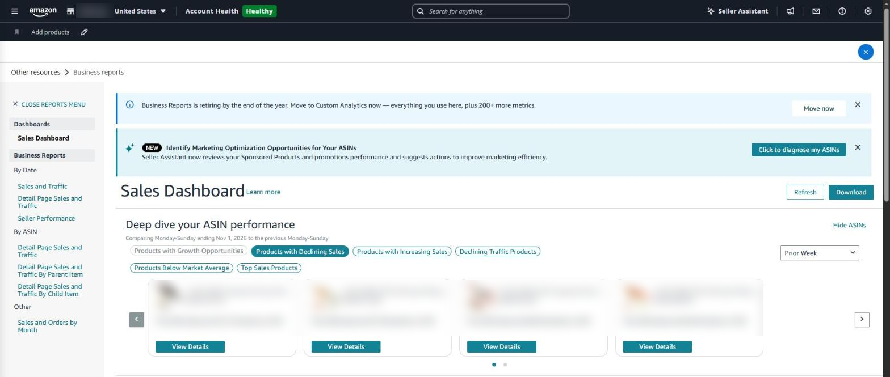
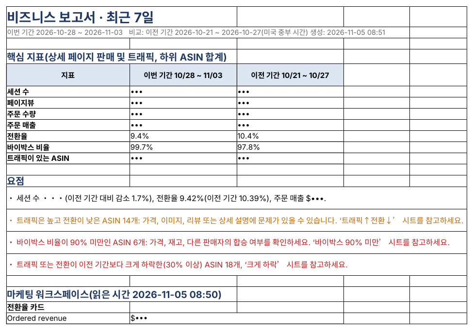

## Sales = visits × conversion

If sales fell, one of two things happened: fewer people visited the detail page (sessions), or a smaller share of visitors bought (conversion). Splitting the two shows what to do.

| Sessions | Conversion | What it means | Check first |
|---|---|---|---|
| ↓ | Flat | Fewer people are finding you | Search rank, ad exposure, stock |
| Flat | ↓ | Visitors look but don't buy | Price, reviews and rating, images, Buy Box |
| ↓ | ↓ | Both fell | Buy Box and stock first (they hit both) |
| ↑ | ↓ | New visitors don't match the product | Whether ad search terms and targets fit the product |

### Where to see it in Seller Central

Site map → **Other resources → Business reports** → ‘By ASIN’ on the left → **Detail Page Sales and Traffic By Child Item**.

| Metric                       | Meaning                                                        |
|------------------------------|----------------------------------------------------------------|
| Sessions                     | Visits to the detail page (repeat views in one day count once) |
| Page views                   | Total times the detail page was shown                          |
| Units ordered, sales         | Units and amount ordered in the period                         |
| Conversion (Unit Session %)  | Units ordered ÷ sessions                                       |
| Buy Box % (Featured Offer %) | Share of views where your offer held the buy button            |

You can pick any date range, but comparing with the previous period means downloading twice and lining them up. The last two or three days' figures may still change.

Note that as of November 2026, the Business Reports page shows a notice that **Business Reports is retiring at the end of the year** and asks sellers to move to Custom Analytics. If you rely on these metrics, find where they live in the new menu ahead of time.

*The Business Reports sales dashboard in Seller Central. Reports by date and by ASIN are in the left menu. Product details are masked.*

### Business report in SellerMorning

- Downloads this and the previous period and lays them side by side per child ASIN (yesterday, 7, 14 or 30 days).
- **High traffic, low conversion** — ASINs with plenty of visits but under half the store's average conversion; time to check price, images, reviews and description.
- **High conversion, low traffic** — ASINs that sell well but get few visits; candidates for more ad spend.
- Collects ASINs with **Buy Box under 90%** and **drops of more than 30%**.
- Also reads the conversion card and top search terms from the Marketing workspace.

*The business report Summary: sessions, conversion and Buy Box against the previous period, plus the ASIN groups to check (sessions and sales masked; the program's reports are in Korean).*

---

**Amazon seller series**

1. [Anyone can become an Amazon seller](../amazon-seller-1-getting-started/)
2. [The real challenge after you start](../amazon-seller-2-real-challenge/)
3. [Sales data at a glance](../amazon-seller-3-sales-data/)
4. [Ads at a glance](../amazon-seller-4-ads/)
5. [Listings at a glance](../amazon-seller-5-listings/)
6. [Keeping your account healthy](../amazon-seller-6-account-health/)
7. [FBA inventory without stock-outs or overstock](../amazon-seller-7-fba-inventory/)
8. [Finding problems in orders and returns](../amazon-seller-8-orders-returns/)
9. **Reading conversion in business reports** (this post)
10. [Finding drop-offs with Brand Analytics](../amazon-seller-10-brand-analytics/)
11. [Guarding your Buy Box from hijackers](../amazon-seller-11-buy-box/)
12. [Getting reimbursed for lost FBA inventory](../amazon-seller-12-fba-reimbursement/)
13. [Check profit before you change a price](../amazon-seller-13-fees-profit/)
14. [A 15-minute morning routine](../amazon-seller-14-daily-routine/)
15. [Safe automation with the official API](../amazon-seller-15-safe-automation/)

*Based on personal experience. Not affiliated with or endorsed by Amazon.com, Inc. or its affiliates. Policies and fees are as of the time of writing — check Seller Central for the latest.*
