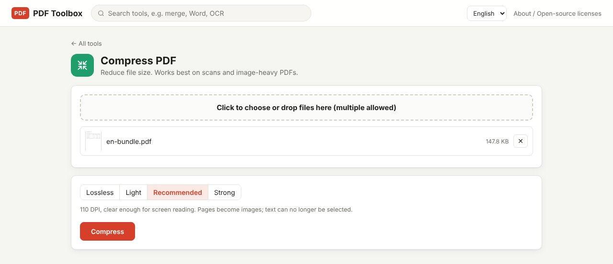

A PDF is usually large because of the images inside it. Scans and photo-heavy PDFs shrink a lot when their image resolution is lowered; text-only PDFs have little to remove. This guide explains what each of PDF Toolbox's four compression levels does and which one to pick. The file never leaves your computer.

> **What you need**: [download the latest PDF Toolbox](https://github.com/toolboxnotes/pdf-toolbox/releases/latest) (free, Windows and Mac). For first-launch steps, see "Download and install" in the [PDF Toolbox introduction](../offline-pdf-toolbox/).

## First, why is your PDF large?

| Type of PDF | What makes it large | How much compression helps |
|---|---|---|
| Copier scans | One high-resolution picture per page | A lot |
| Reports with many photos or drawings | The embedded images | A lot |
| Text documents saved from Word | Fonts and file structure | A little |
| A PDF that was already compressed | Not much left to remove | Hardly at all |

If a text document is several megabytes, it often embeds whole fonts or repeats a high-resolution logo on every page.

## Compress a PDF step by step

*Compress PDF. Choose Lossless, Light, Recommended or Strong; the line below explains the selected level.*

1. **Drop the file on PDF Toolbox and choose Compress PDF.** You can add several files at once.
2. **Pick a level.** Try **Lossless** first and go up to **Recommended** if that isn't enough. The table below shows the differences.
3. **Click Compress.** A file ending in `_compressed.pdf` is saved and the original is left as it is. Several files are saved together as `compressed.zip`.

If the result would be larger than the original, the original is kept and you see "(already small, original kept)". That happens with PDFs that are already optimized.

## Which level to choose

| Level | What it does | Selectable, searchable text | Use it when |
|---|---|---|---|
| Lossless | Rewrites the file structure | Kept | You don't want any quality change. Savings are usually small |
| Light | Pages become 150 DPI images | No | You may still print the document |
| Recommended | Pages become 110 DPI images | No | The document will be read on screen, e.g. by email |
| Strong | Pages become 80 DPI images | No | Size matters most. Small text may blur |

The key point: **every level except Lossless turns pages into images.** The file gets much smaller, but text can no longer be selected or found with Ctrl+F. If the recipient needs to copy text, use Lossless, or [run OCR afterwards](../scanned-pdf-searchable-ocr/) to make the compressed file searchable again.

## If scans are the problem, start smaller

- **Copier settings**: scanning at 200 DPI instead of 300, and in black and white or grayscale instead of color, cuts the size before any compression. 200 DPI black and white is plenty for text.
- **Phone photos**: photos go into a PDF at full size, which makes large files. Create the PDF, then compress it once at Recommended.

## Limitations worth knowing

- **Text-only PDFs don't shrink much.** With few images, Lossless can trim a little and that's about it.
- **Pages turned into images can't be turned back.** Keep the original.
- **Bookmarks and form fields** may be lost at the levels that turn pages into images.
- **Password-protected PDFs** need [Unlock PDF](../pdf-password-protect-unlock/) first.

## FAQ

### How much smaller will it get?

It depends on the file. High-resolution scans shrink a lot at Recommended; text-only documents barely change. The original size is shown in the file list and the new size in the completion message, so try a couple of levels and compare.

### Will it look blurry when printed?

Light (150 DPI) prints fine for everyday use. Recommended (110 DPI) and Strong (80 DPI) are meant for screens, and small text may look soft on paper.

### My email limit is 10 MB. Which level should I use?

Start with Recommended. If it's still too big, [split the PDF](../split-pdf-extract-pages/) into two or three files.

### Is the result the same as an online compressor?

The approach is similar. The difference is that nothing is uploaded and there are no size or usage limits.

## Related posts

- [How to merge PDF files offline](../merge-pdf-offline/)
- [How to make a scanned PDF searchable offline (free OCR)](../scanned-pdf-searchable-ocr/)
- [How to split a PDF or extract pages](../split-pdf-extract-pages/)
- [PDF Toolbox: free offline PDF converter for Windows and Mac](../offline-pdf-toolbox/)
