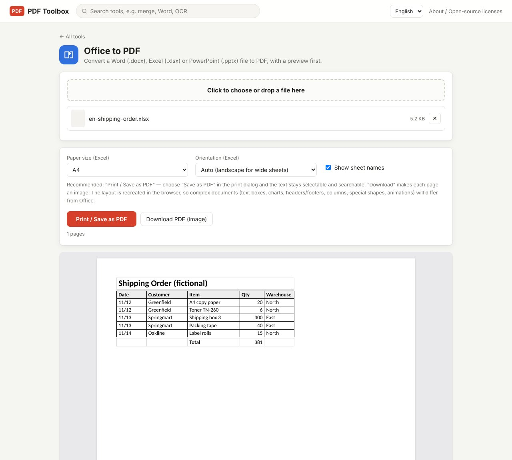

The easiest way to turn a spreadsheet into a PDF is "Save as PDF" in Excel. But sometimes the computer has no Excel, or you just need to look at an `.xlsx` you received and send it on as a PDF. PDF Toolbox's **Office to PDF** reads the `.xlsx` without Excel, lays it out on pages, and lets you preview it before saving. Word (.docx) and PowerPoint (.pptx) work in the same tool.

> **What you need**: [download the latest PDF Toolbox](https://github.com/toolboxnotes/pdf-toolbox/releases/latest) (free, Windows and Mac). For first-launch steps, see "Download and install" in the [PDF Toolbox introduction](../offline-pdf-toolbox/).

## Convert an Excel file to PDF step by step

*A fictional shipping order `.xlsx` loaded. The preview at the bottom shows the pages that will be saved.*

1. **Drop the `.xlsx` file on PDF Toolbox and choose Office to PDF.**
2. **Set the paper and orientation.**
   - **Paper size (Excel)**: A4 or Letter
   - **Orientation (Excel)**: "Auto (landscape for wide sheets)" is the default, so sheets with many columns are turned sideways automatically.
   - **Show sheet names**: in a file with several sheets, puts each sheet's name before it.
3. **Check the preview.** The pages appear below, with the page count.
4. **Choose how to save.**
   - **Print / Save as PDF (recommended)**: in the print dialog, pick **Save as PDF** as the destination. Text in the PDF stays selectable and searchable.
   - **Download PDF (image)**: saves straight away with no print dialog. Each page is an image, so text can't be selected.

## What carries over

| Item | Result |
|---|---|
| Cell values, number formats, any language | Kept |
| Merged cells, borders, fill colors, bold | Kept |
| Formulas | Shown with the result Excel calculated when the file was last saved |
| Hidden sheets and columns | Left out |
| Empty rows and columns before the data | Skipped (starts where content begins, like Excel's own printing) |
| Shapes, text boxes, charts | Shown as empty boxes |

Formula results come from the values stored in the file. Files saved by Excel or Google Sheets are fine, but some files generated by other software store no calculated results. If totals come out blank, open the file in a spreadsheet app, save it once, and convert again.

## Print / Save as PDF vs. Download

| | Print / Save as PDF | Download PDF (image) |
|---|---|---|
| Selectable, searchable text | Yes | No |
| File size | Smaller | Larger |
| Steps | Choose "Save as PDF" in the print dialog | One click |
| Use it when | Almost always | The print dialog is a hassle, or the recipient shouldn't edit the content |

## Limitations worth knowing

- **Excel's print area and "fit to one page" settings are not applied yet.** Each sheet is scaled down to fit the paper width.
- **Charts, shapes and text boxes appear as empty boxes.** For files where charts matter, Save as PDF from Excel is more accurate.
- **Some image formats (EMF/WMF and similar) can't be shown.**
- The layout is rebuilt in the browser, so complex documents can differ slightly from Excel. Always check the preview before saving.

## FAQ

### Do I need Excel installed?

No. The file is read directly and laid out into pages, so no Office software is needed.

### What happens with several sheets?

All visible sheets are included in order, each starting on a new page.

### Do Word and PowerPoint files work?

Yes. Drop a `.docx` or `.pptx` into the same tool. In PowerPoint each slide becomes a page; charts and SmartArt show as empty boxes.

### Can I turn the PDF back into Excel?

Use **PDF to Office** with Excel selected. See [How to convert PDF to Excel offline](../pdf-to-excel-offline/).

## Related posts

- [How to convert PDF to Excel offline](../pdf-to-excel-offline/)
- [How to merge PDF files offline](../merge-pdf-offline/)
- [How to compress a PDF offline](../compress-pdf-offline/)
- [PDF Toolbox: free offline PDF converter for Windows and Mac](../offline-pdf-toolbox/)
