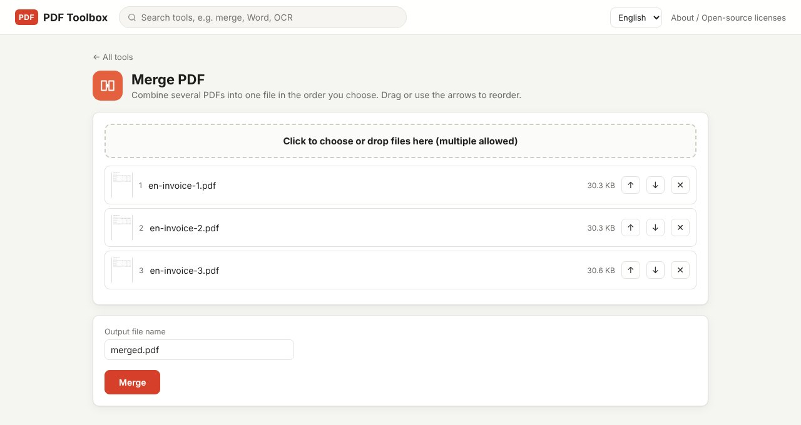

To merge PDFs, add the files in the order you want and click Merge. Online sites need every file uploaded to their server; PDF Toolbox merges on your own computer, so supplier paperwork and personal documents never leave it. There is no limit on the number or size of files.

> **What you need**: [download the latest PDF Toolbox](https://github.com/toolboxnotes/pdf-toolbox/releases/latest) (free, Windows and Mac). For first-launch steps, see "Download and install" in the [PDF Toolbox introduction](../offline-pdf-toolbox/).

## When you need to merge PDFs

- Sending a month of invoices to accounting as one file
- Turning an application form, references and certificates into a single PDF for submission
- Putting the front and back of a contract, scanned separately, back together
- Getting under an email attachment limit by sending one file instead of ten

## Merge PDFs step by step

*Merge PDF with three fictional invoices added. The ↑ ↓ buttons next to each file change the order.*

1. **Open PDF Toolbox and drop all the PDFs on the home screen.** With two or more PDFs, **Merge PDF** is the first suggestion. You can also type "merge" in the search bar.
2. **Set the order.** The numbers in the list are the merge order. Drag a file, or use the **↑ ↓** buttons on the right; click **✕** to drop a file. Each file shows a thumbnail of its first page, so you can tell them apart.
3. **Rename the output.** The default is `merged.pdf`. A name like `2026-11 invoices.pdf` is easier to find later.
4. **Click Merge.** The file is saved to your Downloads folder.

You need at least two PDFs. There is no upper limit, but merging several files with hundreds of pages each uses a lot of memory, so very large jobs are steadier in batches.

## Mixing pages instead of whole files

Merge joins whole files end to end. To slot page 1 of file B between pages 2 and 3 of file A, use the **Organize pages** tool instead.

| What you want | Tool |
|---|---|
| Join several files in order | Merge PDF |
| Reorder pages or delete some | Organize pages |
| Insert pages from another PDF in the middle | Organize pages (add pages from another PDF) |
| Keep only some pages as a new file | Split PDF, "Extract pages" |

Organize pages shows every page as a thumbnail; drag to reorder, and rotate, delete, duplicate or insert blank pages.

## Checks after merging

- **Page count**: the merged file should have as many pages as the originals combined.
- **Orientation**: a sideways scan stays sideways after merging. Fix it in the **Rotate PDF** tool by clicking the page thumbnail.
- **File size**: several scans merged together easily exceed an email limit. If so, follow up with [compressing the PDF](../compress-pdf-offline/).

## Limitations worth knowing

- **Bookmarks and some links are not kept.** Page content is copied into the new file, but the bookmark outline of the originals is not.
- **Password-protected PDFs can't be merged.** If you see "This PDF is password-protected", remove the password first with [Unlock PDF](../pdf-password-protect-unlock/).
- **Fillable forms** may not work properly after merging. Fill them in first, then merge.

## Why offline instead of an online merge site

A merge job is usually a bundle of documents with several people's details in it. Online merge sites upload the files and say they delete them after a while. PDF Toolbox never sends them anywhere, so there is nothing to wait for or trust. It works without an internet connection and has no daily limits.

## FAQ

### How many files can I merge?

There is no fixed limit. It depends on your computer's memory; dozens of ordinary documents are no problem.

### Does merging reduce quality?

No. Pages are copied as they are, not turned into images, so text stays selectable and searchable.

### Can I merge JPG photos too?

Merge PDF accepts PDFs only. Turn photos into a PDF with **Image to PDF** first, then merge.

### Does it work on a Mac?

Yes. Windows and Mac use the same interface.

## Related posts

- [How to compress a PDF offline](../compress-pdf-offline/)
- [How to split a PDF or extract pages](../split-pdf-extract-pages/)
- [How to password protect or unlock a PDF offline](../pdf-password-protect-unlock/)
- [PDF Toolbox: free offline PDF converter for Windows and Mac](../offline-pdf-toolbox/)
