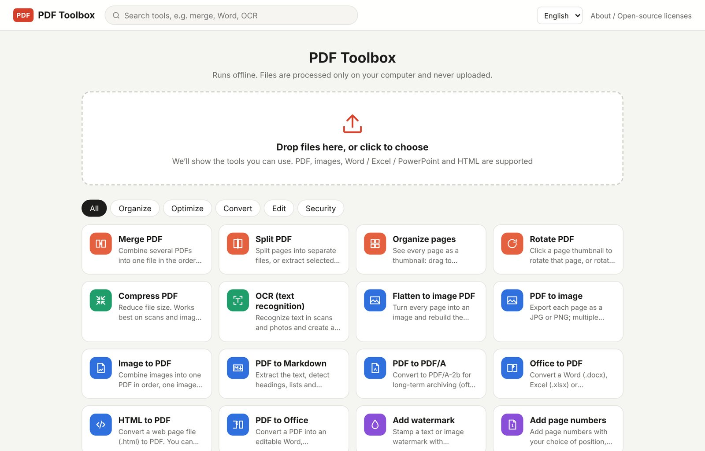
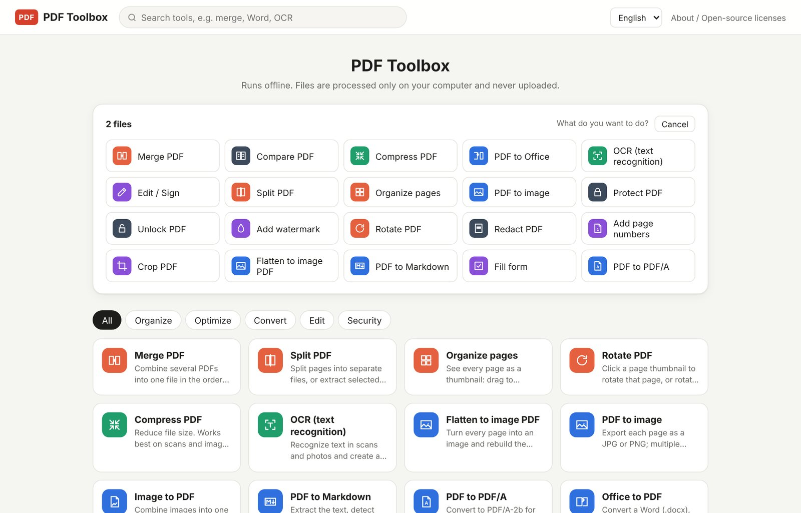
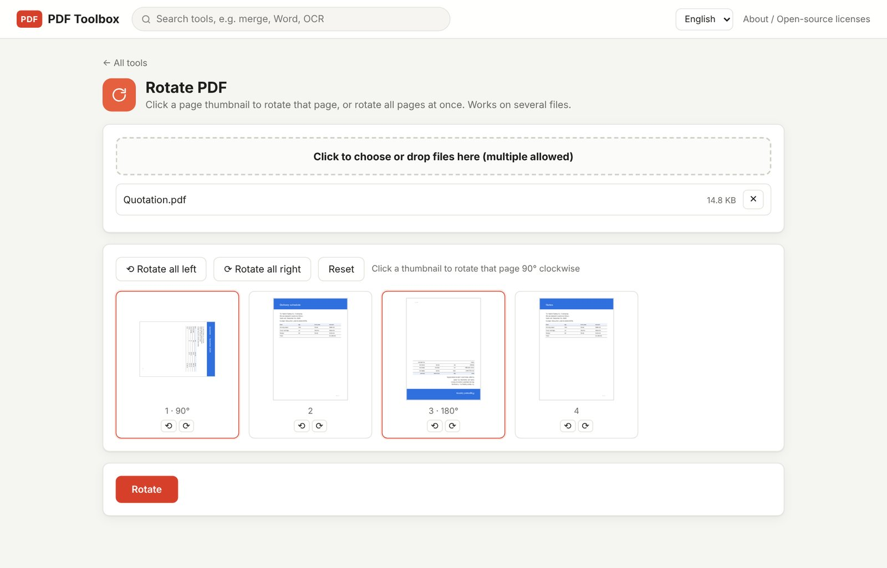
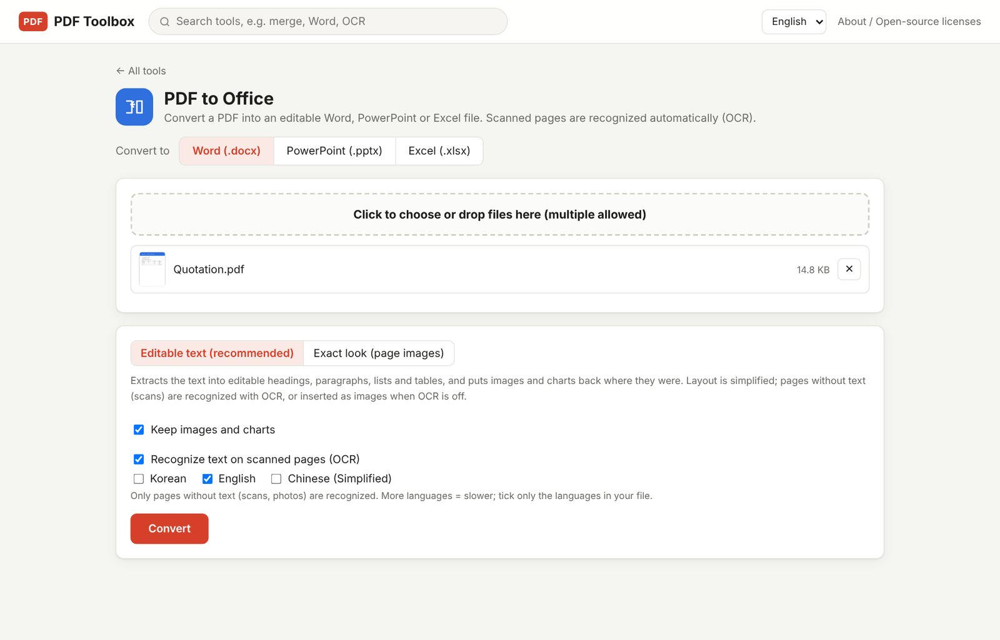
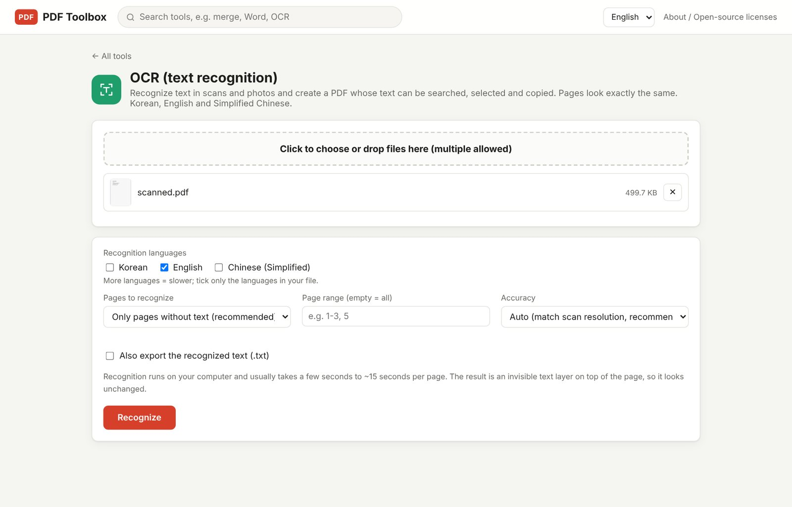
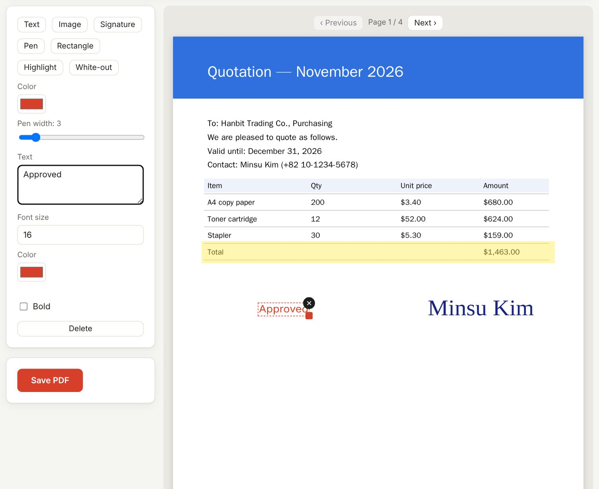
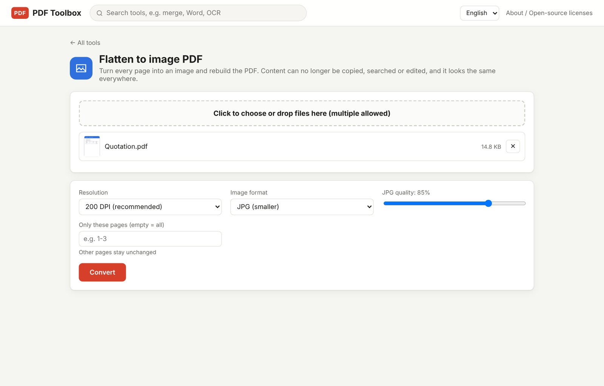

Search for "merge PDF" and you get a wall of free websites. They work. But every time my cursor hovered over the upload button, I hesitated, especially when the file was a supplier contract, a quote with every unit price on it, or a shipping order for the warehouse.

> So this file is about to take a quick trip to a server on the other side of the planet, right?

I have no way of knowing how quick that trip really is. So I decided to build **a PDF converter where the file never leaves my computer**. The result is **PDF Toolbox**.

This post walks through what PDF Toolbox can do, with real screenshots. It's **free**, and you can download it right now.

> **Download:** [Get the latest PDF Toolbox from GitHub](https://github.com/toolboxnotes/pdf-toolbox/releases/latest) (Windows, Mac, HTML)
> Setup steps are in [Download and install](#download-and-install) below.

## In one sentence

An all-in-one PDF tool that works **with no install, no internet and no uploads**.

- **It works offline.** Everything happens on your computer and nothing is uploaded to any server. Turn off Wi-Fi and it keeps working.
- **Nothing to install.** The whole app is a single, lightweight HTML file. On Windows, double-click `PDF Toolbox.exe`; on a Mac, `PDF Toolbox.app`. It opens in its own window.
- **The everyday tools in one place.** 23 tools, from merge, split and compress to PDF ↔ Office conversion, OCR, signing and password protection. The interface is in English, Korean and Chinese.

## What bugged me about online PDF converters

Online converters aren't bad. But when you handle documents every day, small annoyances add up:

| Situation | Online converter | PDF Toolbox |
|---|---|---|
| Sensitive files (contracts, quotes, ID copies) | Must be uploaded to a server | Processed on your computer only |
| A 100 MB scan | Wait for upload and download | Zero upload time |
| Slow or no internet | Doesn't work | Works the same |
| Many conversions a day | Often limited or paywalled | No limits |
| Ads and pop-ups | Depends on the site | None |

The first row was the big one. As an online seller, I deal with a surprising number of PDFs that would be awkward in the wrong hands: supplier price lists, invoices, customs paperwork.

## Who it's for

- **Online sellers**: merge a stack of invoices into one PDF, sign a quote and send it back, or move a supplier's scanned price list into Excel
- **Office workers**: archive reports as PDF/A, add watermarks and page numbers to meeting decks
- **Freelancers**: add a handwritten signature to a contract, or shrink a portfolio so it fits in an email
- **Students**: make scanned papers searchable and pull out just the pages you need

## A quick tour

### 1. Start by dropping a file

Drop a file on the big box on the home screen and it lists the tools that fit. Two PDFs put Merge and Compare first; an image suggests Image to PDF. Pick a tool and it opens with your file already loaded.

In other words, you don't need to know which tool you want. The file tells you.

*Figure 1. Home screen: tools by category, with search*

*Figure 2. Drop two PDFs and Merge and Compare come first*

### 2. Rotate while you look

Every scan seems to have one or two pages lying on their side. Rotate PDF shows every page as a thumbnail, and each click turns that page 90° clockwise. There are also Rotate all left, Rotate all right and Reset, so you see the result before you save.

*Figure 3. Rotate PDF: page 1 turned 90°, page 3 turned 180°*

### 3. PDF to Word, PowerPoint and Excel

This is the one I use most. Choose Word, PowerPoint or Excel and get an editable file.

- **Word**: detects headings, paragraphs, lists and tables, and puts images and charts back where they were.
- **PowerPoint**: puts the text back as editable text boxes on top of the page background, keeping position, size, bold and color.
- **Excel**: splits columns by the gaps between words and turns numbers, thousands separators, negatives in parentheses and percentages into **real numbers**. You can SUM a statement that arrived as a PDF right away.

Office to PDF goes the other way for Word, Excel and PowerPoint files.

*Figure 4. PDF to Office: choosing the output format and mode*

### 4. Make scans searchable (OCR)

A scanned or photographed PDF looks like text, but to your computer it's just a picture. Ctrl+F finds nothing and you can't copy a word.

OCR reads the text in the image and adds it as an **invisible text layer**. The pages look exactly the same, but now you can search and copy. Korean, English and Simplified Chinese are supported, and a 4-page test took about 4 seconds. The recognition engine and language data are built into the app, so OCR works offline too.

PDF to Word and Excel also have an "auto OCR for scanned pages" option, so a scanned table can go straight into a spreadsheet.

*Figure 5. OCR: recognition languages and accuracy*

### 5. Edit and sign: no more print, sign, scan

Add text, images, a handwritten signature, highlights or white-out on top of a PDF, then drag to move and resize. Stamp "Approved", draw your signature with the mouse, and the old print-sign-scan routine happens on one screen.

*Figure 6. Edit / Sign: a quote with an approval note and a handwritten signature*

### 6. Flatten to image PDF: hard to copy, hard to edit

Turns every page into an image and rebuilds the PDF. Text can no longer be copied or easily changed, which is handy for quotes or design drafts that the other side should only look at. You can choose the resolution and image format (JPG or PNG).

*Figure 7. Flatten to image PDF: resolution and format*

## All 23 tools

| Group | Tools |
|---|---|
| Organize | Merge, Split, Organize pages (reorder, delete, duplicate, insert blank), Rotate |
| Optimize | Compress, OCR |
| Convert | PDF to Office (Word, PowerPoint, Excel), Office to PDF, Image to PDF, PDF to image, Flatten to image PDF, PDF to Markdown / TXT, PDF to PDF/A, HTML to PDF |
| Edit | Edit / Sign, Watermark, Page numbers, Crop, Fill form |
| Security | Protect (AES-256), Unlock, Redact (true removal), Compare |

## Four tips worth knowing

**1. White-out is not redaction.**
White-out in the editor puts a white box on top, but the text underneath is still in the file. Copy it and it comes right back. For information that must really be gone, like ID or bank account numbers, use Redact under Security. It turns those pages into images so the text itself no longer exists.

**2. Try lossless compression first.**
Compression has four levels, from lossless up to strong. Lossless only tidies the file structure and doesn't touch quality. If the file is still too big, go up a level. The higher levels turn pages into images, so the file shrinks a lot but text is no longer selectable.

**3. Use PDF/A for files you'll keep for years.**
PDF/A is the archiving standard designed so a file opens the same way decades from now. Fonts and color information go inside the file and outside dependencies are removed. Good for contracts and tax records.

**4. Use Compare to see what changed.**
When a revised contract arrives, you don't have to reread the whole thing. Compare highlights the differences, by text or by appearance.

## Fun things I learned building it

- **It all fits in one small file.** The OCR engine, Korean, English and Chinese language data, the libraries that write Word, Excel and PowerPoint files, and encryption all live in one HTML file, and it's still only about the size of a few photos. You can carry it around on a USB stick.
- **The encryption is hand-built.** AES-256 protection, and unlocking everything from old RC4 files to AES-256, uses only what's built into the browser.
- **Korean OCR and spaces.** The recognition engine often splits one Korean word into several pieces, so I regroup them using the spacing of the whole line. Copied text comes out with natural spacing.
- **A 33-page PDF to PowerPoint in about 4 seconds.** Faster than I expected.

## Honest limitations

- Complex documents with lots of text boxes, charts or multi-column layouts may look slightly different from the original in Office.
- OCR is accurate on clean scans, but noisy scans and very large headings can produce typos. Check important documents.
- In PowerPoint to PDF, charts and SmartArt show up as empty boxes.
- A computer with Chrome or Edge installed is recommended.

## Download and install

PDF Toolbox is free. Download it from the [GitHub releases page](https://github.com/toolboxnotes/pdf-toolbox/releases/latest). The source code is public in the same place ([toolboxnotes/pdf-toolbox](https://github.com/toolboxnotes/pdf-toolbox)).

| Platform | File | How to open |
|---|---|---|
| Windows | `PDF-Toolbox-Windows-<version>.zip` | Unzip it and double-click `PDF Toolbox.exe`. It opens in its own window with Chrome (or Edge if Chrome isn't installed), with no address bar. Keep it in the same folder as `PDF-Toolbox.html`. |
| Mac | `PDF-Toolbox-Mac-<version>.zip` | Unzip it and move `PDF Toolbox.app` to Applications. |
| Anything else | `PDF-Toolbox-<version>.html` | Open it in Chrome or Edge. |

**A warning on first launch is normal.** The app isn't code-signed yet, so you'll see one the first time:

- **Windows**: if "Windows protected your PC" appears, click **More info → Run anyway**.
- **Mac**: if it says the developer can't be verified, **right-click the app → Open**.

You can switch the language in the top-right corner; the first time, it follows your browser's language.

## FAQ

**Are my files really not uploaded?**
Really. Open the app, turn off Wi-Fi and try it. Every tool keeps working.

**Does it work on a Mac?**
Yes. It isn't signed with an Apple developer certificate, so the first time you need to right-click and choose Open.

**Is it really free?**
Yes, for personal and business use. No sign-up either.

**How do I get new versions?**
New versions appear on the [GitHub releases page](https://github.com/toolboxnotes/pdf-toolbox/releases/latest). Click Watch → Custom → Releases on the repository to get notified.

**Can I use it on my phone?**
Not yet. It's for computers for now, and a web version is in the works.

## Feedback and bug reports

[**Download PDF Toolbox (GitHub)**](https://github.com/toolboxnotes/pdf-toolbox/releases/latest)

If something doesn't work or you wish it had a feature, let me know. Open a [GitHub issue](https://github.com/toolboxnotes/pdf-toolbox/issues) or email me. Including these three things helps me fix it faster:

1. Your computer (Windows or Mac) and browser
2. What you were trying to do (for example, scans to Excel, or signing a contract)
3. The screen where it went wrong, or the feature you'd like

Email: [toolbox@toolboxnotes.com](mailto:toolbox@toolboxnotes.com)

---

**Related reading**

- [Hello, Toolbox Notes](../hello-toolbox-notes/)
- [A 15-Minute Daily Routine for Amazon Sellers](../amazon-seller-14-daily-routine/)
