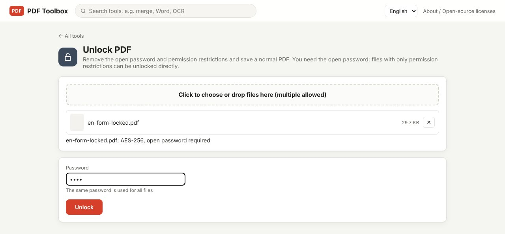
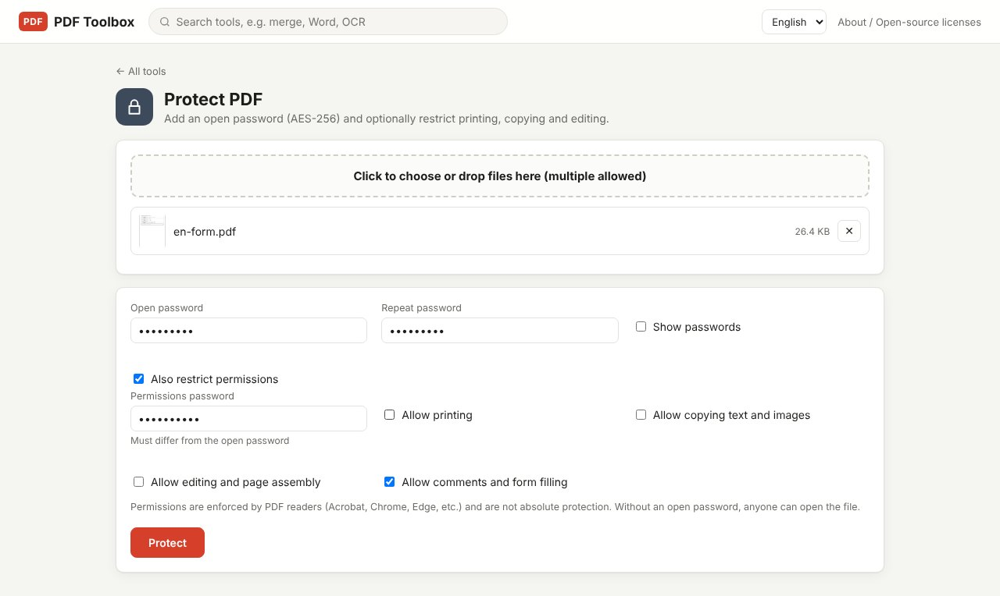

A PDF can carry two kinds of password. The **open password** is asked when you open the file. The **permissions password** restricts printing, copying and editing. An open password can only be removed if you know it; a file with permission restrictions alone can be unlocked directly. This guide covers the difference, how to add a password, and how to remove one you know and save a normal PDF.

> **What you need**: [download the latest PDF Toolbox](https://github.com/toolboxnotes/pdf-toolbox/releases/latest) (free, Windows and Mac). Neither the file nor the password leaves your computer.

## Open password vs. permissions password

| | Open password | Permissions password |
|---|---|---|
| When it is asked | When opening the file | When changing the permission settings |
| What it blocks | Viewing the content at all | Printing, copying, editing, comments and form filling |
| Encryption | Content can't be read without it | PDF readers honor the restrictions |
| Removal | You must know the password | Can be removed without the password |

The last two rows are the important ones. Permission restrictions are a rule that PDF readers (Acrobat, Chrome, Edge and others) agree to follow, not absolute protection. If other people must not read the content, set an open password.

## Remove a password you know

Bank statements, payslips and insurance documents often arrive locked with the same password every month. For copies you keep on your own computer, an unlocked version saves typing it each time.

*As soon as a file is added, its encryption and status appear under it, for example "AES-256, open password required".*

1. **Drop the file on PDF Toolbox and choose Unlock PDF.** It is in the Security group.
2. **Check the status line.** For each file the tool shows the encryption type and either "open password required" or "permissions only — can be unlocked directly".
3. **Type the open password.** Leave it empty if the file only has permission restrictions.
4. **Click Unlock.** A normal PDF ending in `_unlocked.pdf` is saved.

You can add several files at once; the same password is used for all of them. That is useful for a year of monthly statements.

Supported encryption: RC4 40-bit and 128-bit, AES-128 and AES-256. PDFs secured with a certificate are not supported.

## Add a password before sending

*The open password entered twice, with "Also restrict permissions" turned on. The permissions password must differ from the open password.*

1. **Drop the file and choose Protect PDF.**
2. **Type the open password and repeat it.** Turn on "Show passwords" to see what you typed.
3. **Optionally turn on "Also restrict permissions".** Set a separate permissions password (it must differ from the open password) and choose what to allow:
   - Allow printing
   - Allow copying text and images
   - Allow editing and page assembly
   - Allow comments and form filling
4. **Click Protect.** A file ending in `_protected.pdf` is saved.

The encryption is AES-256. Current versions of Acrobat, Chrome, Edge and macOS Preview open it; very old readers may not.

To put a new password on a file that is already encrypted, remove the old one with Unlock PDF first.

## Choosing and sharing the password

- **A forgotten password can't be recovered.** The open password actually encrypts the content, so without it even the creator can't open the file. Keep the original.
- **Send the file and the password separately.** If the file goes by email, send the password by text or chat. A password in the same email protects nothing.
- **Avoid birthdays and phone numbers.** Anyone who knows the recipient can guess them.
- **A password does not hide parts of the document.** If some information must not be seen even by the recipient, [redact it](../redact-pdf-permanently/) first.

## If you forgot the open password

This tool does not crack passwords and there is no plan to add that. What you can do:

- Re-read the message that came with the file. Senders such as banks and insurers usually state the rule, for example a date of birth or part of an account number.
- Look for the original file from before the password was added.
- Ask the sender for a new copy.

Only unlock documents that are yours or that you are authorized to unlock.

## FAQ

### Can I unlock a PDF without the password?

If the file opens without asking and only blocks printing or copying, yes. If it asks for a password to open, you need that password.

### Why not use an online unlock site?

A locked document is usually sensitive. An online service receives both the file and its password. Doing it on your own computer avoids that.

### Is the unlocked file identical to the original?

Yes. Only the encryption is removed; page content is not changed.

### Can't I remove a password with Chrome's "Print to PDF"?

Opening the file with its password and printing to "Save as PDF" does create an unlocked copy. It fails when printing is restricted, can drop bookmarks and form fields, and handles one file at a time.

### Is a permissions password alone enough?

No. Without an open password anyone can open the file, and as shown above, permission restrictions can be removed directly.

## Related posts

- [How to redact a PDF so the text is really gone](../redact-pdf-permanently/)
- [How to make a scanned PDF searchable offline (free OCR)](../scanned-pdf-searchable-ocr/)
- [PDF Toolbox: free offline PDF converter for Windows and Mac](../offline-pdf-toolbox/)
