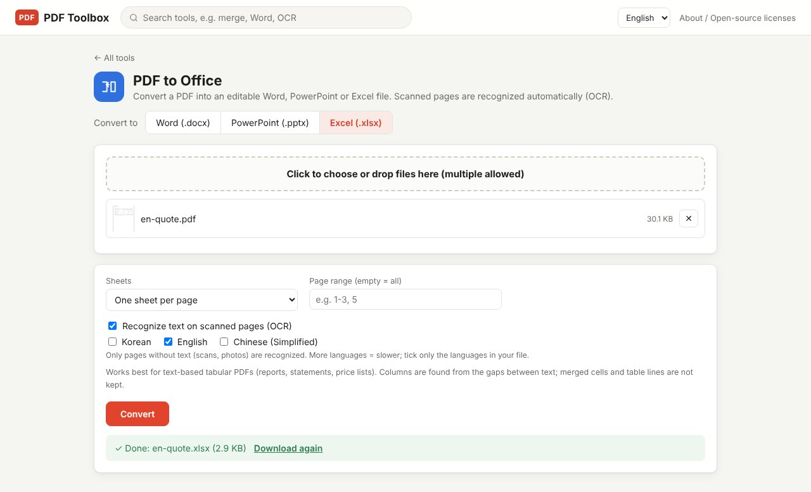
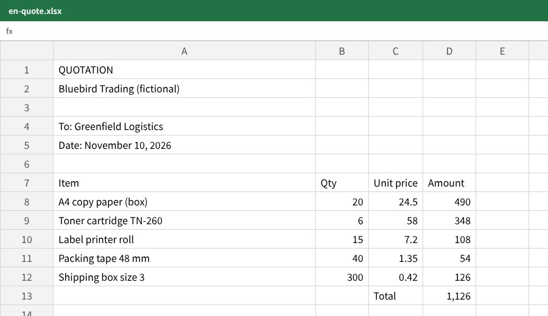

The annoying part of moving a PDF table into Excel is the numbers. Copy and paste, and `1,126.00` lands as text or the whole row ends up in one cell, so SUM doesn't work. In PDF Toolbox, **PDF to Office** with Excel selected splits the table into rows and columns and turns numbers with commas, parentheses or percent signs into **real numbers** you can calculate with. The file is processed on your computer only.

> **What you need**: [download the latest PDF Toolbox](https://github.com/toolboxnotes/pdf-toolbox/releases/latest) (free, Windows and Mac). For first-launch steps, see "Download and install" in the [PDF Toolbox introduction](../offline-pdf-toolbox/).

## What converts well, and what doesn't

| PDF | Result |
|---|---|
| Quotes, statements, price lists and transaction lists saved from software | Good. This is what the tool does best |
| Scanned tables | Converted after OCR. Expect some recognition errors |
| Complex forms with many merged cells | Columns may shift |
| Documents with text and no tables | Convert to Word instead |

The tool finds columns from the gaps between words. Neatly aligned tables come out cleanly; borders and merged-cell shapes are not carried over.

## Convert a PDF to Excel step by step

*A fictional quotation converted to Excel. Pick Excel (.xlsx) next to "Convert to" at the top.*

1. **Drop the PDF on PDF Toolbox and choose PDF to Office.**
2. **Click Excel (.xlsx) next to "Convert to".** The tool remembers your choice next time.
3. **Choose how to use sheets.**
   - **One sheet per page**: each page holds a different table
   - **Everything on one sheet**: one long table runs across several pages
4. **Optionally enter a page range.** Leave it empty for all pages. Example: `2-4`
5. **For scans, check that "Recognize text on scanned pages (OCR)" is on.** It is on by default and only affects pages without text.
6. **Click Convert.** An `.xlsx` file is saved.

## The result: numbers arrive as numbers

*The quotation above after conversion. Quantity, unit price and amount are right-aligned numeric values, ready for a SUM.*

The number rules:

| Written in the PDF | Value in Excel |
|---|---|
| `1,126.00` | 1126 (number) |
| `(3,500)` | -3500 (accounting-style negative) |
| `12.5%` | 0.125 (percent format) |
| `555-123-4567`, `00123` | Kept as text (leading zeros are not lost) |
| `A4 copy paper` | Kept as text |

So you can write `=SUM(D8:D12)` right after converting. If you reconcile a monthly statement in Excel, that difference adds up.

## Checks after converting

- **Compare totals**: check that the total in the PDF matches the one Excel calculates. A column shifted by one shows up immediately.
- **Header lines**: the company name and date above the table land in the top rows. Delete what you don't need.
- **Scans**: compare OCR'd numbers against the original by eye. `8` and `3`, or `0` and `6`, can swap.

## Limitations worth knowing

- **Borders, merged cells and text colors are not kept.** The tool moves values, not formatting.
- **Columns are split by white space**, so in very tight tables two columns may end up in one cell.
- **Password-protected PDFs** need [Unlock PDF](../pdf-password-protect-unlock/) first.

## FAQ

### Can I convert to Word or PowerPoint too?

Yes. In the same tool, switch "Convert to" to Word (.docx) or PowerPoint (.pptx). Text-heavy documents belong in Word.

### Can I convert several PDFs at once?

Yes. Each file becomes its own Excel file and they are zipped together as `Excel.zip`.

### Does it work with bank statement PDFs?

Text-based statements usually convert well. They often arrive password-protected, so unlock them first.

### How do I go the other way, Excel to PDF?

Use **Office to PDF**. See [How to convert Excel to PDF offline](../excel-to-pdf-offline/).

## Related posts

- [How to convert Excel to PDF offline](../excel-to-pdf-offline/)
- [How to make a scanned PDF searchable offline (free OCR)](../scanned-pdf-searchable-ocr/)
- [How to password protect or unlock a PDF offline](../pdf-password-protect-unlock/)
- [PDF Toolbox: free offline PDF converter for Windows and Mac](../offline-pdf-toolbox/)
