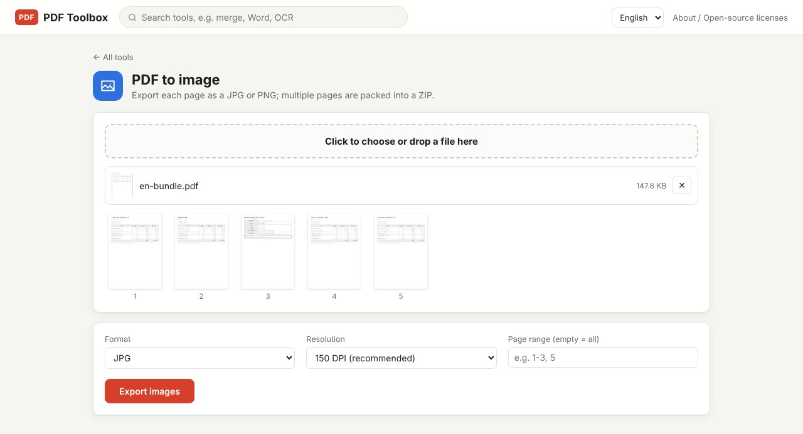
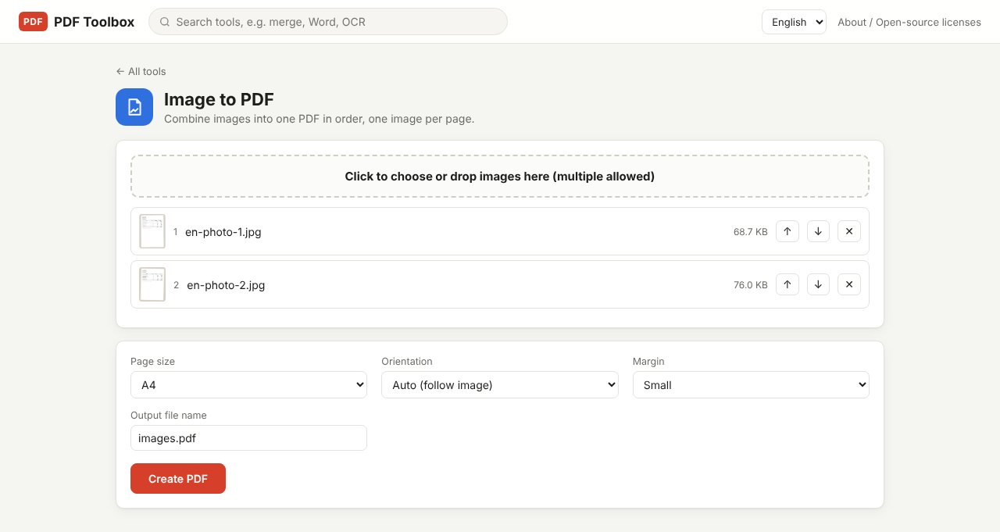

Converting between PDFs and images comes up more often than you'd think: posting one page of a document as a picture on a blog or product page, or the reverse, sending a stack of phone photos of receipts as a single PDF. PDF Toolbox does both directions, and your files never leave your computer.

> **What you need**: [download the latest PDF Toolbox](https://github.com/toolboxnotes/pdf-toolbox/releases/latest) (free, Windows and Mac). For first-launch steps, see "Download and install" in the [PDF Toolbox introduction](../offline-pdf-toolbox/).

## PDF to JPG: the PDF to image tool

*A five-page PDF loaded. Choose the format, resolution and page range.*

1. **Drop the PDF and choose PDF to image.** Page thumbnails appear.
2. **Pick a format:** JPG (smaller files) or PNG (sharper text edges, larger files).
3. **Pick a resolution.** See the table below.
4. **Enter only the pages you need.** Leave it empty for all pages, e.g. `1-3, 5`
5. **Click Export images.** One page gives you one image; several pages give `name_01.jpg`, `name_02.jpg` and so on, packed into `name_images.zip`.

| Resolution | Use it for |
|---|---|
| 72 DPI (small) | Quick previews in chat apps, thumbnails |
| 150 DPI (recommended) | Blogs, product pages, viewing on screen |
| 300 DPI (high) | Printing, or zooming in on small print |

For text-heavy pages, PNG looks crisper. For photo-heavy pages, JPG gives better quality for the size.

## JPG to PDF: the Image to PDF tool

*Two fictional phone photos of documents loaded. Each image becomes one page.*

1. **Choose Image to PDF and drop all the photos in.** You can add many at once; JPG, PNG, WebP, GIF and BMP are supported.
2. **Set the order.** The list number is the page order. Drag, or use the ↑ ↓ buttons.
3. **Pick page size, orientation and margin.**
   - **Page size**: A4 (default), Letter, A3, or Same as image
   - **Orientation**: with Auto (follow image), landscape photos get landscape pages
   - **Margin**: None, Small (default), Large
4. **Set the output file name** and click **Create PDF**. The default name is `images.pdf`.

The rotation info (EXIF) in phone photos is read, so portrait shots don't end up lying on their side.

## Tips for PDFs you need to submit

- **Too big?** Phone photos are several MB each, so the PDF gets large. Run it through [Compress PDF](../compress-pdf-offline/) at the "Recommended" level and it usually fits upload limits.
- **Need searchable text?** In a PDF made from photos, the text is just pixels. Run [OCR](../scanned-pdf-searchable-ocr/) to make it searchable.
- **Adding photos to an existing PDF?** Turn the photos into a PDF, then join them with [Merge PDF](../merge-pdf-offline/).

## Limitations worth knowing

- **iPhone HEIC photos can't be added directly.** In iPhone Settings → Camera → Formats, choose "Most Compatible" to shoot JPG; photos you already took are often converted to JPG when you share them.
- **Images made from a PDF have no selectable text,** because they are pictures. To reuse the text, try [PDF to Excel](../pdf-to-excel-offline/) or PDF to Office with Word.

## FAQ

### Can I save just one page as an image?

Type only that page number in "Page range", e.g. `3`.

### I added the images in the wrong order.

Before creating the PDF, just drag them in the list. If it's already made, reorder the pages with the **Organize pages** tool.

### I want the whole PDF turned into an image-only PDF.

If the goal is a PDF that can't easily be copied or edited, rather than image files, use the **Flatten to image PDF** tool. It turns each page into an image and rebuilds the PDF.

## Related posts

- [How to compress a PDF offline](../compress-pdf-offline/)
- [How to make a scanned PDF searchable with free OCR](../scanned-pdf-searchable-ocr/)
- [How to merge PDF files offline](../merge-pdf-offline/)
- [PDF Toolbox: free offline PDF converter for Windows and Mac](../offline-pdf-toolbox/)
