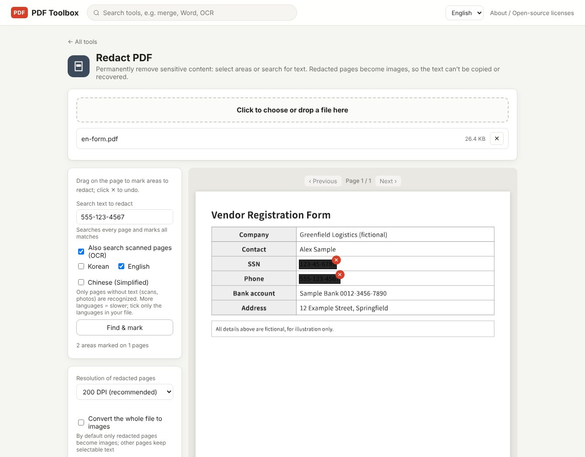

Drawing a black rectangle over a name or an account number in a PDF does not remove it. The rectangle is a separate shape placed on top of the text, and the text underneath stays in the file where it can be copied and searched. To really remove information you have to delete the content in that area. This guide shows how, and how to verify the result.

> **What you need**: [download the latest PDF Toolbox](https://github.com/toolboxnotes/pdf-toolbox/releases/latest) (free, Windows and Mac). Files are processed on your computer only.

## Why a black box is not redaction

A PDF page is a stack of text, images and shapes. When you add a black rectangle or a highlight in an editor, one more shape goes on top of the stack and the text below is untouched. That means:

- Selecting across the covered area and pasting into a text editor reveals the original words.
- Ctrl+F still finds the covered name or number.
- Anyone with a PDF editor can select the rectangle and delete it.

The same applies to a Word document where you gave text a black background and then saved it as PDF. Hidden on screen is not the same as removed from the file.

## Check a file in 30 seconds

1. Open the PDF, press Ctrl+A to select everything, and copy.
2. Paste into a plain text editor.
3. If the names or numbers that should be hidden show up, the file is not redacted.

If you have already sent a file like that, the recipient can read it the same way.

## Redact permanently, step by step

*A fictional vendor form with the SSN and phone number found through "Search text to redact". The count under the button reads "2 areas marked on 1 pages".*

1. **Drop the file on PDF Toolbox and choose Redact PDF.** It is in the Security group.
2. **Mark what to remove.** There are two ways, and you can combine them.
   - **Drag**: drag on the page to mark an area. Click ✕ to undo a mark.
   - **Search**: type a phone number or name into "Search text to redact" and click **Find & mark**. Every match on every page is marked at once.
3. **For scanned documents, keep "Also search scanned pages (OCR)" turned on.** It is on by default, and text inside page images is recognized and matched too.
4. **Check the count.** The tool shows how many areas are marked and on how many pages.
5. **Click Apply redaction & save.** A new file ending in `_redacted.pdf` is saved. The original is left as it is.

## How this tool removes the content

Each page that contains a marked area is rebuilt as an image. The black boxes become part of that image, so no text remains on the page to copy or extract.

- By default **only redacted pages** become images. Other pages keep selectable, searchable text.
- Turn on **Convert the whole file to images** if nothing in the document should be selectable.
- If the redacted pages look soft, raise **Resolution of redacted pages**. Higher resolution means a larger file.

## Checks to run after saving

1. Open the `_redacted.pdf` file and repeat the 30-second check above.
2. Search for the redacted words with Ctrl+F and confirm zero results.
3. Look for the same information elsewhere: headers, signature blocks, attached pages. Marking by search makes misses less likely.
4. Check the file name. A name like `John_Smith_bank_statement.pdf` travels with the file no matter what is inside.

## Limitations worth knowing

- **Redacted pages are no longer searchable**, because they are images. You can [run OCR](../scanned-pdf-searchable-ocr/) on the saved file to bring search back; the redacted areas are solid black by then and will not be recognized.
- **White-out is not redaction.** The white-out in the Edit / Sign tool is for tidying up a page, and the original text stays in the file. Use Redact PDF for anything sensitive.
- **Search matches the exact text you type.** `555-123-4567` and `5551234567` need separate searches. There is no automatic detection of ID or card number patterns.
- **The original file still exists.** Keep track of it. Attaching the unredacted original by mistake is the most common failure.

## FAQ

### Can redaction be undone later?

Not from the saved `_redacted.pdf`. Keep the original somewhere safe if you may need it.

### Can I redact in white instead of black?

This tool redacts in black. White-out exists in the Edit / Sign tool, but it covers text without removing it.

### Does it work on scanned PDFs?

Yes. Mark areas by dragging, or search by text with "Also search scanned pages (OCR)" left on.

### Why not use an online redaction site?

The file you want to redact is sensitive by definition. Uploading the unredacted original to a server in order to redact it defeats the purpose, so this tool does everything locally.

## Related posts

- [How to make a scanned PDF searchable offline (free OCR)](../scanned-pdf-searchable-ocr/)
- [How to password protect or unlock a PDF offline](../pdf-password-protect-unlock/)
- [PDF Toolbox: free offline PDF converter for Windows and Mac](../offline-pdf-toolbox/)
