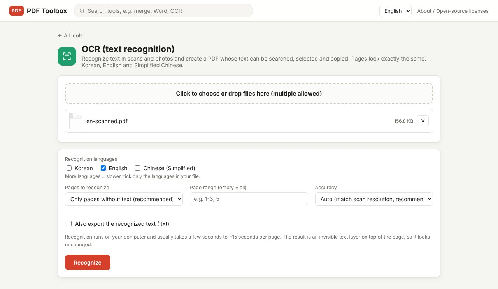

Ctrl+F finds nothing in a scanned PDF because every page is a single picture. OCR (optical character recognition) fixes that by placing an invisible text layer over the picture, so the page looks the same but you can search, select and copy the words. This guide shows how to do it for free on your own computer, without uploading the file anywhere.

> **What you need**: [download the latest PDF Toolbox](https://github.com/toolboxnotes/pdf-toolbox/releases/latest) (free, Windows and Mac). For first-launch steps, see "Download and install" in the [PDF Toolbox introduction](../offline-pdf-toolbox/).

## How to tell if your PDF is a scan

Three quick checks:

- Dragging the mouse over a line selects the whole page instead of individual words.
- Ctrl+F (Cmd+F on Mac) returns zero results for a word you can clearly see.
- Copying a paragraph and pasting it into a text editor gives you nothing.

If any of these is true, the file is an image-only PDF. Contracts scanned on an office copier, receipts photographed with a phone, and faxed documents usually fall into this group.

## Make the PDF searchable, step by step

*The OCR tool with a scanned quotation (a fictional document) loaded. English is selected by default on the English interface.*

1. **Open PDF Toolbox and drop the PDF on the box on the home screen.** Pick **OCR (text recognition)** from the suggested tools, or type "OCR" in the search bar at the top.
2. **Check the recognition languages.** English is selected by default on the English interface. Tick only the languages that appear in the document: English, Korean or Simplified Chinese.
3. **Choose which pages to recognize.** The default, **Only pages without text (recommended)**, skips pages that already have real text and works on the scanned ones.
4. **Leave Accuracy on Auto.** Switch to **Fine (400 DPI, for small text)** only when the document has a lot of tiny print.
5. **Click Recognize.** The result is saved to your Downloads folder with `_OCR.pdf` added to the file name.

Open the new file and press Ctrl+F to confirm. The pages look identical to the original; the only change is the hidden text sitting on top of the image.

## Which settings to pick

| Setting | Options | When to change it |
|---|---|---|
| Recognition languages | English / Korean / Simplified Chinese | Tick only what the document contains. More languages means slower |
| Pages to recognize | Only pages without text (recommended) / All pages | Use "All pages" only if the existing text is broken |
| Accuracy | Auto (recommended) / Fast 200 / Standard 300 / Fine 400 DPI | Use 400 for footnotes and dense tables |
| Also export the recognized text (.txt) | On / Off | Turn on if you plan to paste the text elsewhere |

Auto is the recommended setting for a reason. Enlarging a page beyond the resolution it was scanned at makes recognition worse, not better. So the tool estimates the original scan resolution from the pixel size of the page image and recognizes at that resolution.

## Speed and accuracy in practice

- **Speed**: a few seconds to roughly 15 seconds per page. A four-page test document with tables and mixed languages took 3 to 5 seconds. For files over 100 pages, start it and do something else.
- **Accuracy**: clean, straight scans of printed documents come out well enough for search. Expect more errors with:
  - phone photos taken at an angle or with shadows
  - faxes with speckles and smudges
  - very large headings and decorative fonts
  - handwriting (the engine is built for printed text)

A few typos rarely matter for search. For amounts, account numbers and anything where one character counts, compare against the original image by eye.

## Converting a scan to Word or Excel instead

You don't need to make a searchable PDF first. The **PDF to Office** tool has **Recognize text on scanned pages (OCR)** turned on by default, so scanned pages are recognized automatically and written into Word or Excel. It is handy for pulling a table out of a scanned quote.

## Why offline instead of an online OCR site

The documents people scan and keep are mostly contracts, ID copies, bank statements and medical paperwork. Online OCR services send those files to a server and say they delete them after a set time. I have no reason to doubt that, but a file that never leaves your computer needs no such promise.

PDF Toolbox ships with the OCR engine and language data built in, so it works the same with Wi-Fi turned off. There are no page limits and no daily quotas.

## FAQ

### Does OCR reduce the quality of my scan?

No. The page image is left untouched and an invisible text layer is added on top. File size grows only by the size of the text.

### Which languages are supported?

English, Korean and Simplified Chinese. Other languages are not supported yet.

### Can I OCR a photo (JPG)?

Yes. Convert it with **Image to PDF** first, then run OCR on the result.

### Can I correct OCR mistakes?

There is no editor for the hidden text layer. If you need clean text, turn on the .txt export and fix the text file, or convert the PDF to Word with PDF to Office and edit there.

### Does it work on a phone?

It is built for Windows and Mac and has not been tested on phones.

## Related posts

- [How to redact a PDF so the text is really gone](../redact-pdf-permanently/)
- [How to password protect or unlock a PDF offline](../pdf-password-protect-unlock/)
- [PDF Toolbox: free offline PDF converter for Windows and Mac](../offline-pdf-toolbox/)
