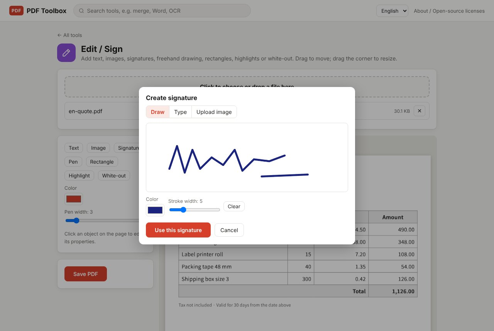
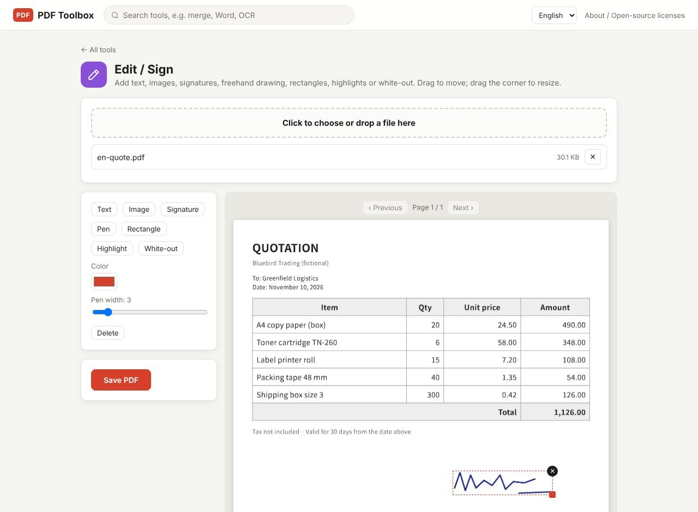

You don't need to print a PDF, sign it with a pen and scan it back just to add a signature. In PDF Toolbox's **Edit / Sign**, you create a signature, drop it where it belongs and save. The document never leaves your computer, so it's fine for paperwork with personal details.

> **What you need**: [download the latest PDF Toolbox](https://github.com/toolboxnotes/pdf-toolbox/releases/latest) (free, Windows and Mac). For first-launch steps, see "Download and install" in the [PDF Toolbox introduction](../offline-pdf-toolbox/).

## Three ways to create a signature

*The "Draw" tab of the Create signature dialog. Sign with a mouse or touchpad.*

Open the PDF in **Edit / Sign** and click **Signature** to open the **Create signature** dialog. It has three tabs.

| Tab | How | Use it when |
|---|---|---|
| Draw | Sign with a mouse, touchpad or pen tablet. Adjust **Stroke width**, and **Clear** to start over | You want your usual signature |
| Type | Enter your name under **Type your name** and pick a **Font** (English script and others) | Drawing with a mouse is awkward, or you want a tidy signature |
| Upload image | Use a photo of a signature on paper, or a stamp image | You already have a signature image. **A transparent PNG works best** |

When it looks right, click **Use this signature**.

## Sign a PDF step by step

*A signature placed at the bottom of a fictional quote. The selected signature shows a dashed border, a resize corner and an ✕ button.*

1. **Drop the PDF on PDF Toolbox and choose Edit / Sign.**
2. **Go to the page you need to sign.** Use Previous / Next above the preview; the signature is added to the page you're viewing.
3. **Create the signature and click Use this signature.** It appears near the middle of the page.
4. **Drag it onto the signature line.** Drag the bottom-right corner to resize. To remove it, click ✕, the **Delete** button on the left, or press the Delete key.
5. **Add the date or your name if needed.** Click **Text**, edit the words on the left, and move it into place.
6. **Click Save PDF.** It's saved as `name_edited.pdf`, and the original is left untouched.

## More than signatures

The same screen covers the other marks paperwork usually needs:

- **Text**: dates, names, check marks (✓)
- **Image**: company stamps or logos
- **Pen**: circle or underline by hand
- **Rectangle / Highlight**: mark what matters
- **White-out**: cover a mistake with white

If the PDF has fillable fields, the **Fill form** tool, which types straight into the fields, is easier.

## Important to know

- **This is a signature placed as an image.** It is not a certificate-based digital signature with identity checks or tamper detection. If the other party requires a specific e-signature service, use that. This is for everyday "please sign and send back the PDF" situations: consent forms, quote approvals, internal paperwork.
- **White-out doesn't delete text.** It's hidden, but still in the file and can be copied. To truly remove personal details, use [Redact PDF](../redact-pdf-permanently/).
- **Want the signature locked in place?** Run the saved PDF through **Flatten to image PDF** and the signature and content merge into one image per page. Text is no longer selectable, though.

## FAQ

### I need to sign several pages.

Move to each page and click **Signature** again. One save keeps the signatures on every page.

### My signature shows a white box behind it.

A photo of a signature on white paper includes the paper. Use a transparent PNG, or create a new one with "Draw".

### The contract is password protected.

[Unlock it](../pdf-password-protect-unlock/) first, sign it, and protect it again if needed.

### The signed PDF is too big.

Shrink it with [Compress PDF](../compress-pdf-offline/).

## Related posts

- [How to redact a PDF so the text is really gone](../redact-pdf-permanently/)
- [How to password protect or unlock a PDF offline](../pdf-password-protect-unlock/)
- [PDF to JPG and JPG to PDF](../pdf-to-jpg-and-jpg-to-pdf/)
- [PDF Toolbox: free offline PDF converter for Windows and Mac](../offline-pdf-toolbox/)
