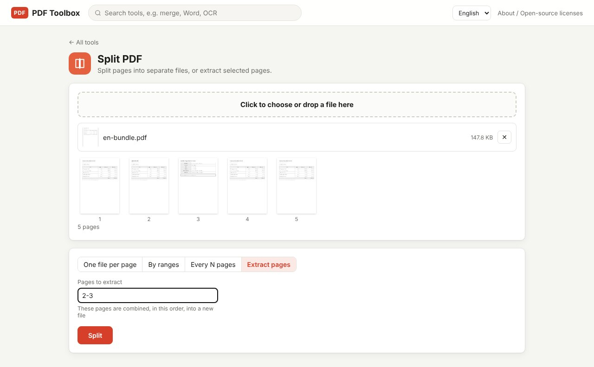

Often you only need to send part of a PDF: the signature page of a 50-page contract, or one customer's statements out of a month-long bundle. PDF Toolbox's **Split PDF** offers four modes: one file per page, split by ranges, every N pages, and extract selected pages. The file is processed on your computer only.

> **What you need**: [download the latest PDF Toolbox](https://github.com/toolboxnotes/pdf-toolbox/releases/latest) (free, Windows and Mac). For first-launch steps, see "Download and install" in the [PDF Toolbox introduction](../offline-pdf-toolbox/).

## Four ways to split

| Mode | What it does | Files you get | Use it when |
|---|---|---|---|
| One file per page | Every page on its own | One per page | Separating a stack of scanned receipts |
| By ranges | One file per range you enter | One per range | Pages 1–3 are a contract, 4–6 a quote, and so on |
| Every N pages | Cuts every N pages | Total ÷ N | A file of two-page statements joined end to end |
| Extract pages | The pages you pick, in order, in one new file | One | Sending just the signature or summary page |

## Split a PDF step by step

*A fictional five-page bundle. Looking at the thumbnails, `2-3` is entered under "Extract pages".*

1. **Drop the PDF on PDF Toolbox and choose Split PDF.** Every page is shown as a numbered thumbnail, so you can see what's on which page.
2. **Pick a mode:** One file per page, By ranges, Every N pages, or Extract pages.
3. **Enter the ranges or page count.**
   - By ranges: `1-3, 4-6, 7-` (`7-` means page 7 to the end)
   - Every N pages: pages per file (e.g. `2`)
   - Extract pages: `1, 3, 5-8` (pages go into the new file in the order you type them)
4. **Click Split.**

## Output file names

- **Extract pages** saves one file named `name_extracted.pdf`.
- **The other modes** create files with page numbers in the name, such as `name_1.pdf` and `name_2-3.pdf`, packed into `name_split.zip`. Unzip it to get the files.

With page numbers in the names, you always know which part each file came from.

## Writing page ranges

| You type | It means |
|---|---|
| `3` | Page 3 only |
| `2-5` | Pages 2 through 5 |
| `1, 3, 5` | Pages 1, 3 and 5 |
| `7-` | Page 7 to the last page |
| `5, 1-2` | (Extract pages) page 5 first, then pages 1–2 |

Spaces after commas are optional. Extract pages keeps the order you type, so you can also use it to reorder pages.

## Good to know

- **The original is never changed.** Results are always saved as new files.
- **Quality is unchanged.** Pages are copied as they are, not turned into images, so text stays selectable and searchable.
- **Bookmarks are not carried into the output files.**
- **Password-protected PDFs** need [Unlock PDF](../pdf-password-protect-unlock/) first.

## FAQ

### Can I put the pieces back together?

Yes, with [Merge PDF](../merge-pdf-offline/), in whatever order you like.

### I just want to delete a few pages.

If only a few pages go, the **Organize pages** tool is quicker: delete them from the thumbnails. If only a few pages stay, use "Extract pages".

### I'm splitting because the file is too big to email.

Try [compressing the PDF](../compress-pdf-offline/) first. Often the whole file then fits in one email.

### Can I split several PDFs at once?

Split PDF works on one file at a time.

## Related posts

- [How to merge PDF files offline](../merge-pdf-offline/)
- [How to compress a PDF offline](../compress-pdf-offline/)
- [How to redact a PDF so the text is really gone](../redact-pdf-permanently/)
- [PDF Toolbox: free offline PDF converter for Windows and Mac](../offline-pdf-toolbox/)
