FBA로 판매하다 보면 재고 숫자가 조금씩 맞지 않는 날이 있습니다. 입고한 수량보다 적게 잡히거나, 어제 있던 재고가 ‘분실’로 빠지거나, 환불은 됐는데 반품 상품이 돌아오지 않기도 하죠.

대부분은 아마존이 알아서 보상해 주지만, 빠지는 건도 있고 기한이 지나면 받을 수 없습니다. 이 글에서는 제 셀러센트럴 계정의 실제 화면으로 다음 순서를 따라가 봅니다.

1. 어디서 얼마나 사라졌는지 확인하기
2. 이미 보상됐는지, 다시 발견됐는지 확인하기
3. 빠진 건만 골라 보상 신청하기
4. 보상금과 재고 회수 여부 최종 확인하기

> 이 글은 미국 셀러센트럴(한국어 화면) 기준입니다. 화면의 SKU·ASIN·FNSKU·주문 번호·상품명은 가렸습니다.

## 먼저 알아둘 것: 어디서 사라졌는지에 따라 기한이 다르다

아마존 도움말의 FBA 재고 보상 정책은 재고가 사라진 위치를 네 가지로 나누고, 위치마다 신청 기한과 방법이 다릅니다.

| 사라진 위치 | 신청 기한 | 신청 방법 |
|---|---|---|
| 아마존으로 보내는 배송(입고) | 배송 확인일로부터 9개월 이내, 배송 화면에 ‘조사에 적합’으로 표시된 뒤 | 배송 → 해당 배송의 **내용물** 탭 |
| 주문 처리 센터(창고) 운영 | 분실·손상으로 보고된 날로부터 **60일 이내** | 재고 결함 및 보상 포털, 또는 도움말의 FNSKU·거래 ID 도구 |
| FBA 고객 반품 | 환불·교환 후 60일부터 120일 사이 | 도움말 도구에 고객 주문 ID 입력 |
| 재고 처분(Removal) | 정책 페이지 확인 | 도움말 도구에 재고 처분 주문 ID 입력 |

창고 분실·손상의 기한은 예전에는 18개월이었지만 지금은 60일입니다. 한 달에 한 번은 확인해야 놓치지 않습니다 ([주문 처리 센터 운영 클레임 도움말](https://sellercentral.amazon.com/help/hub/reference/external/GGEV4254LJJ9BAEG)).

보상 금액도 알아두세요. 고객 주문 전에 사라진 재고는 판매가가 아니라 **소싱 비용(매입 원가)** 기준으로 보상합니다. 상품당 최대 5,000달러입니다 ([FBA 재고 보상 정책](https://sellercentral.amazon.com/help/hub/reference/external/G200213130)).

## 1단계: ‘재고 결함 및 보상’ 포털에서 전체 상황 보기

가장 먼저 볼 곳은 **재고 결함 및 보상** 포털입니다. FBA 대시보드 상단 메뉴의 **재고 → 재고 결함 및 보상**으로 들어갑니다.

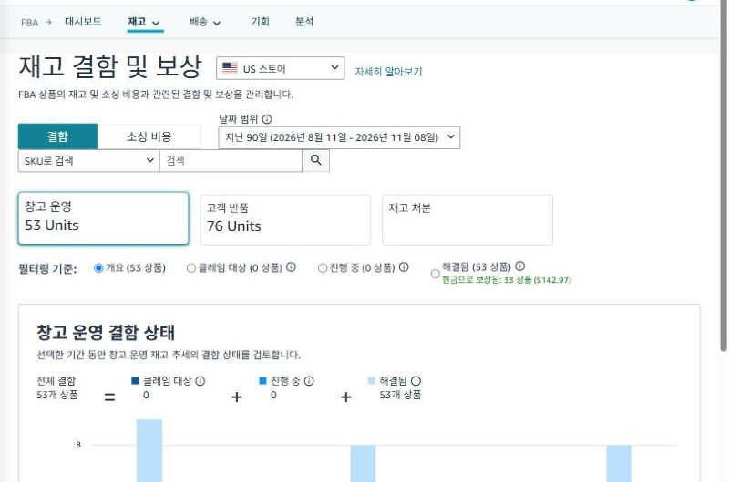

*재고 결함 및 보상 포털. 창고 운영·고객 반품·재고 처분별로 결함 수량이 나오고, 아래 필터로 상태를 고를 수 있습니다.*

화면 위쪽 카드가 사라진 위치이고, ‘필터링 기준’이 처리 상태입니다.

- **클레임 대상**: 아마존이 아직 보상하지 않아 **셀러가 직접 신청할 수 있는 건**
- **진행 중**: 아마존이 조사 중인 건
- **해결됨**: 보상·조정이 끝난 건(옆에 현금 보상 합계가 나옴)

제 계정은 최근 90일 동안 창고 운영 결함이 53개였고, 53개 모두 ‘해결됨’이었습니다. 그중 33개는 현금으로 \$142.97을 받았습니다. **클레임 대상이 0이면 따로 신청할 건이 없다**는 뜻입니다.

해결됨을 누르면 결과가 어떻게 나뉘었는지 볼 수 있습니다.

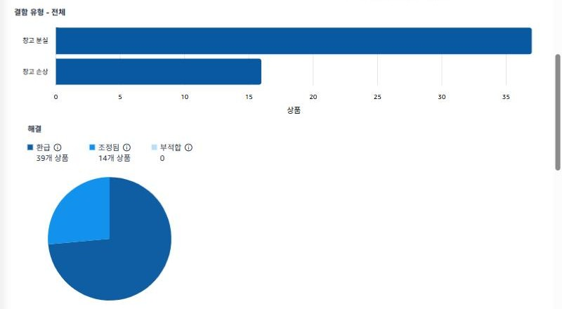

*해결된 53개 중 창고 분실이 37개, 창고 손상이 16개였습니다. 결과는 환급 39개, 조정됨 14개, 부적합 0개.*

‘조정됨’은 대부분 **나중에 재고를 찾은 경우**입니다. 이 경우에는 보상 대신 재고가 돌아옵니다.

## 2단계: 한 건씩 결과 확인하기

목록으로 내려가면 건마다 이벤트 날짜, 결함 유형, 거래 ID, 결과가 나옵니다.

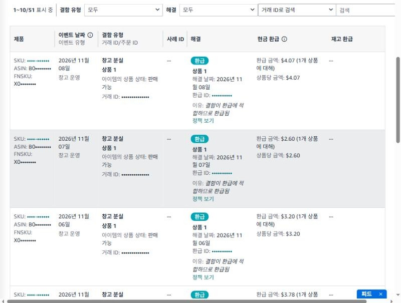

*창고 분실 건이 같은 날 ‘환급’으로 해결된 예. 환급 ID와 상품당 금액(\$4.07, \$2.60 등)이 함께 나옵니다.*

결과는 크게 세 가지입니다.

| 결과 | 의미 | 할 일 |
|---|---|---|
| 환급 + 현금 환급 | 보상금이 지급됨 | 금액이 원가와 맞는지만 확인 |
| 환급 + 재고 환급 | 돈 대신 같은 상품 1개를 재고로 채워 줌 | 재고 수량 확인 |
| 조정됨 | 나중에 발견됐거나 재평가됨 | 할 일 없음(재고가 돌아옴) |

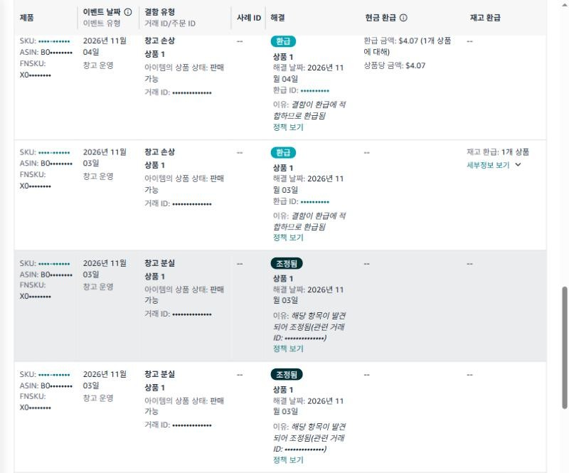

*두 번째 줄은 현금 대신 ‘재고 환급: 1개 상품’, 아래 두 줄은 ‘해당 항목이 발견되어 조정됨’입니다. 관련 거래 ID로 발견 기록을 추적할 수 있습니다.*

고객 반품 카드를 누르면 환불 후 아직 반품이 들어오지 않은 건들이 보입니다.

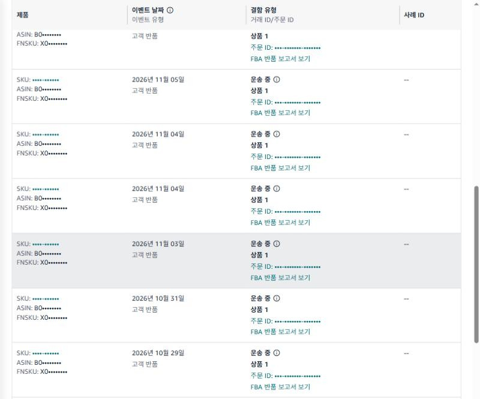

*고객 반품 결함 중 ‘진행 중’. 대부분 ‘운송 중’ 상태로, 반품이 오는 중이거나 아마존이 기다리는 중입니다.*

고객 반품은 **환불 후 60일이 지나야** 신청할 수 있습니다. 이 단계에서는 기다리면 됩니다. 60일 안에 반품이 오지 않으면 대부분 아마존이 고객에게 청구하고 셀러에게 보상합니다.

## 3단계: 재고 원장에서 분실·발견 기록 맞춰 보기

포털에 ‘클레임 대상’이 떴거나 숫자가 이상하다고 느껴지면, **재고 원장(Inventory Ledger)** 보고서로 실제 재고 이동을 확인합니다. 메뉴는 **공급망 → 공급망 보고서 → 재고 원장**입니다.

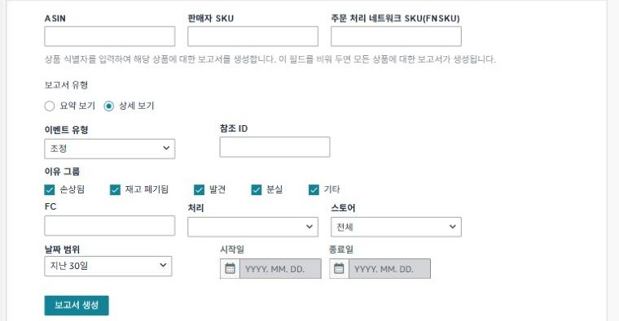

*보고서 유형은 ‘상세 보기’, 이벤트 유형은 ‘조정’을 고르면 이유 그룹(손상됨·재고 폐기됨·발견·분실·기타)으로 거를 수 있습니다.*

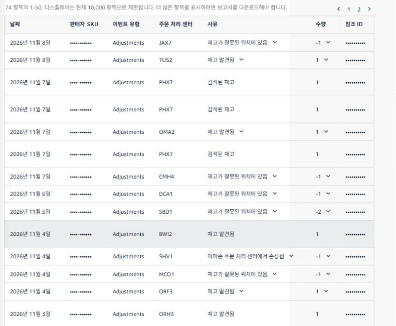

*조정 이벤트 목록. ‘재고가 잘못된 위치에 있음 -1’(분실 처리)과 ‘재고 발견됨 +1’, ‘검색된 재고 +1’이 섞여 있습니다.*

읽는 법은 간단합니다.

- **재고가 잘못된 위치에 있음 / 분실 (-)**: 창고에서 못 찾아 재고에서 뺀 것
- **재고 발견됨 / 검색된 재고 (+)**: 다시 찾아 재고에 넣은 것
- **아마존 주문 처리 센터에서 손상됨 (-)**: 창고에서 파손된 것

같은 FNSKU의 마이너스와 플러스를 맞춰 보면, **아직 돌아오지도 보상되지도 않은 수량**만 남습니다. 이 수량이 신청 대상 후보입니다. 분실로 빠진 재고는 며칠 안에 ‘발견됨’으로 돌아오는 경우가 많습니다. 그래서 정책상 신청은 보고 후 바로가 아니라 조사가 끝난 뒤에 하는 게 맞습니다.

## 4단계: 보상 보고서로 ‘이미 받은 것’ 빼기

신청하기 전에 **보상(Reimbursements)** 보고서에서 이미 받은 건을 빼야 합니다. 같은 주문 처리 보고서 화면 왼쪽 목록의 결제 항목 아래 ‘더 보기’에 있습니다.

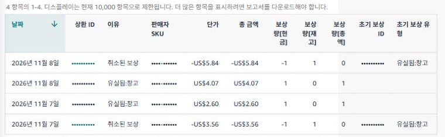

*보상 보고서. ‘유실됨:창고’로 \$4.07, \$2.60이 지급됐고, 다른 두 건은 ‘취소된 보상’으로 -\$5.84, -\$3.56이 회수되고 재고 1개가 돌아왔습니다.*

‘취소된 보상’ 줄을 보세요. 이미 보상받은 상품을 아마존이 나중에 찾으면 **보상금을 회수하고 재고를 돌려줍니다**. 보상량[현금]은 -1, 보상량[재고]는 +1입니다. 정책에도 보상된 아이템이 나중에 발견되면 보상 크레딧을 회수할 수 있다고 나와 있습니다. 그래서 보상 금액만 보지 말고, 이 회수까지 합쳐서 봐야 실제로 받은 금액이 나옵니다.

## 5단계: 소싱 비용 확인하기(보상 금액을 정하는 값)

포털의 **소싱 비용** 탭에서 상품별로 어떤 원가로 보상받는지 확인할 수 있습니다.

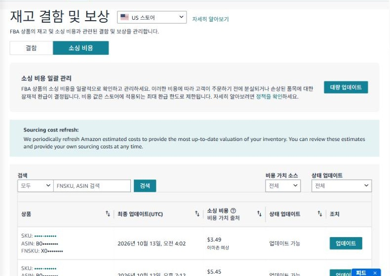

*소싱 비용 탭. ‘비용 가치 출처’가 ‘아마존 예상’이면 아마존이 추정한 원가로 보상됩니다. ‘업데이트’로 실제 원가를 입력할 수 있습니다.*

직접 입력하지 않으면 아마존이 비슷한 상품을 바탕으로 추정한 원가를 씁니다. 실제 원가가 더 높다면 인보이스 같은 증빙을 준비해 업데이트하세요. 배송비·관세는 소싱 비용에 포함되지 않습니다.

## 6단계: 빠진 건만 보상 신청하기

1~4단계를 거쳐도 남는 건이 있다면 신청합니다.

**창고 분실·손상**

- 포털의 **클레임 대상**에 뜬 건은 그 화면의 정보(거래 ID, FNSKU, 수량)로 바로 신청합니다.
- 포털에 없지만 원장으로 확인한 건은 도움말 ‘주문 처리 센터 운영에 대한 클레임’ 페이지 아래 도구를 씁니다. 손상은 **거래 ID(TRID)**, 분실은 **FNSKU**를 넣습니다. 한 번에 최대 25개까지 넣을 수 있습니다.

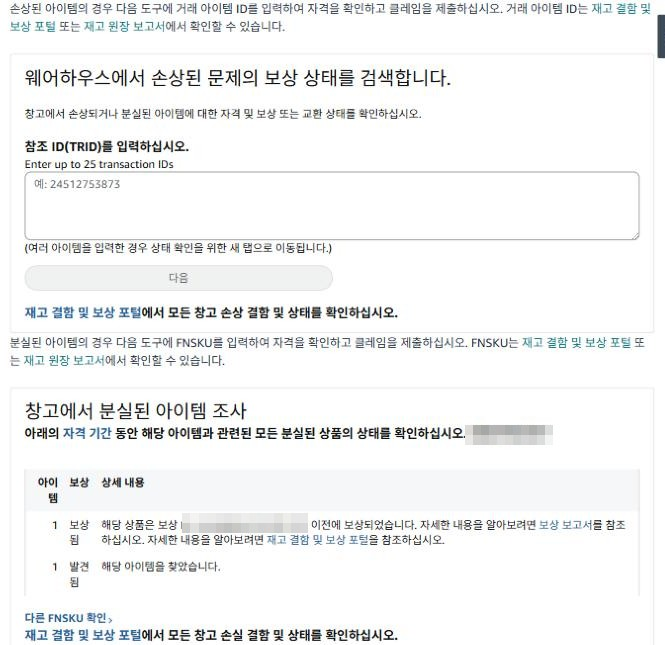

*도움말의 신청 도구. FNSKU를 넣고 ‘다음’을 누르면 그 상품의 분실 건 상태가 나옵니다. 이 예는 ‘보상됨’ 1개와 ‘발견됨’ 1개라 신청할 것이 없습니다.*

신청할 수 있는 건이면 이 도구에서 바로 신청 단계로 넘어가고, 날짜나 주문 처리 센터 ID 같은 추가 정보를 요청받을 수 있습니다.

**입고(아마존으로 보내는 배송) 수량 부족**

- **배송** 화면에서 해당 배송의 **내용물** 탭을 열면 보낸 수량과 받은 수량의 차이가 보입니다.
- 상태가 ‘조사에 적합’으로 바뀐 뒤 그 탭에서 분실 클레임을 엽니다.
- 배송 ID, 소유권 증빙(구매일·상품명·수량이 있는 인보이스), 배송 증빙(소화물은 추적 번호, LTL·FTL은 아마존 수령 도장이 있는 서류)이 필요합니다.
- **배송당 클레임은 한 번만** 됩니다. 증빙을 다 모은 뒤 한 번에 내세요.

**고객 반품 미반환**

- 환불 후 60~120일 사이에, 포털에 표시된 **고객 주문 ID**를 도움말 도구에 넣고 신청합니다.

> 아마존 정책은 충분히 조사하지 않거나, 너무 이르거나, 단기간에 대량으로 신청하는 것을 금지합니다. 반복하면 지원이 늦어지거나 계정 조치가 있을 수 있으니, 위 단계로 걸러진 건만 신청하세요.

## 7단계: 신청 후 결과 확인하기

신청한 건은 **도움말(?) → 지원 케이스 관리**에서 진행 상황과 아마존 회신을 볼 수 있습니다.

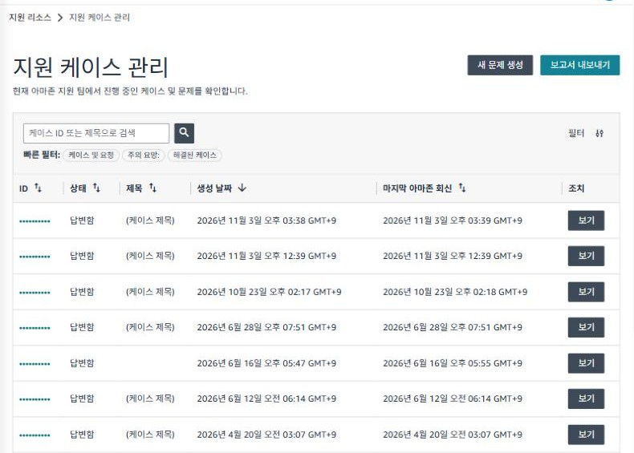

*지원 케이스 관리. 케이스 ID, 상태, 마지막 아마존 회신 날짜가 나옵니다(케이스 ID와 제목은 가림).*

결과는 세 곳에서 교차 확인합니다.

1. **재고 결함 및 보상 포털 → 해결됨**: 결과(환급·조정됨·부적합)와 금액
2. **보상 보고서**: 실제 지급된 줄, 그리고 나중에 생길 수 있는 ‘취소된 보상’
3. **재고 원장**: 같은 FNSKU에 ‘재고 발견됨’ 이벤트가 생겼는지

결정에 동의하지 않으면 해결됨 탭의 정보로 다시 클레임을 낼 수 있습니다. 보상 금액(단가)에 이의가 있으면 보상 지급 후 60일 안에 제기해야 합니다.

## 한 장으로 정리

| 확인할 것 | 어디서 |
|---|---|
| 신청할 건이 있는지 | 재고 결함 및 보상 → 클레임 대상 |
| 아마존이 조사 중인지 | 재고 결함 및 보상 → 진행 중 |
| 보상됐는지, 다시 찾았는지 | 재고 결함 및 보상 → 해결됨 |
| 실제 재고 이동(분실·발견·손상) | 공급망 보고서 → 재고 원장(상세, 조정) |
| 받은 돈과 회수된 돈 | 주문 처리 보고서 → 보상 |
| 보상 기준 원가 | 재고 결함 및 보상 → 소싱 비용 |
| 신청 진행 상황 | 도움말 → 지원 케이스 관리 |

창고 분실·손상은 60일, 고객 반품은 환불 후 120일까지입니다. **한 달에 한 번 ‘클레임 대상’ 숫자만 확인**해도 대부분 놓치지 않습니다.

## SellerMorning으로 자동 점검하기

저는 이 확인을 매일 아침 [SellerMorning](../amazon-seller-15-safe-automation/)이 대신 하도록 만들었습니다. 공식 API로 재고 원장과 보상 보고서를 받아 분실과 발견, 보상과 보상 취소를 상쇄합니다. 아직 보상되지 않은 건만 기한과 함께 ‘오늘의 요약’에 올려 줍니다. 신청은 위 6단계처럼 셀러가 직접 합니다.

SellerMorning에 관심이 있으면 [toolbox@toolboxnotes.com](mailto:toolbox@toolboxnotes.com)으로 문의해 주세요.

---

**함께 읽으면 좋은 글**

- [아마존 FBA 분실·파손 재고 보상 신청 방법과 기한 총정리](../amazon-seller-12-fba-reimbursement/) (보상 정책 요약)
- [FBA 재고, 품절도 과재고도 없게](../amazon-seller-7-fba-inventory/)
- [주문·반품 숫자에서 문제 찾기](../amazon-seller-8-orders-returns/)
- [아마존 판매 수수료와 이익 계산법](../amazon-seller-13-fees-profit/)

*이 글은 개인 경험을 바탕으로 작성되었으며, Amazon.com, Inc. 및 그 계열사와 관련이 없습니다. 정책·수수료는 작성 시점 기준이니 최신 내용은 Seller Central에서 확인하세요.*
