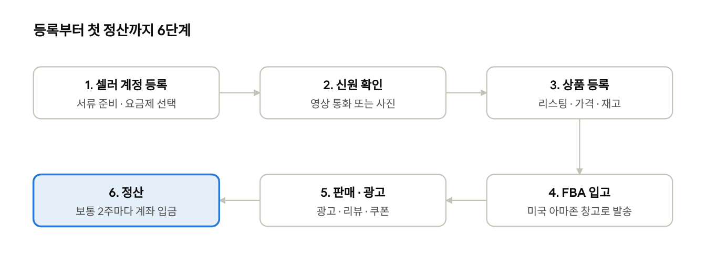
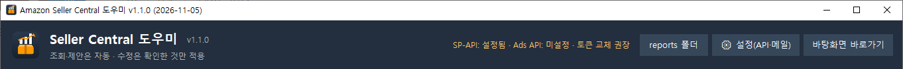

## 공장도, 창고도 없이 시작할 수 있다

아마존 셀러가 되는 데 필요한 것은 신분증, 은행 계좌, 신용카드, 그리고 팔고 싶은 상품 하나입니다. 창고는 아마존이 대신 맡아 주고(FBA), 결제와 배송, 고객 응대의 상당 부분도 아마존이 처리합니다.

그래서 지금은 회사원이 퇴근 후 부업으로, 작은 공방이 자기 브랜드로, 한국의 제조사가 미국 시장으로 직접 아마존에 상품을 올립니다. 미국 아마존(Amazon.com)은 한국에서도 계정을 만들고 판매할 수 있습니다.

이 시리즈는 5편으로 이어집니다.

1. 누구나 아마존 셀러가 될 수 있다 — 등록, 상품 등록, 판매 시작(이 글)
2. [셀러가 된 다음의 진짜 어려움](../amazon-seller-2-real-challenge/) — 모든 상품을 늘 지켜볼 수 없고, Seller Central은 복잡하다
3. [판매 데이터를 한눈에](../amazon-seller-3-sales-data/) — 재고·주문·매출 관리
4. [광고를 한눈에](../amazon-seller-4-ads/) — 광고 분석과 조치 제안
5. [리스팅을 한눈에](../amazon-seller-5-listings/) — 점검과 수정

*아마존 셀러 시작 흐름 · 6단계*

이 글은 위 흐름을 세 단계(등록 → 상품 등록 → 판매)로 묶어 설명합니다.

## 1단계: 셀러 계정 만들기

등록은 온라인으로 끝납니다. 아래 서류를 미리 준비하면 신청 자체는 1시간이면 충분하고, 심사에는 며칠이 걸립니다.

**준비물** ([아마존 공식 FAQ](https://sell.amazon.com/learn/faq))

- 정부 발급 신분증(여권 등)
- 해외 결제가 되는 신용카드
- 대금을 받을 은행 계좌
- 전화번호와 이메일
- 사업자 등록 서류(있는 경우)
- 최근 180일 이내 주소 증빙(은행·카드 명세서 등)
- 세금 정보

**요금제 고르기** ([아마존 요금 안내](https://sell.amazon.com/pricing))

| 요금제             | 비용                   | 어울리는 사람                            |
|--------------------|------------------------|------------------------------------------|
| 개인(Individual)   | 팔린 상품 1개당 \$0.99 | 한 달 40개 미만으로 시험 판매            |
| 프로(Professional) | 월 \$39.99             | 광고·브랜드 등록·보고서를 쓰는 본격 판매 |

두 요금제 모두 팔릴 때마다 카테고리별 판매 수수료(대부분 15% 안팎, 최소 \$0.30)가 붙습니다. 아마존에 처음 입점하는 브랜드는 첫해 수수료 면제 등 \$50,000이 넘는 혜택을 받을 수 있습니다.

**신원 확인**

신분증과 주소 증빙을 올린 뒤, 신분증을 든 얼굴 사진을 보내거나 아마존 담당자와 영상 통화를 합니다. 서류의 이름·주소가 신청서와 한 글자라도 다르면 반려되니, 영문 표기를 미리 통일해 두세요.

## 2단계: 상품 올리기

아마존에서 상품 하나는 ‘리스팅(listing)’ 하나입니다. 리스팅은 제목, 이미지, 불릿(핵심 특징 5줄), 설명, 검색어, 가격, 재고로 이루어집니다.

1. **상품 찾기 또는 새로 만들기** — 이미 아마존에 있는 상품이면 기존 페이지에 판매자로 붙고, 내 브랜드 상품이면 새 페이지를 만듭니다. 새 상품에는 바코드(UPC/GTIN)가 필요하고, 브랜드 등록(Brand Registry)을 하면 면제받을 수 있습니다.
2. **카테고리 고르기** — 카테고리에 따라 입력 항목과 수수료가 달라집니다. 일부 카테고리는 승인이 필요합니다.
3. **리스팅 쓰기** — 제목에는 브랜드·상품명·핵심 특징을 넣고, 고객이 실제로 검색하는 단어를 불릿과 검색어에 담습니다. 첫 이미지는 흰 배경의 상품 사진이어야 합니다.
4. **가격과 재고 입력** — 수수료·배송비·광고비를 뺀 뒤에도 남는 가격인지 [FBA 수익 계산기](https://sell.amazon.com/blog/how-to-use-fba-calculator)로 확인합니다.
5. **배송 방식 고르기** — 아래 두 가지 중 하나입니다.

| 방식                       | 누가 보관·배송 | 장점                                             | 부담                                             |
|----------------------------|----------------|--------------------------------------------------|--------------------------------------------------|
| FBA(Fulfillment by Amazon) | 아마존 창고    | 프라임 배지, 배송·반품·고객 응대를 아마존이 처리 | 보관료·배송 수수료, 재고를 미국 창고로 보내야 함 |
| FBM(셀러 직접 배송)        | 셀러           | 보관료 없음, 재고를 직접 통제                    | 배송 기한과 고객 응대를 셀러가 지켜야 함         |

해외에서 미국으로 파는 셀러는 대부분 FBA를 씁니다. 한국에서 매번 국제 배송을 하면 배송 기한을 지키기 어렵기 때문입니다.

## 3단계: 팔기 시작

FBA라면 주문이 들어오고 돈이 들어오기까지 셀러가 손댈 일은 거의 없습니다. 고객이 주문하면 아마존 창고에서 출고되고, 수수료를 뺀 대금이 보통 2주마다 등록한 계좌로 들어옵니다.

하지만 첫 주문은 저절로 오지 않습니다. 새 상품은 리뷰도 판매 기록도 없어서 검색 결과 뒤쪽에 나오기 때문입니다. 그래서 대부분의 셀러는 이렇게 시작합니다.

- **스폰서 광고** — 검색 결과 위쪽에 내 상품을 띄웁니다. 처음에는 자동 타깃팅 캠페인으로 어떤 검색어에서 팔리는지 알아냅니다.
- **리뷰** — 구매 후 리뷰 요청, 신제품 리뷰 프로그램(Vine)을 씁니다.
- **프로모션과 쿠폰** — 초기 판매량을 만들어 검색 순위를 올립니다.

여기까지 오면 여러분도 아마존 셀러입니다. 그런데 상품이 10개, 50개로 늘어나면 새로운 문제가 생깁니다. 다음 글에서는 셀러가 된 뒤 누구나 부딪히는 관리의 어려움을 이야기합니다.

3편부터는 이 관리 일을 대신하도록 저희가 직접 만들어 쓰고 있는 프로그램, **Seller Central 도우미**를 소개합니다. 조회와 제안은 자동으로 하고, 수정은 셀러가 확인한 것만 적용하는 것이 원칙입니다.

*Seller Central 도우미의 상단 화면. 아마존 공식 API 연결 상태와 설정 메뉴가 보입니다.*

---

**아마존 셀러 시리즈**

1. **누구나 아마존 셀러가 될 수 있다** — 등록, 상품 등록, 판매 시작 (이 글)
2. [셀러가 된 다음의 진짜 어려움](../amazon-seller-2-real-challenge/) — 모든 상품을 늘 지켜볼 수 없고, Seller Central은 복잡하다
3. [판매 데이터를 한눈에](../amazon-seller-3-sales-data/) — 재고·주문·매출 관리
4. [광고를 한눈에](../amazon-seller-4-ads/) — 광고 분석과 조치 제안
5. [리스팅을 한눈에](../amazon-seller-5-listings/) — 점검과 수정
