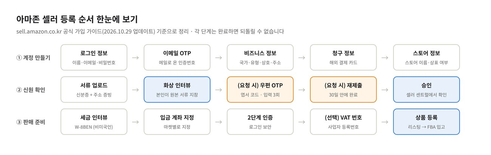
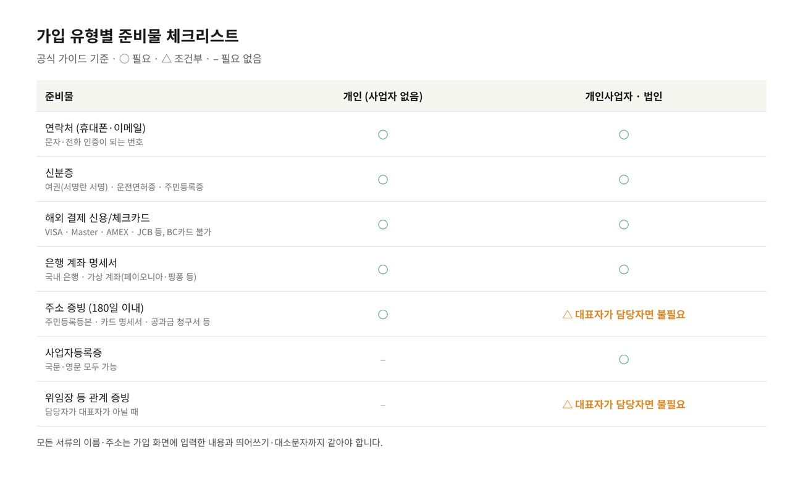
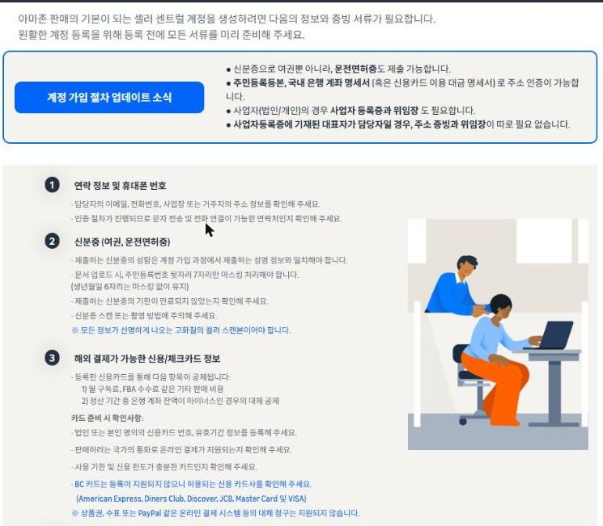
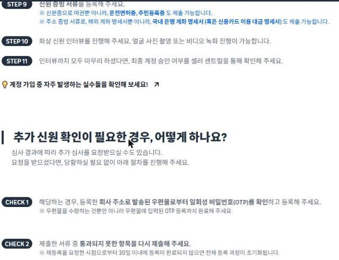
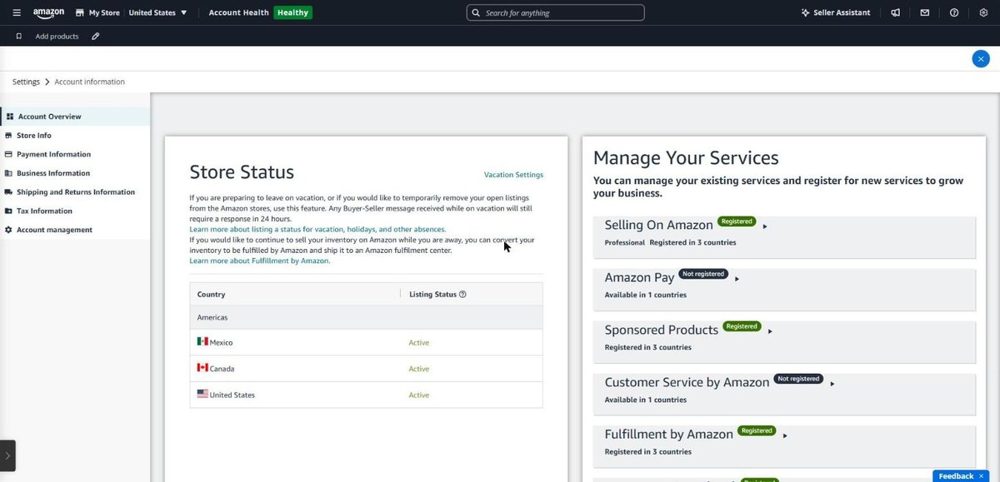

아마존 셀러 등록은 한국에서도 온라인으로 끝납니다. 미국 법인이 없어도, 사업자등록증이 없는 개인이어도 가입할 수 있습니다. 필요한 것은 **신분증, 해외 결제가 되는 카드, 은행 계좌 명세서, 주소 증빙 서류**이고, 서류만 미리 준비하면 신청은 한두 시간, 화상 인터뷰와 심사까지 보통 며칠이면 끝납니다.

이 글은 아마존이 한국 셀러용으로 운영하는 공식 사이트 [sell.amazon.co.kr](https://sell.amazon.co.kr/start/registration)(2026년 10월 29일 업데이트 기준)과 미국 [sell.amazon.com](https://sell.amazon.com/pricing), 영국 아마존의 [미국 판매 등록 가이드](https://sell.amazon.co.uk/global-selling/registration-guide)를 바탕으로, 한국에서 처음 가입하는 분이 막히는 지점을 중심으로 정리했습니다. 아마존 셀러 시리즈의 1편입니다.

> **먼저 알아둘 것**: 가입 단계는 하나를 끝낼 때마다 **되돌릴 수 없습니다.** 사업 국가나 사업자 유형을 잘못 고르면 다른 이메일로 처음부터 다시 가입해야 하니, 아래 준비물을 다 모은 뒤 시작하세요.

## 한국에서 아마존 셀러가 될 수 있나요?

됩니다. 아마존은 '글로벌 셀링'이라는 이름으로 해외 판매자를 받고 있고, 한국 셀러를 위한 전담 사이트와 팀이 있습니다. 미국 sell.amazon.com도 "미국 밖의 사업체는 미국 법인을 만들지 않아도 될 수 있다"고 안내합니다.

알아두면 좋은 점은 다음과 같습니다.

- **계정 하나로 여러 나라**: 셀러 센트럴 계정은 '글로벌 통합 계정'으로 만들어집니다. 북미 계정을 활성화하면 미국·캐나다·멕시코 판매가 함께 열리고, 유럽·일본 등은 나중에 추가 정보만 내면 됩니다(인도는 별도 계정).
- **사업자등록증이 없어도 가입 가능**: 순수 개인도 '개인(Individual)'으로 가입할 수 있습니다. 다만 수익이 생기면 한국 세금 신고는 따로 챙겨야 합니다(아래 '세금' 참고).
- **대표자가 아니어도 됨**: 법인 계정도 담당자 명의로 가입할 수 있습니다. 다만 서류에 적힌 사람, 가입 정보의 사람, 화상 인터뷰를 하는 사람이 모두 같아야 합니다.
- **한국어 지원**: 공식 사이트, 가입 매뉴얼 PDF, 안내 영상, 아마존이 운영하는 네이버 공식 카페(셀러 커뮤니티)가 모두 한국어로 되어 있습니다.

*공식 가이드의 가입 단계를 세 줄로 정리했습니다. 주황색은 아마존이 요청할 때만 하는 단계입니다.*

## 가입 전 준비물: 개인과 사업자가 다릅니다

*공식 가이드를 바탕으로 만든 체크리스트. 사업자등록증에 적힌 대표자가 직접 가입하면 주소 증빙과 위임장이 필요 없습니다.*

### 1. 연락처

휴대폰 번호와 이메일. 가입 중에 문자와 전화 인증이 있으니 실제로 받을 수 있는 번호여야 합니다. 이메일은 앞으로 계정의 아이디가 되므로 오래 쓸 주소를 고르고, 아마존 메일이 스팸함으로 가지 않는지 확인해 두세요.

### 2. 신분증

**여권, 운전면허증, 주민등록증** 모두 됩니다.

- 이름이 가입 화면에 입력하는 이름과 같아야 합니다(여권이면 영문 이름 그대로).
- 여권은 **서명란에 서명이 된 상태**로 스캔해야 합니다. 서명은 한글이어도 영문이어도 상관없지만, 빈 서명란은 공식 사이트가 꼽은 대표적인 반려 사유입니다.
- 주민등록번호가 보이는 서류는 **뒷자리 7자리만 가리고**, 생년월일 6자리는 그대로 둡니다.
- 흑백 복사본이나 흐린 사진이 아니라 **선명한 컬러 스캔본**이어야 합니다. 만료된 신분증은 안 됩니다.

### 3. 해외 결제가 되는 신용/체크카드

월 구독료와 FBA 수수료 같은 비용, 그리고 정산 잔액이 마이너스일 때의 대체 공제가 이 카드로 나갑니다.

- VISA, Master, American Express, JCB, Diners Club, Discover만 됩니다. **BC카드는 등록되지 않습니다.**
- 본인 또는 법인 명의, 달러 결제가 되고 한도가 넉넉한 카드를 쓰세요.
- 상품권, 수표, PayPal 같은 다른 결제 수단은 받지 않습니다.

### 4. 은행 계좌 명세서

공식 사이트 기준으로 주소 확인용으로도, 나중에 판매 대금을 받는 계좌로도 쓰입니다. 다음 중 하나면 됩니다.

- 국내 은행 계좌 명세서
- 신용카드 이용 대금 명세서
- 해외 현지 계좌나 **가상 계좌** 명세서(페이오니아, 핑퐁 같은 외부 서비스에서 발급)

명세서의 계좌번호와 금액은 가려도 되지만, **이름과 주소는 가입 정보와 띄어쓰기·대소문자까지 같아야** 합니다. 최근 180일 안에 발행된 것이어야 하고, 잘라내거나 고친 흔적이 없는 원본 PDF가 안전합니다.

### 5. 주소 증빙(최근 180일 이내)

입력한 주소를 증명하는 서류입니다. 주민등록등본, 주소가 나온 은행·카드 명세서, 전화·수도·가스·전기·인터넷 요금 청구서, 임대차 계약서, 임대료 영수증 등이 인정됩니다. 공식 가이드에 따르면 사업자등록증에 적힌 대표자가 직접 가입하는 경우에는 따로 필요하지 않습니다.

### 6. 사업자등록증(개인사업자·법인만)

국문도 영문도 됩니다. 상호와 사업장 주소를 확인하는 용도이므로 가입 화면에 입력하는 사업장 주소와 같아야 합니다.

### 7. 위임장 등(대표자가 아닌 담당자가 가입할 때만)

담당자와 회사의 관계를 증명하는 서류입니다. 위임장 말고도 주주명부, 급여명세서, 고용계약서, 담당자 이름이 들어간 요금 청구서가 인정됩니다.

*아마존 한국 공식 사이트의 '서류 준비' 안내. 최신 변경 사항(운전면허증 허용, 주민등록등본·국내 은행 명세서로 주소 인증 가능)이 맨 위에 정리되어 있습니다. 출처: sell.amazon.co.kr*

### 영문 주소, 미리 하나로 정해 두세요

가입 반려의 가장 흔한 원인은 서류끼리, 혹은 서류와 입력값이 **한 글자라도 다른 것**입니다. 한국 주소는 영문 표기가 여러 가지라 특히 자주 걸립니다.

- 은행·카드 명세서에 찍힌 영문 주소가 있다면 그 표기를 그대로 씁니다.
- 없다면 도로명주소 영문 표기 하나를 정해 은행 명세서, 카드, 셀러 센트럴에 똑같이 맞춥니다.
- 이름도 여권 영문 이름 그대로(성과 이름 순서, 띄어쓰기 포함) 입력합니다.

## 요금제와 비용: 가입만으로는 매달 나가지 않습니다

| 요금제 | 월 비용 | 판매 건당 | 이럴 때 |
|---|---|---|---|
| 개인(Individual) | 없음 | \$0.99 | 한 달 40개 미만 시험 판매 |
| 프로페셔널(Professional) | \$39.99 | 없음 | 광고, 브랜드 등록, 보고서를 쓰는 본격 판매 |

*출처: [sell.amazon.com 판매 비용](https://sell.amazon.com/pricing)*

여기에 판매될 때마다 **카테고리별 판매 수수료**(대부분 15% 안팎, 대개 최소 \$0.30)가 붙고, FBA를 쓰면 배송·보관 수수료가 따로 듭니다.

한국 공식 사이트가 정리한 비용 관련 사실 중 처음 가입하는 분이 알아두면 좋은 것:

- 가입을 마치면 기본적으로 **프로페셔널 플랜**이 되고 첫 달 구독료(\$39.99, VAT 제외)가 청구됩니다. **둘째 달부터는 활성 리스팅이 없으면 청구되지 않습니다.**
- 북미·유럽·일본 계정을 모두 합쳐도 월 구독료는 최대 \$39.99이고, 마켓별 활성 리스팅 비율대로 나눠 청구됩니다. 카드사 해외 결제 수수료는 별도입니다.
- 개인사업자·법인은 가입 후 사업자등록번호를 등록하면 구독료에서 VAT를 뺀 금액만 냅니다.

### 신규 셀러 혜택

아마존은 처음 입점하는 프로페셔널 셀러에게 여러 크레딧을 줍니다. 미국 기준 주요 항목은 다음과 같습니다([sell.amazon.com/grow](https://sell.amazon.com/grow) 기준, 조건은 수시로 바뀝니다).

| 혜택 | 내용 | 조건 |
|---|---|---|
| 브랜드 등록 보너스 | 브랜드 매출 첫 \$50,000의 10%, 다음 \$950,000의 5% 환급 | 첫 리스팅 후 6개월 안에 브랜드 레지스트리 등록 |
| Vine 크레딧 | \$200 | 브랜드 등록 후 90일 안에 Vine 등록 |
| FBA 신규 상품 | 보관료·반품 처리 등 무료 | 리스팅 후 90일 안에 FBA 입고 |
| FBA 입고 배치 크레딧 | \$400 | 리스팅 후 90일 안에 발송 |
| 스폰서 광고 크레딧 | 광고비 \$50/\$200/\$1,000 쓰면 같은 금액 크레딧 | 리스팅 후 90일 안에 캠페인 시작 |
| 쿠폰 크레딧 | \$50 | 리스팅 후 90일 안에 쿠폰 생성 |

대부분 **"첫 리스팅 후 90일"** 이 기준이라, 상품을 올리기 전에 상표·광고·FBA 입고 계획까지 세워 두면 혜택을 훨씬 많이 받습니다.

## 가입 절차 11단계

공식 사이트의 단계를 그대로 따라가되, 각 단계에서 한국 셀러가 주의할 점을 붙였습니다.

**STEP 1~3. 계정 만들기**
sell.amazon.co.kr 상단의 '판매 시작'을 눌러 셀러 센트럴에 들어간 뒤 'Create your Amazon account'를 누릅니다. 이름, 이메일, 비밀번호를 입력하고, 메일로 온 일회용 비밀번호(OTP)를 넣으면 계정이 생깁니다.

> 아마존 쇼핑 계정과 같은 이메일을 써도 되지만, 회사로 운영할 계획이라면 판매 전용 이메일을 새로 만드는 편이 관리하기 편합니다.

**STEP 4. 준비물 확인**
여기서부터는 위의 서류가 필요합니다. 모두 파일로(png, jpg, pdf) 준비됐는지 확인하세요.

**STEP 5~6. 비즈니스 정보**
- **사업 소재지**: 대한민국
- **사업자 유형**: 법인, 개인사업자(Sole Proprietor), 개인(Individual) 등에서 고릅니다. 사업자등록증에 맞춰 고르세요.
- 상호, 사업장 주소, 사업자등록번호, 담당자 정보(신분증과 같은 이름)를 입력합니다.
- 담당자가 실소유자(beneficial owner)인지, 법적 대표인지 묻는 질문이 나옵니다.

> 이 단계의 국가·유형은 나중에 바꿀 수 없습니다. 잘못 고르면 새 이메일로 다시 가입해야 합니다.

**STEP 7. 청구 정보(카드)**
위에서 준비한 해외 결제 카드를 등록합니다. 카드 명의자는 가입자와 달라도 되지만, 카드사에 등록된 청구 주소와 입력한 주소가 같아야 합니다.

**STEP 8. 스토어 정보**
스토어 이름(구매자에게 보이는 판매자 이름, 나중에 바꿀 수 있음)과 판매할 상품에 대한 질문, 상표를 가진 브랜드 소유자인지를 입력합니다. 내 브랜드 상품이면 UPC/GTIN 바코드나 브랜드 레지스트리 계획도 이때 생각해 두세요.

**STEP 9. 신원 증빙 서류 업로드**
신분증과 주소 증빙(은행·카드 명세서 등)을 올립니다. 같은 잘못된 서류를 여러 번 다시 올리면 심사가 실패할 수 있으니, 반려되면 이유를 읽고 서류를 바꿔서 내세요.

**STEP 10. 화상 신원 인터뷰**
아마존 담당자와 영상 통화를 하거나, 얼굴 사진·영상을 촬영합니다.

- 가입한 **본인**이 업로드한 신분증 **원본**을 들고 참여합니다.
- 바로 들어가거나 예약할 수 있습니다. 예약은 영업일 기준 며칠 뒤로 잡힐 수 있으니 미루지 마세요.
- 조용한 곳에서 카메라·마이크가 되는 PC나 휴대폰으로, Chrome이나 Safari를 권장합니다. 통화 언어를 고를 수 있고 통역을 동반할 수 있습니다.
- 통화가 끝나면 아마존이 영업일 2일 안에 추가 확인을 요청할 수 있습니다.

**STEP 11. 승인 확인**
셀러 센트럴에서 최종 승인 여부를 확인합니다.

*공식 가이드의 STEP 9~11과 '추가 신원 확인' 안내. 출처: sell.amazon.co.kr*

### 추가 확인을 요청받았다면

심사 결과에 따라 두 가지를 더 요청받을 수 있습니다.

1. **우편 OTP**: 등록한 주소로 코드가 적힌 엽서가 옵니다. 받기만 하면 안 되고 셀러 센트럴에 **코드를 입력해야** 끝납니다. 입력 기회는 3번이고, 모두 틀리면 계정을 다시 만들어야 할 수 있습니다. 배송 추적은 셀러 센트럴에서 됩니다. 이 기간에는 주소를 바꿀 수 없습니다.
2. **서류 재제출**: 통과되지 못한 서류만 다시 냅니다. **요청받은 날부터 30일 안에** 마치지 않으면 전체 가입 과정이 초기화됩니다.

## 승인 뒤에 꼭 해야 할 4가지

승인 메일을 받았다고 바로 팔 수 있는 것은 아닙니다. 아래를 끝내지 않으면 상품을 올려도 **구매자에게 보이지 않습니다.**

*셀러 센트럴 '계정 정보' 화면(필자 계정, 스토어 이름은 가렸습니다). 북미 통합 계정이라 미국·캐나다·멕시코가 함께 활성화되어 있고, 왼쪽 메뉴에서 결제 정보·세금 정보를 설정합니다.*

### 1. 세금 정보와 세금 인터뷰

미국에서 판매 대금을 받으려면 미국 국세청(IRS) 규정에 따라 **세금 인터뷰**를 해야 합니다. 셀러 센트럴의 계정 정보 → 세금 정보에서 질문에 답하면, 미국인이 아닌 개인은 보통 W-8BEN, 해외 법인은 W-8BEN-E 양식이 자동으로 만들어지고 전자 서명으로 제출합니다. 제출 후 '검증 대기' 상태가 되었다가 정보가 맞으면 완료됩니다.

미국 각 주의 판매세(sales tax)는 대부분 아마존이 구매자에게 받아 대신 납부합니다. 한국 쪽 세금(부가세, 종합소득세·법인세)은 별개이니 아래 '세금' 항목을 참고하세요.

### 2. 판매 대금 입금 계좌 지정

계정 정보 → 결제 정보 → **입금 방법**에서 계좌를 등록하고, 판매할 마켓플레이스(미국 등)에 **지정**해야 합니다. 방법은 두 가지입니다.

| 방법 | 어떻게 | 비용 |
|---|---|---|
| 아마존 통화 변환 서비스(ACCS) | 국내 은행 계좌를 등록하면 달러 매출을 원화로 바꿔 입금 | 원화(KRW)는 일률 1.5%, 보통 영업일 1~5일 |
| 가상 계좌 서비스 | 페이오니아·핑퐁 등에서 미국 계좌를 받아 등록, 달러로 받은 뒤 원하는 때 환전 | 서비스별 수수료 확인 |

*출처: [아마존 통화 변환 서비스](https://sell.amazon.com/programs/amazon-currency-converter), sell.amazon.co.kr*

입금 계좌는 본인 또는 사업자 명의여야 합니다. 정산은 보통 2주마다 이뤄집니다.

### 3. 2단계 인증

로그인할 때 휴대폰 인증이나 인증 앱 코드를 함께 받도록 설정합니다. 계정 탈취는 셀러에게 가장 치명적인 사고이니 OTP 앱으로 설정해 두는 것을 권합니다.

### 4. VAT(사업자등록번호) 등록과 언어 설정

개인사업자·법인이라면 사업자등록번호를 등록해 구독료의 VAT를 빼세요. 셀러 센트럴 화면은 한국어로도 볼 수 있어서, 처음에는 한국어로 메뉴를 익히고 나중에 영어 메뉴명을 같이 익히면 해외 자료를 찾을 때 편합니다.

## 반려를 부르는 실수 Top 7

공식 사이트가 꼽은 실수와, 공식 가이드의 주의 사항을 모았습니다.

1. **여권 서명란이 비어 있음**: 서명한 뒤 컬러로 스캔하세요.
2. **주소 증빙이 없거나 오래됨**: 180일 이내 발행본이어야 합니다. 화면 캡처본, 잘린 명세서, 만료된 서류는 거의 반려됩니다.
3. **이름·주소가 서류와 다름**: 띄어쓰기, 대소문자, 동·호수 표기까지 맞추세요.
4. **사업 국가·유형을 잘못 고름**: 되돌릴 수 없어 새 이메일로 다시 가입해야 합니다.
5. **BC카드나 해외 결제 안 되는 카드 등록**: 카드 단계에서 막힙니다.
6. **화상 인터뷰를 다른 사람이 진행**: 서류와 가입 정보의 사람이 직접 해야 합니다.
7. **우편 OTP를 받고 입력하지 않음 / 재제출 30일 넘김**: 처음부터 다시 해야 합니다.

하나 더: **같은 사람이 계정을 여러 개 만들지 마세요.** 아마존은 정당한 사유 없이 한 판매자가 여러 계정을 운영하는 것을 허용하지 않습니다. 가입이 꼬였다면 새 계정을 만들기 전에 셀러 서포트에 먼저 문의하세요.

## 가입 후 첫 판매까지

### 상품 올리기

아마존에서 상품 하나는 '리스팅' 하나입니다. 제목, 이미지, 불릿(핵심 특징 5줄), 설명, 검색어, 가격, 재고로 이루어집니다.

1. **기존 상품에 붙을지, 새로 만들지**: 이미 아마존에 있는 상품이면 기존 페이지에 판매자로 붙고, 내 브랜드면 새 페이지를 만듭니다. 새 상품에는 UPC/GTIN 바코드가 필요하고, 브랜드 레지스트리를 하면 면제받을 수 있습니다.
2. **카테고리 확인**: 카테고리마다 입력 항목과 수수료가 다르고, 일부(식품, 화장품 일부, 의료기기 등)는 승인이나 추가 서류가 필요합니다. 미국 규정(FDA, FCC 등)도 미리 확인하세요.
3. **이익 계산**: 판매 수수료, FBA 수수료, 배송비, 광고비를 뺀 뒤에도 남는지 확인합니다. 계산 방법은 [13편 수수료와 이익 계산](../amazon-seller-13-fees-profit/)에 정리했습니다.

### 배송 방식 고르기

| 방식 | 누가 보관·배송 | 장점 | 부담 |
|---|---|---|---|
| FBA(Fulfillment by Amazon) | 아마존 창고 | 프라임 배지, 배송·반품·고객 응대를 아마존이 처리 | 보관료·배송 수수료, 미국 창고로 입고 필요 |
| FBM(셀러 직접 배송) | 셀러 | 보관료 없음, 재고 직접 통제 | 배송 기한과 고객 응대를 셀러가 지켜야 함 |

한국에서 미국으로 파는 셀러는 대부분 FBA를 씁니다. 매번 국제 배송으로 배송 기한을 맞추기 어렵기 때문입니다. 한국에서 미국 FBA 창고까지는 포워딩 업체나 아마존의 국제 물류 서비스(한국 공식 사이트의 '아마존 SEND' 등)를 이용하고, 수출 신고와 인보이스·패킹 리스트, HS 코드를 준비해야 합니다.

### 첫 주문 만들기

새 상품은 리뷰도 판매 기록도 없어서 검색 결과 뒤쪽에 나옵니다. 그래서 대부분 이렇게 시작합니다.

- **스폰서 광고**: 자동 타깃팅 캠페인으로 어떤 검색어에서 팔리는지 먼저 알아냅니다(신규 셀러 광고 크레딧 활용).
- **리뷰**: 구매 후 리뷰 요청 버튼, 브랜드 등록 셀러라면 Vine 프로그램.
- **쿠폰·프로모션**: 초기 판매량을 만들어 검색 순위를 올립니다.

## 세금: 한국에서도 신고해야 합니다

아마존 매출은 해외 매출이어도 한국 세금 신고 대상입니다. 상황마다 달라 여기서는 큰 그림만 적습니다.

- **사업자등록**: 꾸준히 판매할 계획이면 통신판매업·사업자등록 여부를 검토하세요. 개인으로 가입했다가 나중에 사업자로 바꾸는 것보다 처음부터 맞추는 편이 서류 정리가 쉽습니다.
- **부가세**: 수출에 해당하는 매출은 영세율 적용 대상이 될 수 있고, 수출 신고 방식에 따라 매입 부가세 환급 여부가 달라집니다.
- **소득세·법인세**: 수수료와 물류비를 뺀 이익에 대해 신고합니다. 아마존 정산 보고서와 입금 내역을 매달 보관해 두세요.

정확한 처리는 해외 판매를 다뤄 본 세무사와 상의하는 것이 안전합니다. 한국 공식 사이트의 '지원 사업 및 세미나'에서도 세무·물류 관련 교육이 열립니다.

## 자주 묻는 질문

### 사업자등록증 없이 개인으로 가입할 수 있나요?

됩니다. 공식 사이트도 "개인 셀러는 사업자 등록증을 제출할 필요가 없다"고 안내합니다. 신분증, 카드, 은행 명세서, 주소 증빙으로 가입합니다.

### 가입에 얼마나 걸리나요?

서류가 다 있으면 신청은 한두 시간이면 됩니다. 화상 인터뷰 예약, 추가 확인(우편 OTP 등)이 붙으면 며칠에서 몇 주가 걸릴 수 있습니다.

### 가입만 해 두면 매달 \$39.99가 나가나요?

첫 달은 청구되지만, 둘째 달부터는 활성 리스팅이 없으면 청구되지 않습니다. 당분간 팔지 않을 거라면 개인 플랜으로 내리는 방법도 있습니다.

### 미국 법인이나 미국 주소가 필요한가요?

필요하지 않습니다. 한국 주소와 한국 서류로 가입하고, 정산은 국내 계좌(ACCS)나 가상 계좌로 받을 수 있습니다.

### 영어를 못해도 되나요?

가입 안내, 매뉴얼, 셀러 센트럴 화면, 셀러 커뮤니티가 한국어로 지원됩니다. 다만 상품 리스팅과 고객 문의는 영어로 해야 하니 번역 도구를 함께 쓰는 셀러가 많습니다.

### 반려되면 다시 가입해야 하나요?

대부분은 반려된 서류만 다시 내면 됩니다. 재제출 요청 후 30일이 지나거나 국가·유형을 잘못 고른 경우에만 처음부터 다시 합니다. 같은 서류를 반복해서 내지 말고 반려 사유를 먼저 확인하세요.

## 여기까지 왔다면

이제 여러분도 아마존 셀러입니다. 그런데 상품이 10개, 50개로 늘어나면 새로운 문제가 생깁니다. 다음 글에서는 셀러가 된 뒤 누구나 부딪히는 관리의 어려움을 이야기합니다.

3편부터는 이 관리 일을 대신하도록 저희가 직접 만들어 쓰고 있는 프로그램, **SellerMorning**(셀러모닝)을 소개합니다. 조회와 제안은 자동으로 하고, 수정은 셀러가 확인한 것만 적용하는 것이 원칙입니다.

*SellerMorning의 상단 화면. 아마존 공식 API 연결 상태와 설정 메뉴가 보입니다.*

**참고한 공식 자료**

- [아마존 셀러 계정 가입 방법](https://sell.amazon.co.kr/start/registration) (sell.amazon.co.kr, 2026.10.29 업데이트)
- [아마존 셀러 등록, 실수 없이 한 번에 끝내는 방법](https://sell.amazon.co.kr/update/amazon-blog/amazon-selling-tips/registration-mistakes-top5) (sell.amazon.co.kr)
- [Selling on Amazon fees](https://sell.amazon.com/pricing), [New Seller Incentives](https://sell.amazon.com/grow) (sell.amazon.com)
- [A Registration Guide to Selling in Amazon US](https://sell.amazon.co.uk/global-selling/registration-guide) (sell.amazon.co.uk)
- [Amazon Currency Converter for Sellers](https://sell.amazon.com/programs/amazon-currency-converter) (sell.amazon.com)

---

**아마존 셀러 시리즈**

1. **아마존 셀러 등록 방법** (이 글)
2. [셀러가 된 다음의 진짜 어려움](../amazon-seller-2-real-challenge/)
3. [판매 데이터를 한눈에](../amazon-seller-3-sales-data/)
4. [광고를 한눈에](../amazon-seller-4-ads/)
5. [리스팅을 한눈에](../amazon-seller-5-listings/)
6. [계정 상태 지키기](../amazon-seller-6-account-health/)
7. [FBA 재고, 품절도 과재고도 없게](../amazon-seller-7-fba-inventory/)
8. [주문·반품 숫자에서 문제 찾기](../amazon-seller-8-orders-returns/)
9. [비즈니스 보고서로 전환율 읽기](../amazon-seller-9-business-reports/)
10. [Brand Analytics로 이탈 단계 찾기](../amazon-seller-10-brand-analytics/)
11. [Buy Box와 합승 판매자 지키기](../amazon-seller-11-buy-box/)
12. [잃어버린 FBA 재고 보상받기](../amazon-seller-12-fba-reimbursement/)
13. [가격을 바꾸기 전에 이익부터](../amazon-seller-13-fees-profit/)
14. [아침 15분 셀러 루틴](../amazon-seller-14-daily-routine/)
15. [공식 API로 안전한 자동화](../amazon-seller-15-safe-automation/)

*이 글은 아마존 공식 자료와 개인 경험을 바탕으로 작성되었으며, Amazon.com, Inc. 및 그 계열사와 관련이 없습니다. 가입 절차·수수료·혜택은 작성 시점(2026년 11월) 기준이니 최신 내용은 sell.amazon.co.kr과 셀러 센트럴에서 확인하세요. 세금 관련 내용은 일반 정보이며 세무 자문이 아닙니다.*
