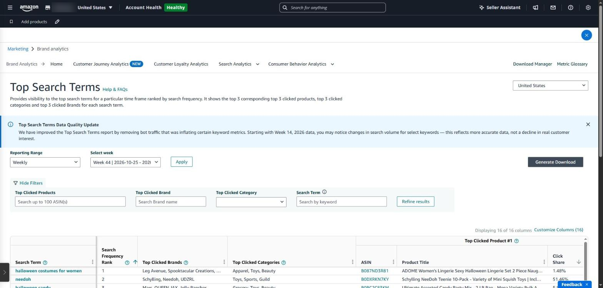
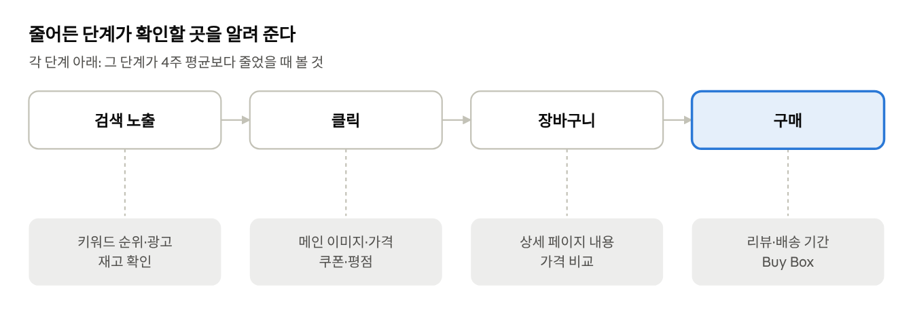
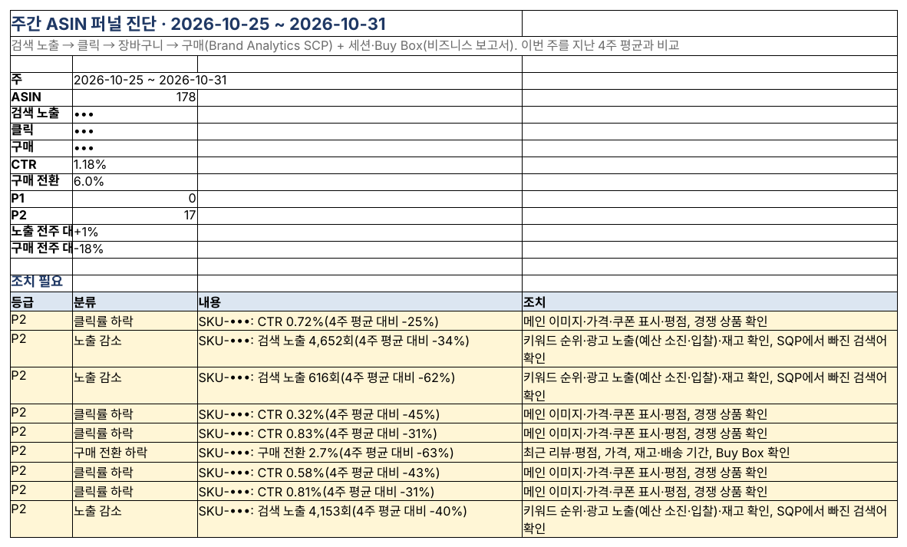

## 검색에서 구매까지, 어디서 새는가

고객은 검색 결과에서 상품을 보고(노출), 눌러 보고(클릭), 장바구니에 담고, 삽니다. Brand Analytics는 이 네 단계를 숫자로 보여 주는 아마존 기본 도구입니다.

### Seller Central의 Brand Analytics

브랜드 레지스트리에 등록된 브랜드의 대표자가 프로 계정으로 쓸 수 있습니다. 메뉴 → **마케팅 → 브랜드 분석** ([아마존 안내](https://sell.amazon.com/blog/brand-analytics)).

| 보고서                          | 보여 주는 것                                                           |
|---------------------------------|------------------------------------------------------------------------|
| Search Query Performance(SQP)   | 내 상품으로 이어진 검색어별 노출·클릭·장바구니·구매와 내 브랜드 점유율 |
| Search Catalog Performance(SCP) | ASIN별 검색 노출·클릭·장바구니·구매 퍼널                               |
| Top Search Terms(TST)           | 검색어별 순위와 클릭 상위 상품                                         |
| 그 밖                           | 고객 여정 분석, 고객 충성도 분석, 소비자 행동 분석 등(메뉴 구성은 자주 바뀜)               |

주 단위(일요일~토요일) 데이터가 나오고, 내려받으려면 ‘다운로드 생성’ 후 다운로드 관리자에서 기다려야 합니다.

2026년에는 인기 검색어(TST) 보고서에서 검색량을 부풀리던 봇 트래픽을 걸러내는 개선이 있었습니다. 아마존 안내에 따르면 **2026년 14주차 데이터부터** 일부 키워드의 검색량이 줄어 보일 수 있는데, 실제 고객 관심이 줄어든 것이 아니라 데이터가 더 정확해진 것입니다. 그 전후를 비교할 때는 이 점을 감안해야 합니다.

*Seller Central ‘브랜드 분석 → 인기 검색어’ 화면(영어 화면). 위쪽 메뉴에서 검색 쿼리 성과, 고객 여정 분석 등 다른 보고서로 이동합니다.*

*검색 퍼널 4단계와 단계별 확인 항목*

### SellerMorning의 ‘주간 ASIN 퍼널 진단’

- 매주 SCP를 받아 ASIN마다 네 단계를 지난 4주 평균과 비교합니다.
- **노출 감소** → 키워드 순위·광고 노출·재고, **클릭률 하락** → 메인 이미지·가격·쿠폰·평점, **구매 전환 하락** → 리뷰·가격·배송 기간·Buy Box처럼 단계별로 볼 것을 알려 줍니다.
- 8주 추세와, 리스팅을 고친 뒤 전후 2주 비교(수정 효과)도 보여 줍니다.
- 비즈니스 보고서의 세션·Buy Box를 함께 봐서, Buy Box를 잃어 생긴 하락을 구분합니다.

*주간 ASIN 퍼널 진단 ‘요약’. 이번 주 전체 퍼널과, 4주 평균보다 떨어진 ASIN별 조치(수치 일부·SKU는 가림).*

---

**아마존 셀러 시리즈**

1. [누구나 아마존 셀러가 될 수 있다](../amazon-seller-1-getting-started/)
2. [셀러가 된 다음의 진짜 어려움](../amazon-seller-2-real-challenge/)
3. [판매 데이터를 한눈에](../amazon-seller-3-sales-data/)
4. [광고를 한눈에](../amazon-seller-4-ads/)
5. [리스팅을 한눈에](../amazon-seller-5-listings/)
6. [계정 상태 지키기](../amazon-seller-6-account-health/)
7. [FBA 재고, 품절도 과재고도 없게](../amazon-seller-7-fba-inventory/)
8. [주문·반품 숫자에서 문제 찾기](../amazon-seller-8-orders-returns/)
9. [비즈니스 보고서로 전환율 읽기](../amazon-seller-9-business-reports/)
10. **Brand Analytics로 이탈 단계 찾기** (이 글)
11. [Buy Box와 합승 판매자 지키기](../amazon-seller-11-buy-box/)
12. [잃어버린 FBA 재고 보상받기](../amazon-seller-12-fba-reimbursement/)
13. [가격을 바꾸기 전에 이익부터](../amazon-seller-13-fees-profit/)
14. [아침 15분 셀러 루틴](../amazon-seller-14-daily-routine/)
15. [공식 API로 안전한 자동화](../amazon-seller-15-safe-automation/)
