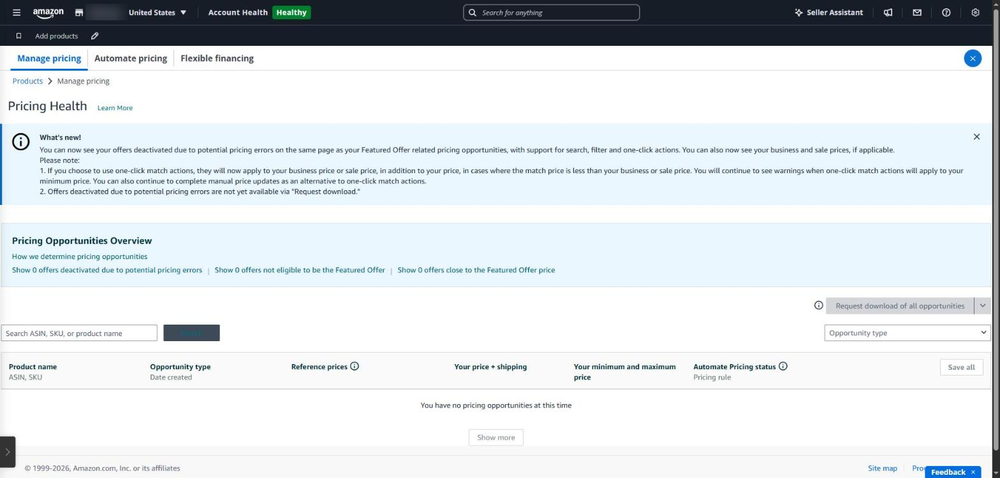
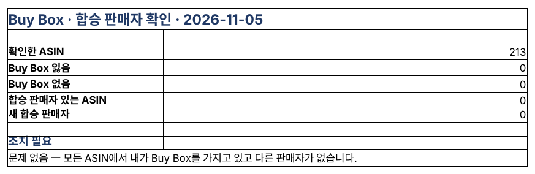

## 구매 버튼을 누가 갖고 있나

상세 페이지 오른쪽의 ‘장바구니 담기’·‘바로 구매’ 칸을 Buy Box(아마존 용어로 Featured Offer)라고 합니다. 같은 상품을 여러 판매자가 팔면 이 칸은 한 명에게만 갑니다. 대부분의 판매가 이 칸에서 일어나므로, 내 브랜드 상품이라도 이 칸을 잃으면 판매가 급격히 줄어듭니다 ([Featured Offer 가이드](https://www.repricer.com/blog/amazon-featured-offer-sellers-guide/)).

### 무엇으로 정해지나

- **프로 계정** — 개인 요금제는 Buy Box를 가질 수 없습니다.
- **가격** — 상품 가격 + 배송비. 다른 곳보다 크게 비싸면 아예 대상에서 빠질 수 있습니다.
- **배송** — 배송 속도와 프라임 여부. FBA가 유리합니다.
- **판매자 신뢰도** — 주문 결함률 1% 미만, 계정 상태, 판매 이력.
- **재고** — 품절되면 당연히 다른 판매자에게 넘어갑니다.

### 합승 판매자(hijacker)

내 브랜드 페이지에 다른 판매자가 붙어 더 싼 가격으로 파는 경우입니다. 진품이 아니거나 다른 상품일 수도 있어 리뷰에도 피해가 갑니다. 브랜드 레지스트리에 등록했다면 ‘위반 신고’로 대응할 수 있습니다.

### 합승 판매자가 붙었을 때

1. **오퍼 확인** — 상세 페이지의 ‘다른 판매자’ 목록에서 판매자 이름, 가격, 배송 방식(FBA·FBM)을 봅니다.
2. **진품인지 확인** — 의심되면 그 판매자에게서 직접 사서(테스트 구매) 상품과 포장을 비교하고 사진으로 남깁니다.
3. **위반 신고** — 브랜드 레지스트리의 ‘위반 신고(Report a Violation)’에서 위조품·상표권 침해 등으로 신고하고, 테스트 구매 증거를 첨부합니다.
4. **내 오퍼 점검** — 그동안 내 가격·재고·배송 조건이 Buy Box에서 밀리지 않는지 확인합니다.

다만 정품을 정당하게 사서 다시 파는 판매자는 신고 대상이 아닐 수 있습니다. 증거 없이 신고하기보다 테스트 구매로 먼저 확인하는 것이 좋습니다.

### Seller Central에서 보는 곳

- **비즈니스 보고서** — ASIN별 Featured Offer(Buy Box) 비율
- **상품 관리** — 상품별 판매자 수와 Featured Offer 여부

다만 비율은 며칠이 지나야 내려가고, 어느 판매자가 언제 붙었는지는 따로 남지 않습니다.

*Seller Central ‘가격 상태(Pricing Health)’ 화면(영어 화면). Featured Offer 자격을 잃은 상품과 가격 차이가 있는 상품을 보여 줍니다.*

### SellerMorning의 ‘Buy Box·합승 판매자 확인’

- 매일 판매 중인 모든 ASIN의 오퍼를 공식 API로 읽어, Buy Box를 누가 가졌는지 확인합니다.
- **어제는 없던 판매자**가 붙으면 ‘새 합승 판매자’로 알려 줍니다.
- Buy Box를 잃었거나 Buy Box가 아예 없는 ASIN은 오늘의 요약 P1에 올리고, 광고 기능에도 알려 광고를 재검토하게 합니다.

*Buy Box·합승 판매자 확인 ‘요약’. 이날은 213개 ASIN 모두 문제가 없었습니다.*

---

**아마존 셀러 시리즈**

1. [누구나 아마존 셀러가 될 수 있다](../amazon-seller-1-getting-started/)
2. [셀러가 된 다음의 진짜 어려움](../amazon-seller-2-real-challenge/)
3. [판매 데이터를 한눈에](../amazon-seller-3-sales-data/)
4. [광고를 한눈에](../amazon-seller-4-ads/)
5. [리스팅을 한눈에](../amazon-seller-5-listings/)
6. [계정 상태 지키기](../amazon-seller-6-account-health/)
7. [FBA 재고, 품절도 과재고도 없게](../amazon-seller-7-fba-inventory/)
8. [주문·반품 숫자에서 문제 찾기](../amazon-seller-8-orders-returns/)
9. [비즈니스 보고서로 전환율 읽기](../amazon-seller-9-business-reports/)
10. [Brand Analytics로 이탈 단계 찾기](../amazon-seller-10-brand-analytics/)
11. **Buy Box와 합승 판매자 지키기** (이 글)
12. [잃어버린 FBA 재고 보상받기](../amazon-seller-12-fba-reimbursement/)
13. [가격을 바꾸기 전에 이익부터](../amazon-seller-13-fees-profit/)
14. [아침 15분 셀러 루틴](../amazon-seller-14-daily-routine/)
15. [공식 API로 안전한 자동화](../amazon-seller-15-safe-automation/)
