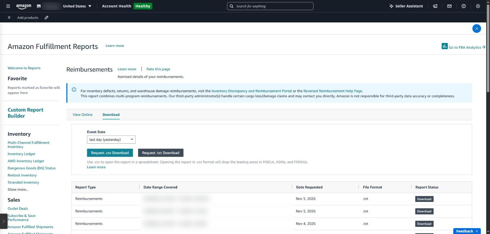
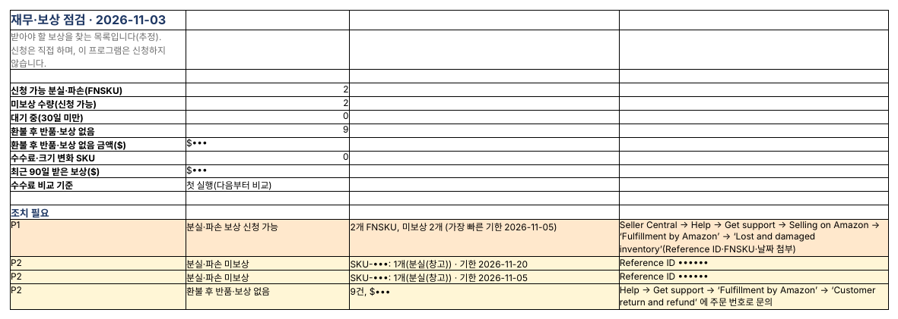

## 아마존도 재고를 잃어버린다

FBA 창고에서는 재고가 분실되거나 파손되기도 하고, 고객에게 환불해 줬는데 반품이 돌아오지 않기도 합니다. 대부분은 아마존이 자동으로 보상하지만, 빠지는 것도 있고 그때는 셀러가 기한 안에 신청해야 합니다.

> 이 글은 보상 **정책**(대상, 신청 기한, 보상 금액 기준)을 정리한 글입니다. 실제로 분실 재고를 찾아 보상을 신청하는 과정은 [아마존 FBA 재고 분실 보상 신청: 셀러센트럴 화면으로 단계별 따라 하기](../amazon-fba-lost-inventory-claim/)에서 화면과 함께 설명합니다.

### 바뀐 보상 정책

| 항목      | 내용                                                                                               |
|-----------|----------------------------------------------------------------------------------------------------|
| 신청 기한 | 2024년 10월 23일부터 크게 짧아짐(이전에는 최대 18개월). 창고 분실·파손은 보고된 날부터 60일 안에 신청                         |
| 고객 반품 | 환불·교환 후 60~120일 사이                                                                         |
| 보상 금액 | 2025년 3월 31일부터 판매가가 아니라 **제조 원가** 기준(고객 주문 후 분실은 판매가에서 수수료 제외) |
| 증빙      | 인보이스·구매 증빙·배송 기록이 필요할 수 있음                                                      |

기한과 조건은 바뀔 수 있으니 Seller Central 도움말의 FBA 보상 정책을 함께 확인하세요 ([정책 변경 정리](https://www.ecomengine.com/blog/fba-reimbursement-policy)).

### Seller Central에서 보는 곳

- **공급망 보고서 → 재고 원장(Inventory Ledger)** — 입고·출고·분실·발견·파손 기록
- **공급망 보고서 → 보상(Reimbursements)** — 받은 보상 내역
- **도움말 → 지원 요청** — 빠진 보상 신청

어려운 점은 ‘분실’이 나중에 ‘발견’으로 상쇄되거나 다른 날 보상되는 경우가 많아, 두 보고서를 길게 맞춰 봐야 진짜 미보상만 남는다는 것입니다.

*Seller Central 주문 처리 보고서의 ‘보상(Reimbursements)’ 화면(영어 화면). 기간을 골라 내려받아야 내용을 볼 수 있습니다.*

### SellerMorning의 ‘재무·보상 점검’

- 공식 API로 재고 원장 18개월, 보상, 반품, 환불, FBA 수수료를 받아 맞춥니다.
- 분실과 나중의 발견, 보상과 보상 취소를 상쇄해 **아직 보상되지 않은 것만** 남깁니다. 30일이 안 된 건은 ‘대기 중’으로 둡니다.
- 환불했는데 반품도 보상도 없는 주문을 찾습니다.
- 건마다 신청 기한, Reference ID, 신청 메뉴 경로를 적어 주고, 기한이 가까운 것은 오늘의 요약 P1에 올립니다.
- 신청은 셀러가 직접 합니다. 프로그램은 찾아 주기만 합니다.

*재무·보상 점검 ‘요약’. 신청 가능한 분실·파손과 환불 후 미반품 건을 기한·신청 방법과 함께 보여 줍니다(SKU·금액·Reference ID는 가림).*

---

**아마존 셀러 시리즈**

1. [누구나 아마존 셀러가 될 수 있다](../amazon-seller-1-getting-started/)
2. [셀러가 된 다음의 진짜 어려움](../amazon-seller-2-real-challenge/)
3. [판매 데이터를 한눈에](../amazon-seller-3-sales-data/)
4. [광고를 한눈에](../amazon-seller-4-ads/)
5. [리스팅을 한눈에](../amazon-seller-5-listings/)
6. [계정 상태 지키기](../amazon-seller-6-account-health/)
7. [FBA 재고, 품절도 과재고도 없게](../amazon-seller-7-fba-inventory/)
8. [주문·반품 숫자에서 문제 찾기](../amazon-seller-8-orders-returns/)
9. [비즈니스 보고서로 전환율 읽기](../amazon-seller-9-business-reports/)
10. [Brand Analytics로 이탈 단계 찾기](../amazon-seller-10-brand-analytics/)
11. [Buy Box와 합승 판매자 지키기](../amazon-seller-11-buy-box/)
12. **잃어버린 FBA 재고 보상받기** (이 글)
13. [가격을 바꾸기 전에 이익부터](../amazon-seller-13-fees-profit/)
14. [아침 15분 셀러 루틴](../amazon-seller-14-daily-routine/)
15. [공식 API로 안전한 자동화](../amazon-seller-15-safe-automation/)

*이 글은 개인 경험을 바탕으로 작성되었으며, Amazon.com, Inc. 및 그 계열사와 관련이 없습니다. 정책·수수료는 작성 시점 기준이니 최신 내용은 Seller Central에서 확인하세요.*
