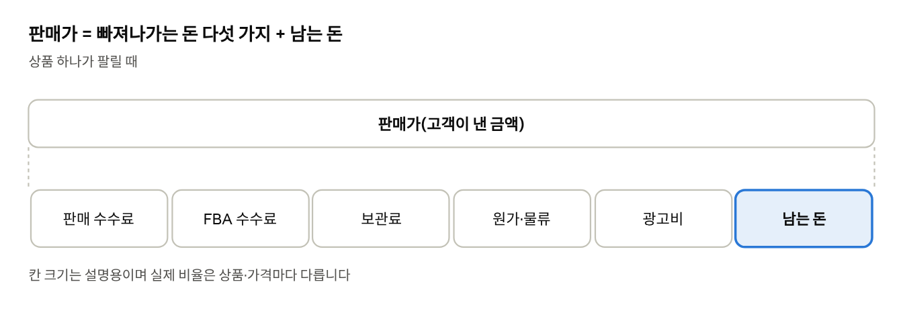
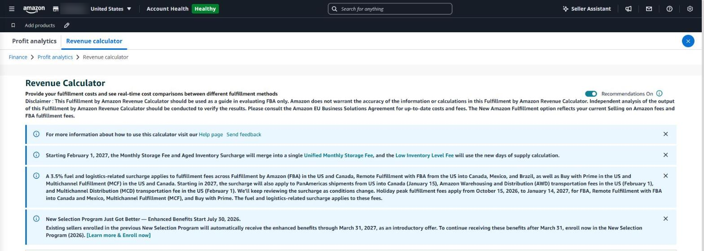

## 판매가에서 얼마가 남나

가격을 1달러 내리면 팔리는 양은 늘 수 있지만, 수수료를 빼고 남는 돈은 생각보다 크게 줄어듭니다. 아마존에서 상품 하나가 팔릴 때 빠져나가는 돈은 다섯 가지입니다.

*판매가의 구성*

| 항목            | 내용                                            |
|-----------------|-------------------------------------------------|
| 판매 수수료     | 판매가의 일정 비율(대부분 15% 안팎, 카테고리별) |
| FBA 배송 수수료 | 크기·무게별 1개당 수수료                        |
| 보관료          | 월 보관료, 오래되면 추가요금(7편)               |
| 원가·물류비     | 제조 원가, 미국까지 보내는 비용                 |
| 광고비          | 광고로 팔린 주문의 비용                         |

### 예시: \$25짜리 상품을 \$23로 내리면

아래는 계산 방법을 보여 주기 위한 예시 수치입니다. 실제 수수료는 카테고리·크기·무게마다 다릅니다.

| 항목 | 판매가 \$25 | 판매가 \$23 |
|---|---|---|
| 판매 수수료(15%) | \$3.75 | \$3.45 |
| FBA 배송 수수료 | \$4.50 | \$4.50 |
| 보관료(1개당) | \$0.30 | \$0.30 |
| 원가·물류비 | \$7.00 | \$7.00 |
| **광고 전 1개당 남는 돈** | **\$9.45** | **\$7.75** |
| 손익분기 ACoS | 37.8% | 33.7% |

가격을 8% 내렸을 뿐인데 1개당 남는 돈은 18% 줄고, 광고에 쓸 수 있는 여유도 함께 줄어듭니다. 같은 이익을 지키려면 판매량이 약 22% 늘어야 합니다.

### 2026~2027년 수수료 변화도 확인

Seller Central 안내(2026년 11월 기준)에 나온 내용입니다. 가격을 정하기 전에 함께 반영해야 합니다.

- 미국·캐나다 FBA 배송 수수료 등에 **3.5%의 연료·물류 추가요금**이 붙습니다.
- **2026년 10월 15일부터 2027년 1월 14일까지**는 연말 성수기 배송 수수료가 적용됩니다.
- **2027년 1월 15일부터** 판매·FBA 수수료가 바뀐다는 안내가 나와 있으니, 새 수수료로 다시 계산해 봐야 합니다.

### Seller Central의 기본 도구

- **재무 → 수익 분석 → 수익 계산기(Revenue Calculator)** — 가격을 넣으면 상품별 수수료와 남는 금액을 계산합니다.
- **재무 → 수익 분석** — 상품별 비용과 이익 추이.
- **상품 → 가격 관리 → 자동 가격 책정** — 규칙에 따라 가격을 자동으로 맞춤. 최소 가격을 꼭 정해 둡니다.

다만 계산기는 한 번에 한 상품이고, 광고비와 내 원가는 직접 넣어야 합니다.

*Seller Central ‘수익 계산기(Revenue Calculator)’ 화면(영어 화면). 상품을 하나씩 검색해 수수료와 이익을 계산합니다.*

### SellerMorning에서는

- **가격 변경 미리 보기** — 리스팅·가격 수정(5편)에서 가격 줄을 검사하면, 새 가격의 아마존 수수료(판매·FBA)를 공식 API로 받아 1개당 남는 금액을 보여 줍니다.
- **원가를 넣으면** — 이익·이익률·지금 가격 대비 변화까지 나오고, 손해 보는 가격은 따로 허용해야만 적용됩니다.
- **큰 변경 보호** — 지금 가격보다 30% 넘게 바꾸는 것도 따로 허용해야 합니다.
- **손익분기 ACoS** — 같은 원가로 상품마다 광고비를 얼마까지 쓸 수 있는지 계산해 광고 목표로 씁니다(4편).

> **손익분기 ACoS = (판매가 − 아마존 수수료 − 원가·물류비) ÷ 판매가**
>
> 광고비가 판매액의 이 비율을 넘으면, 광고로 팔린 주문은 손해입니다.

---

**아마존 셀러 시리즈**

1. [누구나 아마존 셀러가 될 수 있다](../amazon-seller-1-getting-started/)
2. [셀러가 된 다음의 진짜 어려움](../amazon-seller-2-real-challenge/)
3. [판매 데이터를 한눈에](../amazon-seller-3-sales-data/)
4. [광고를 한눈에](../amazon-seller-4-ads/)
5. [리스팅을 한눈에](../amazon-seller-5-listings/)
6. [계정 상태 지키기](../amazon-seller-6-account-health/)
7. [FBA 재고, 품절도 과재고도 없게](../amazon-seller-7-fba-inventory/)
8. [주문·반품 숫자에서 문제 찾기](../amazon-seller-8-orders-returns/)
9. [비즈니스 보고서로 전환율 읽기](../amazon-seller-9-business-reports/)
10. [Brand Analytics로 이탈 단계 찾기](../amazon-seller-10-brand-analytics/)
11. [Buy Box와 합승 판매자 지키기](../amazon-seller-11-buy-box/)
12. [잃어버린 FBA 재고 보상받기](../amazon-seller-12-fba-reimbursement/)
13. **가격을 바꾸기 전에 이익부터** (이 글)
14. [아침 15분 셀러 루틴](../amazon-seller-14-daily-routine/)
15. [공식 API로 안전한 자동화](../amazon-seller-15-safe-automation/)

*이 글은 개인 경험을 바탕으로 작성되었으며, Amazon.com, Inc. 및 그 계열사와 관련이 없습니다. 정책·수수료는 작성 시점 기준이니 최신 내용은 Seller Central에서 확인하세요.*
