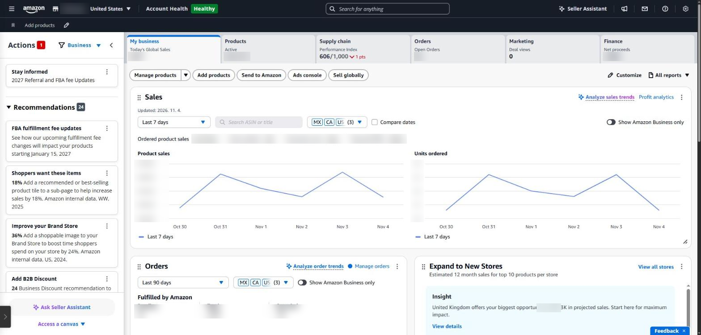
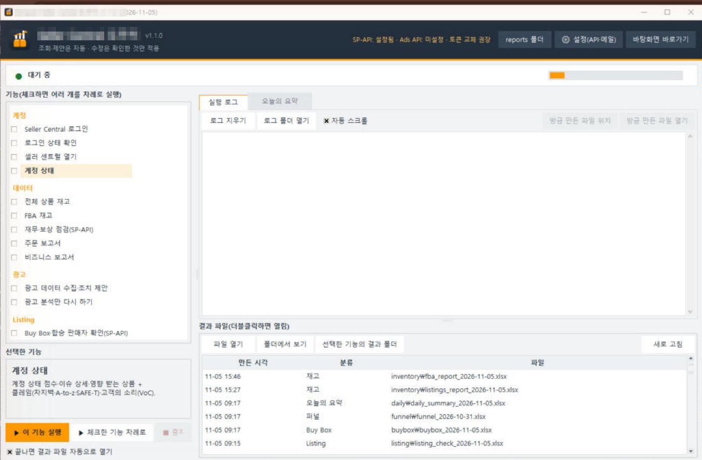
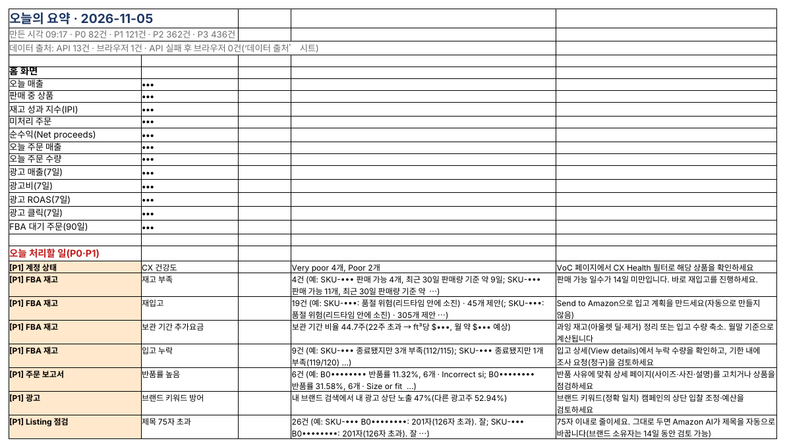

## 프로그램이 새벽에 일하고, 셀러는 아침에 결정만

지금까지 소개한 기능을 매일 하나씩 눌러 실행할 필요는 없습니다. 시간을 예약해 두면 프로그램이 차례로 실행하고, 셀러는 아침에 ‘오늘의 요약’ 한 장을 읽습니다.

*Seller Central 홈(영어 화면). 매출, 주문, 재고, 재무 숫자가 탭마다 나뉘어 있어 아침마다 여러 곳을 눌러 봐야 합니다. 숫자는 가렸습니다.*

### 매일 자동 실행 설정

- 화면 프로그램의 ‘매일 자동 실행’에서 시각(예: 08:10)을 정하면 Windows 작업 스케줄러(Mac은 launchd)에 등록됩니다.
- 그 시각에 PC가 켜져 있어야 합니다.
- 실행 순서는 홈 → 조치 항목 → 계정 상태 → 전체 상품 → FBA → 주문 → 비즈니스 → 광고 → Listing → Buy Box → 퍼널 → 재무(주 1회)입니다. 광고 보고서는 맨 앞에서 미리 요청해 두고 다른 기능이 도는 동안 기다립니다.
- 끝나면 바탕화면 알림으로 가장 급한 일 하나와 P0·P1 건수를 알려 줍니다.

*화면 프로그램. 기능을 체크해 차례로 실행하거나, ‘오늘의 요약’ 탭에서 바로 결과를 봅니다.*

### 아침 15분 루틴

1. **알림 확인(1분)** — P0가 있는지만 봅니다.
2. **P0 처리(5분)** — 계정 위반, 판매 중 품절처럼 오늘 바로 해야 할 일. 요약의 ‘방법’ 칸에 메뉴 경로가 있습니다.
3. **P1 훑어보기(5분)** — Buy Box, 보상 기한, 재고 부족. 이번 주 안에 할 일을 정합니다.
4. **광고 L1 제안(4분)** — 부정 키워드·입찰 소폭 조정처럼 되돌릴 수 있는 것만 광고 콘솔에서 바로 반영합니다.

*실제 ‘오늘의 요약’ 일부(매출·SKU·ASIN은 가림).*

### 주간·월간

| 주기 | 할 일                                                                         |
|------|-------------------------------------------------------------------------------|
| 매주 | 퍼널 진단 확인, 재무·보상 신청, 지난 광고 제안의 효과 확인                    |
| 매달 | 장기 재고 정리, 원가 업데이트, 리스팅 제목 초안 반영, API 토큰 교체 알림 확인 |

---

**아마존 셀러 시리즈**

1. [누구나 아마존 셀러가 될 수 있다](../amazon-seller-1-getting-started/)
2. [셀러가 된 다음의 진짜 어려움](../amazon-seller-2-real-challenge/)
3. [판매 데이터를 한눈에](../amazon-seller-3-sales-data/)
4. [광고를 한눈에](../amazon-seller-4-ads/)
5. [리스팅을 한눈에](../amazon-seller-5-listings/)
6. [계정 상태 지키기](../amazon-seller-6-account-health/)
7. [FBA 재고, 품절도 과재고도 없게](../amazon-seller-7-fba-inventory/)
8. [주문·반품 숫자에서 문제 찾기](../amazon-seller-8-orders-returns/)
9. [비즈니스 보고서로 전환율 읽기](../amazon-seller-9-business-reports/)
10. [Brand Analytics로 이탈 단계 찾기](../amazon-seller-10-brand-analytics/)
11. [Buy Box와 합승 판매자 지키기](../amazon-seller-11-buy-box/)
12. [잃어버린 FBA 재고 보상받기](../amazon-seller-12-fba-reimbursement/)
13. [가격을 바꾸기 전에 이익부터](../amazon-seller-13-fees-profit/)
14. **아침 15분 셀러 루틴** (이 글)
15. [공식 API로 안전한 자동화](../amazon-seller-15-safe-automation/)

*이 글은 개인 경험을 바탕으로 작성되었으며, Amazon.com, Inc. 및 그 계열사와 관련이 없습니다. 정책·수수료는 작성 시점 기준이니 최신 내용은 Seller Central에서 확인하세요.*
