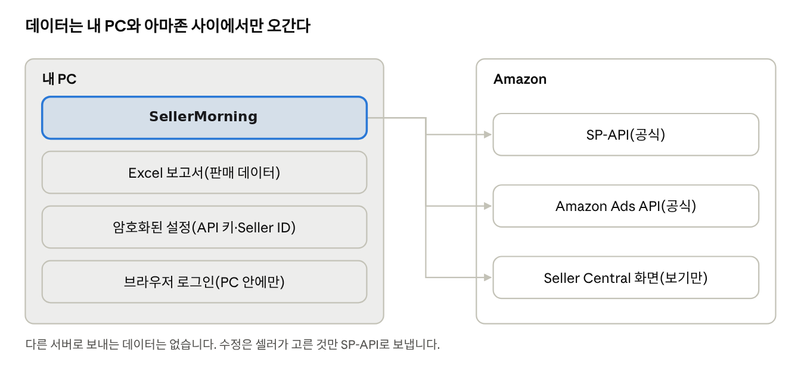

## 자동화에서 가장 중요한 것은 안전

셀러 계정은 사업 그 자체입니다. 그래서 SellerMorning는 처음부터 ‘공식 방식으로, 내 PC에서, 확인한 것만’이라는 원칙으로 만들었습니다.

### SP-API: 아마존이 제공하는 공식 통로

SP-API(Selling Partner API)는 셀러의 재고·주문·재무·리스팅 데이터를 프로그램이 받을 수 있게 아마존이 열어 둔 공식 통로입니다. 내 계정에서 개발자 앱을 등록하고, 필요한 역할(재고·주문·가격·리스팅·Brand Analytics 등)만 승인받아 씁니다. 광고 데이터는 별도의 Amazon Ads API를 씁니다.

API로 받을 수 없는 화면만 브라우저로 열어 내용을 읽기만 하고, 클릭 사이에 충분한 간격을 둬 아마존 서버에 부담을 주지 않습니다.

*프로그램 상단에 SP-API와 Ads API의 연결 상태가 표시됩니다. 이 날은 SP-API만 연결되어 있고, 토큰 교체를 권장하는 알림이 떠 있습니다.*

*SellerMorning의 데이터 흐름*

### 안전 장치

| 무엇을          | 어떻게                                                                           |
|-----------------|----------------------------------------------------------------------------------|
| API 키·로그인   | Windows 계정 암호화(DPAPI) 또는 Mac 키체인에 저장. 다른 PC에서는 풀리지 않음     |
| 판매자 정보     | Seller ID·메일·브랜드는 코드가 아닌 설정에만. 배포 패키지에 들어가면 만들지 않음 |
| 판매 데이터     | 내 PC의 Excel로만 저장. 아마존 외 서버로 보내지 않음                             |
| 수정            | 검사 → 셀러가 고른 줄만 적용 → 원래 값 기록·되돌리기(5편). 광고는 바꾸지 않음    |
| Excel 수식 주입 | 고객 검색어·상품명이 ‘=’로 시작해도 수식으로 실행되지 않게 글자로 저장           |

### 버전 관리

프로그램에는 버전 번호(MAJOR.MINOR.PATCH)가 있고, 버전마다 패키지를 만들어 둡니다. 새 버전에 문제가 있으면 이전 버전으로 바로 되돌릴 수 있고, 판매 데이터·설정·로그인은 그대로 남습니다.

### 마치며

이 시리즈에서는 아마존 셀러를 시작하는 법부터, 매일 확인해야 할 계정 상태·재고·주문·광고·리스팅, 그리고 이 일을 대신해 주는 SellerMorning까지 15편에 걸쳐 정리했습니다.

SellerMorning은 지금도 매일 쓰면서 다듬고 있습니다. 새 기능과 운영하며 배운 점은 이 블로그에 계속 기록하겠습니다.

SellerMorning에 관심이 있거나 사용해 보고 싶다면 [toolbox@toolboxnotes.com](mailto:toolbox@toolboxnotes.com)으로 메일을 보내 주세요.

---

**아마존 셀러 시리즈**

1. [누구나 아마존 셀러가 될 수 있다](../amazon-seller-1-getting-started/)
2. [셀러가 된 다음의 진짜 어려움](../amazon-seller-2-real-challenge/)
3. [판매 데이터를 한눈에](../amazon-seller-3-sales-data/)
4. [광고를 한눈에](../amazon-seller-4-ads/)
5. [리스팅을 한눈에](../amazon-seller-5-listings/)
6. [계정 상태 지키기](../amazon-seller-6-account-health/)
7. [FBA 재고, 품절도 과재고도 없게](../amazon-seller-7-fba-inventory/)
8. [주문·반품 숫자에서 문제 찾기](../amazon-seller-8-orders-returns/)
9. [비즈니스 보고서로 전환율 읽기](../amazon-seller-9-business-reports/)
10. [Brand Analytics로 이탈 단계 찾기](../amazon-seller-10-brand-analytics/)
11. [Buy Box와 합승 판매자 지키기](../amazon-seller-11-buy-box/)
12. [잃어버린 FBA 재고 보상받기](../amazon-seller-12-fba-reimbursement/)
13. [가격을 바꾸기 전에 이익부터](../amazon-seller-13-fees-profit/)
14. [아침 15분 셀러 루틴](../amazon-seller-14-daily-routine/)
15. **공식 API로 안전한 자동화** (이 글)

*이 글은 개인 경험을 바탕으로 작성되었으며, Amazon.com, Inc. 및 그 계열사와 관련이 없습니다. 정책·수수료는 작성 시점 기준이니 최신 내용은 Seller Central에서 확인하세요.*
