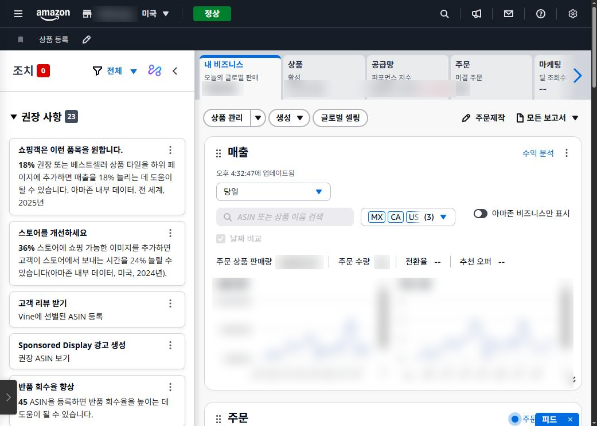
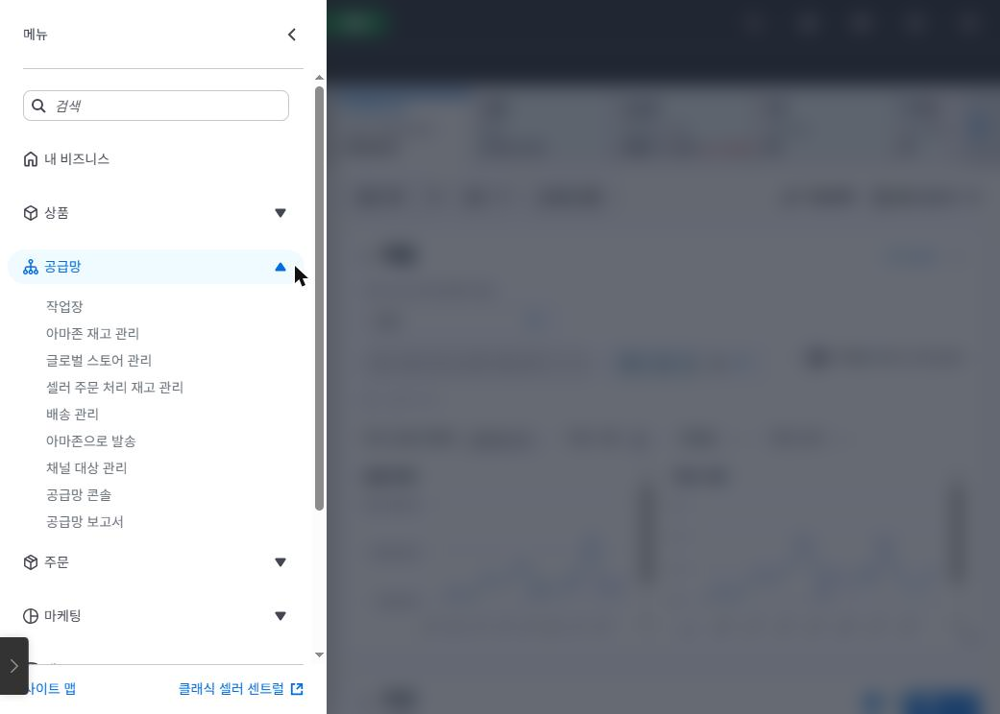
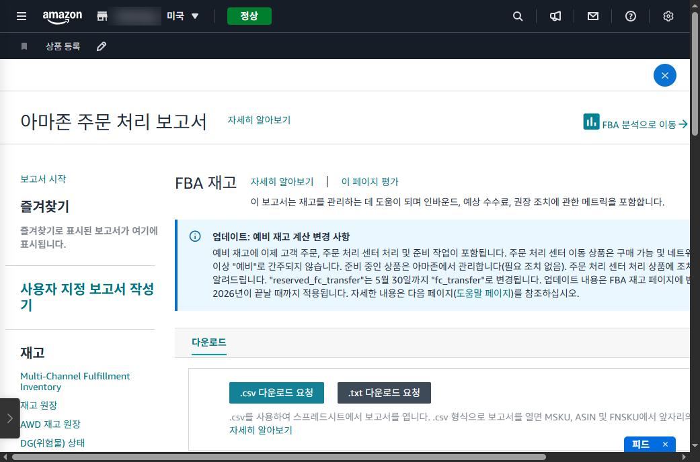
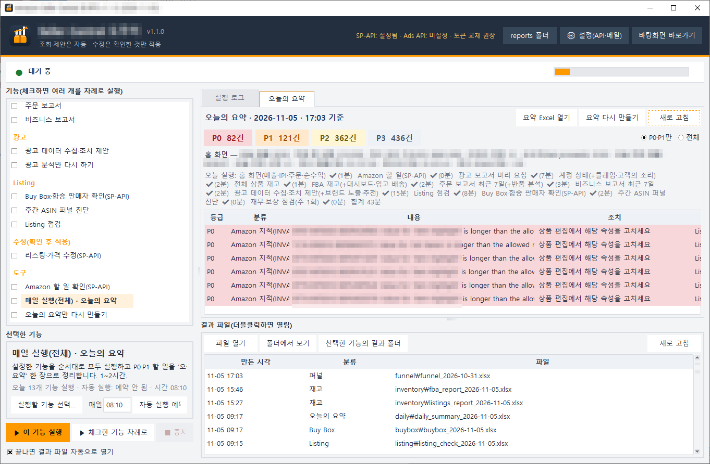

## 상품이 늘면 판매보다 관리가 일이 된다

상품이 3개일 때는 아침마다 Seller Central을 열어 한 번 훑어보면 끝입니다. 상품이 수십 개, 색상·사이즈까지 포함해 수백 개가 되면 이야기가 달라집니다.

어느 날 재고가 떨어진 상품에 광고비만 나가고, 제목 규칙을 어긴 리스팅이 검색에서 사라지고, 누군가 내 페이지에 더 싼 가격으로 붙어 판매를 가져갑니다. 문제는 이런 일이 알림 없이 조용히 일어난다는 것입니다.

이 글은 저희가 직접 미국 아마존에서 상품 수백 개를 운영하며 겪은 관리의 어려움을 정리한 것입니다.

## 매일 봐야 하는데, 다 볼 수는 없다

셀러가 매일 확인해야 하는 것은 최소 여섯 가지이고, 각각 Seller Central의 다른 메뉴에 있습니다.

| 봐야 할 것     | 어디서 보나              | 놓치면                                                        |
|----------------|--------------------------|---------------------------------------------------------------|
| 재고           | 공급망 → FBA 재고 보고서 | 품절되면 검색 순위가 떨어지고, 보관이 길면 장기 보관료가 붙음 |
| 주문·반품      | 주문 → 주문 보고서       | 반품이 늘어도 원인을 모르고 지나감                            |
| 트래픽·전환율  | 비즈니스 보고서          | 제목·이미지 문제로 전환율이 떨어져도 모름                     |
| 광고           | 마케팅 → 광고 콘솔       | 팔리지 않는 검색어에 광고비가 계속 나감                       |
| 리스팅·Buy Box | 상품 → 상품 관리         | 검색 제한, 합승 판매자에게 판매를 빼앗김                      |
| 계정 상태·보상 | 어카운트 헬스, 재무      | 정책 위반이 쌓이거나, 창고에서 잃어버린 재고의 보상을 못 받음 |

하루에 여섯 메뉴를 돌며 상품 수백 개를 비교하는 것은 사람이 꾸준히 하기 어렵습니다. 그래서 대부분의 셀러는 문제가 터진 뒤에야 알게 됩니다.

## Seller Central은 크고 복잡하다

Seller Central 사이트 맵에는 10개 분류 아래 메뉴가 약 100개 있습니다. 상품 22개, 설정 17개, 공급망 16개, 주문 15개, 재무 13개 식입니다.

보고서만 해도 한 곳에 없습니다. 상품 보고서, 공급망 보고서, 주문 보고서, 비즈니스 보고서, 브랜드 분석이 각각 다른 메뉴에 있고, 광고 보고서는 아예 다른 사이트(광고 콘솔)에 있습니다. 화면 구성도 수시로 바뀝니다.

*Seller Central 홈 화면. 한 화면에 매출·상품·공급망·주문·광고 카드와 권장 사항이 함께 있습니다(숫자·상점 이름은 가림).*

*왼쪽 위 메뉴(☰). ‘공급망’ 하나만 펼쳐도 하위 메뉴가 9개입니다.*

## 보고서 하나 받는 데 7번 클릭하고 길게는 45분을 기다린다

FBA 재고 보고서를 받는 과정을 예로 들면 이렇습니다.

1. 왼쪽 위 메뉴(☰) 열기
2. 공급망 → 공급망 보고서
3. 왼쪽 목록의 Inventory 아래 ‘더 보기...’
4. FBA Inventory 선택
5. ‘.txt 다운로드 요청’
6. 보고서가 만들어질 때까지 새로 고침(아마존 안내로는 최대 45분)
7. 다운로드 후 Excel에서 열어 상품별로 정리

재고, 전체 상품, 주문, 반품, 비즈니스, 광고 보고서를 각각 이렇게 받아 서로 맞춰 봐야 비로소 ‘무엇을 해야 하는지’가 보입니다. 다운로드는 시작일 뿐입니다.

*공급망 보고서(보고서 센터)의 FBA 재고 페이지. 왼쪽에 보고서 목록, 가운데에 ‘다운로드 요청’ 버튼이 있습니다.*

## 그래서 직접 만들었다

이 일을 매일 사람 손으로 하는 대신, 저희는 프로그램을 만들었습니다. **SellerMorning**(셀러모닝)은 위의 보고서들을 대신 모으고, 서로 맞춰 본 뒤, 오늘 처리할 일을 급한 순서대로 정리해 줍니다.

*SellerMorning 메인 창. 왼쪽에서 기능을 고르고, 오른쪽 ‘오늘의 요약’에서 등급별(P0~P3) 할 일을 봅니다. 이 날은 아마존이 지적한 리스팅 속성 오류가 P0로 올라왔습니다(매출 수치·SKU·ASIN은 가림).*

다음 글부터는 이 프로그램의 기능을 하나씩 소개합니다. 첫 번째는 재고·주문·매출 데이터를 한 번에 모아 보는 방법입니다.

---

**아마존 셀러 시리즈**

1. [누구나 아마존 셀러가 될 수 있다](../amazon-seller-1-getting-started/)
2. **셀러가 된 다음의 진짜 어려움** (이 글)
3. [판매 데이터를 한눈에](../amazon-seller-3-sales-data/)
4. [광고를 한눈에](../amazon-seller-4-ads/)
5. [리스팅을 한눈에](../amazon-seller-5-listings/)
6. [계정 상태 지키기](../amazon-seller-6-account-health/)
7. [FBA 재고, 품절도 과재고도 없게](../amazon-seller-7-fba-inventory/)
8. [주문·반품 숫자에서 문제 찾기](../amazon-seller-8-orders-returns/)
9. [비즈니스 보고서로 전환율 읽기](../amazon-seller-9-business-reports/)
10. [Brand Analytics로 이탈 단계 찾기](../amazon-seller-10-brand-analytics/)
11. [Buy Box와 합승 판매자 지키기](../amazon-seller-11-buy-box/)
12. [잃어버린 FBA 재고 보상받기](../amazon-seller-12-fba-reimbursement/)
13. [가격을 바꾸기 전에 이익부터](../amazon-seller-13-fees-profit/)
14. [아침 15분 셀러 루틴](../amazon-seller-14-daily-routine/)
15. [공식 API로 안전한 자동화](../amazon-seller-15-safe-automation/)

*이 글은 개인 경험을 바탕으로 작성되었으며, Amazon.com, Inc. 및 그 계열사와 관련이 없습니다. 정책·수수료는 작성 시점 기준이니 최신 내용은 Seller Central에서 확인하세요.*
