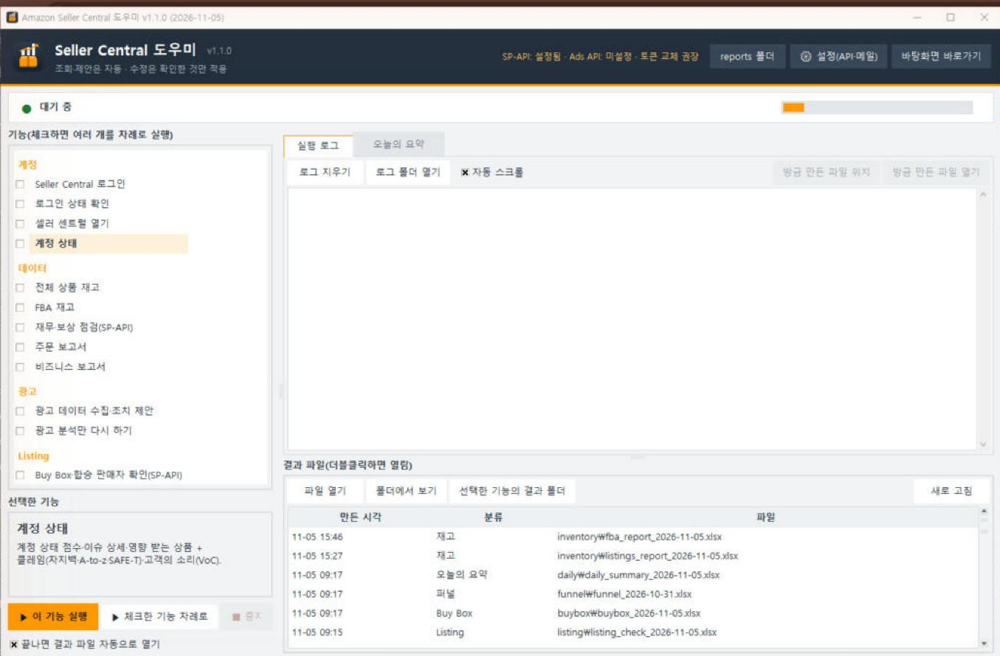
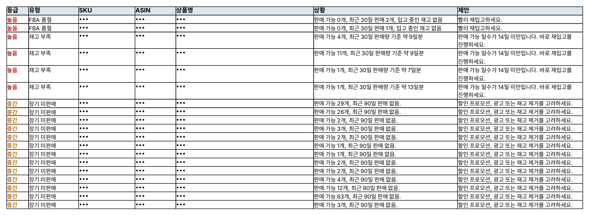
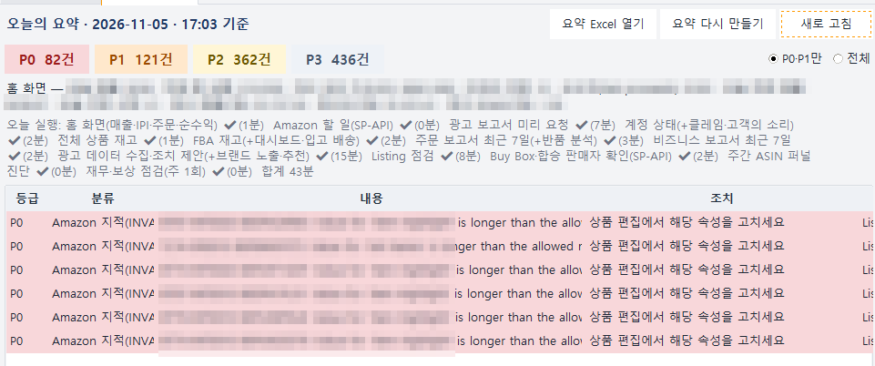
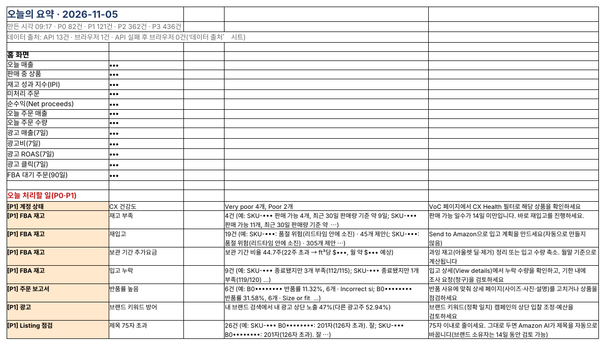

## SellerMorning: 매일 아침 할 일을 한 장으로

지난 글에서 본 ‘메뉴 여섯 개, 보고서 여러 개, 기다림’을 대신하는 프로그램입니다. 내 PC에서 실행되고, 보고서를 모아 Excel로 정리한 뒤 ‘지금 무엇을 해야 하는지’를 등급(P0~P3)으로 알려 줍니다.

동작 방식은 두 가지입니다.

- **아마존 공식 API(SP-API) 우선** — 재고·주문·재무·Buy Box처럼 API로 받을 수 있는 것은 화면을 열지 않고 바로 받습니다.
- **API에 없는 화면은 브라우저로** — 보고서 센터처럼 API로 받을 수 없는 화면은, 셀러가 평소에 쓰는 것과 같은 방식으로 브라우저에서 보고서를 내려받습니다. 아마존 서버에 부담을 주지 않도록 클릭 사이에 충분한 간격을 둡니다.

*SellerMorning 메인 창. 왼쪽에서 기능을 고르거나 여러 개를 체크해 차례로 실행하고, 오른쪽에서 실행 로그와 만들어진 결과 파일을 봅니다.*

## 데이터 기능 한눈에 보기

기능마다 Excel 보고서 하나를 만들고, 맨 앞 시트에 ‘확인 필요’ 목록을 두어 바로 조치할 수 있게 합니다.

| 기능            | 무엇을 모으나                                          | 무엇을 알려 주나                                               |
|-----------------|--------------------------------------------------------|----------------------------------------------------------------|
| 계정 상태       | 어카운트 헬스 점수·지표·정책 준수, 클레임, 고객의 소리 | 새로 생긴 이슈만(이슈 대장으로 중복 제거), 점수 추이           |
| 전체 상품 재고  | All Listings Report                                    | 비활성·정보 부족·가격 누락 상품                                |
| FBA 재고        | FBA 재고 보고서, FBA 대시보드, 입고 배송               | 품절·재고 부족·재입고 필요, 장기 보관 추가요금, 입고 수량 부족 |
| 주문 보고서     | 주문(미국 중부 시간 기준), 반품                        | 이전 기간 대비 증감, 반품률 높은 SKU, 발송 기한 임박 주문      |
| 비즈니스 보고서 | 세션·전환율·Buy Box(하위 ASIN별)                       | 트래픽은 많은데 전환이 낮은 ASIN, 30% 이상 급락                |
| 재무·보상 점검  | 재고 원장 18개월, 보상·환불·FBA 수수료                 | 창고 분실·파손 후 보상 안 된 건, 환불 후 반품 안 된 건         |

같은 보고서는 하루에 한 번만 받습니다. Seller Central에 오늘 만들어진 보고서가 이미 있으면 다시 요청하지 않고 그것을 내려받습니다.

*FBA 재고 보고서의 ‘확인 필요’ 시트. 품절·재고 부족·장기 미판매를 등급순으로 보여 주고, 오른쪽 ‘제안’ 칸에 할 일을 적습니다(SKU·ASIN·상품명은 가림).*

## 매일 자동 실행과 ‘오늘의 요약’

시간을 예약해 두면 매일 그 시간에 위 기능을 차례로 실행하고, 결과를 ‘오늘의 요약’ 한 장으로 묶습니다. 한 기능이 실패해도 나머지는 계속 실행되고, 끝나면 Windows 알림으로 가장 급한 일 하나를 알려 줍니다.

| 등급 | 뜻           | 예                                                    |
|------|--------------|-------------------------------------------------------|
| P0   | 오늘 바로    | 계정 정책 위반, 판매 중인데 품절                      |
| P1   | 이번 주 안에 | Buy Box를 잃음, 보상 신청 가능한 분실 재고, 재고 부족 |
| P2   | 시간 날 때   | 전환율 하락, 장기 재고                                |
| P3   | 참고         | 토큰 교체 알림, 개선 제안                             |

같은 종류의 일은 한 줄로 묶어 ‘SKU 12개 재고 부족’처럼 보여 주므로, 아침에 이 한 장만 읽으면 됩니다. 프로그램 화면의 ‘오늘의 요약’ 탭에서도 같은 내용을 바로 볼 수 있습니다.

*프로그램의 ‘오늘의 요약’ 탭. 등급별 건수, 오늘 실행한 기능과 걸린 시간(합계 43분), 처리할 일과 조치 방법이 한 화면에 나옵니다(매출 수치·SKU·ASIN은 가림).*

*Excel 파일로 저장된 ‘오늘의 요약’ 일부. 위쪽은 홈 화면 수치, 아래는 오늘 처리할 일과 방법입니다(매출·SKU·ASIN은 가림).*

## 내 데이터는 내 PC에

- **내 PC에서만 실행** — 판매 데이터는 내 컴퓨터의 Excel로만 저장되고, 아마존 외의 서버로 보내지 않습니다.
- **비밀값은 암호화** — API 키와 로그인 정보는 Windows 계정 암호화 또는 Mac 키체인에 저장합니다.
- **보기만 함** — 데이터 기능은 아무것도 바꾸지 않습니다. 리스팅·가격 수정은 셀러가 확인하고 고른 것만 적용됩니다(5편에서 소개).
- **Windows와 Mac 모두** — 설치 파일을 더블클릭하면 필요한 패키지를 설치하고, 화면 언어가 영어·한국어·중국어 중 무엇이든 동작합니다.

다음 글에서는 가장 돈이 새기 쉬운 곳, 광고를 다룹니다.

---

**아마존 셀러 시리즈**

1. [누구나 아마존 셀러가 될 수 있다](../amazon-seller-1-getting-started/)
2. [셀러가 된 다음의 진짜 어려움](../amazon-seller-2-real-challenge/)
3. **판매 데이터를 한눈에** (이 글)
4. [광고를 한눈에](../amazon-seller-4-ads/)
5. [리스팅을 한눈에](../amazon-seller-5-listings/)
6. [계정 상태 지키기](../amazon-seller-6-account-health/)
7. [FBA 재고, 품절도 과재고도 없게](../amazon-seller-7-fba-inventory/)
8. [주문·반품 숫자에서 문제 찾기](../amazon-seller-8-orders-returns/)
9. [비즈니스 보고서로 전환율 읽기](../amazon-seller-9-business-reports/)
10. [Brand Analytics로 이탈 단계 찾기](../amazon-seller-10-brand-analytics/)
11. [Buy Box와 합승 판매자 지키기](../amazon-seller-11-buy-box/)
12. [잃어버린 FBA 재고 보상받기](../amazon-seller-12-fba-reimbursement/)
13. [가격을 바꾸기 전에 이익부터](../amazon-seller-13-fees-profit/)
14. [아침 15분 셀러 루틴](../amazon-seller-14-daily-routine/)
15. [공식 API로 안전한 자동화](../amazon-seller-15-safe-automation/)

*이 글은 개인 경험을 바탕으로 작성되었으며, Amazon.com, Inc. 및 그 계열사와 관련이 없습니다. 정책·수수료는 작성 시점 기준이니 최신 내용은 Seller Central에서 확인하세요.*
