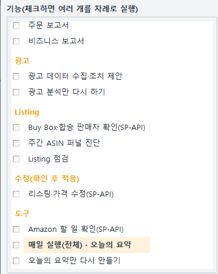
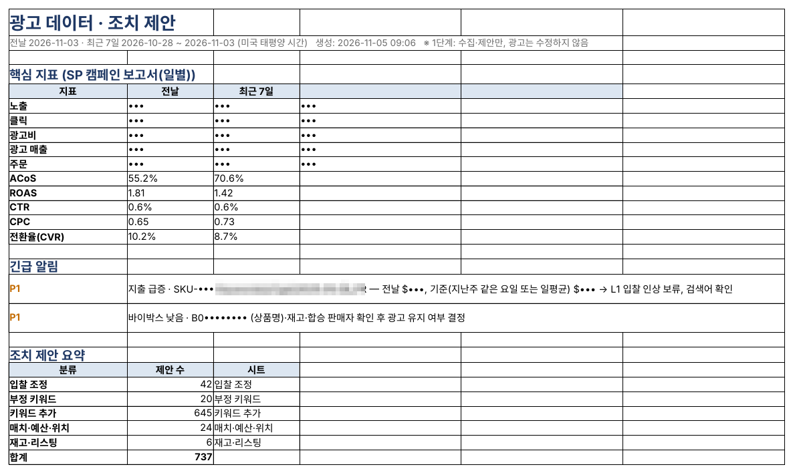
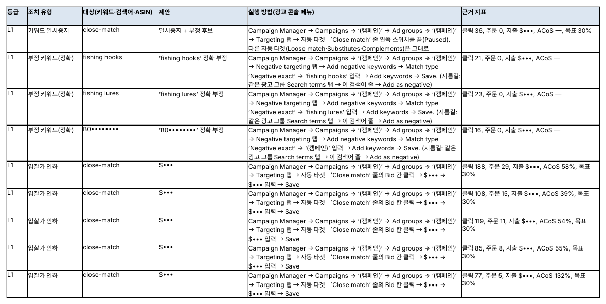

## 광고비는 조용히 샌다

아마존 광고는 클릭할 때마다 돈이 나갑니다. 캠페인이 수십 개, 키워드와 검색어가 수천 개가 되면 어느 클릭이 팔리고 어느 클릭이 버려지는지 사람이 일일이 보기 어렵습니다.

돈이 새는 곳은 대부분 다음 네 가지입니다.

- **팔리지 않는 검색어** — 클릭은 계속 나는데 주문이 없는 검색어
- **맞지 않는 입찰가** — 팔리기는 하지만 광고비가 이익을 넘는 키워드
- **놓친 기회** — 자동 캠페인에서 잘 팔리는데 정확 일치 키워드로 옮기지 않은 검색어
- **재고와 어긋난 광고** — 재고가 거의 없거나 Buy Box를 잃었는데 계속 도는 광고

SellerMorning의 광고 기능은 이 네 가지를 매일 찾아 ‘무엇을, 어디서, 얼마나’ 바꾸면 되는지 제안합니다.

*프로그램 왼쪽의 기능 목록. 광고 기능은 ‘광고 데이터 수집·조치 제안’과, 이미 받은 자료로 분석만 다시 하는 ‘광고 분석만 다시 하기’ 두 가지입니다.*

## 광고만 보지 않고 함께 본다

광고 판단은 광고 보고서만으로는 부족합니다. 그래서 네 가지 자료를 한 번에 모아 맞춰 봅니다.

| 자료            | 내용                                                                                       |
|-----------------|--------------------------------------------------------------------------------------------|
| 광고 보고서     | 검색어·타깃팅·캠페인(게재 위치 포함)·광고 상품, 스폰서 브랜드 검색어(최근 30일, 하루 단위) |
| Brand Analytics | 검색어 성과(SQP), 카탈로그 성과(SCP), 인기 검색어(TST)                                     |
| 재고·상품       | FBA 재고, 전체 상품(제목·가격)                                                             |
| 비즈니스 보고서 | Buy Box 비율, 광고 외 매출까지 포함한 전체 매출                                            |

광고 보고서는 만드는 데 20~40분이 걸리므로, 매일 실행의 첫 단계에서 미리 요청해 두고 다른 기능이 도는 동안 기다립니다. Amazon Ads API가 연결돼 있으면 API로 받고, 안 되면 광고 콘솔 화면에서 받습니다.

*광고 보고서의 ‘요약’ 시트. 핵심 지표, 긴급 알림, 분류별 제안 수를 한눈에 봅니다(금액·노출·클릭·주문 수는 가림).*

## 제안에는 ‘어디를 눌러 무엇을 바꾸는지’까지 적는다

제안은 다섯 가지로 나뉩니다.

| 분류           | 예                                                                                          |
|----------------|---------------------------------------------------------------------------------------------|
| 입찰 조정      | ACoS가 목표의 1.3배를 넘는 키워드의 입찰가 인하, 클릭 30번에 주문 0인 타깃 일시중지         |
| 부정 키워드    | 클릭 15번 이상, 주문 0인 검색어를 정확 부정으로                                             |
| 키워드 추가    | 자동·확장 캠페인에서 팔린 검색어를 정확 일치로 수확, Brand Analytics 인기 검색어 중 빠진 것 |
| 매치·예산·위치 | 검색 결과 상단 · 상품 페이지 등 게재 위치별 조정, 예산 소진 캠페인                          |
| 재고·리스팅    | 재고 14일치도 안 남은 상품은 입찰 낮추기, Buy Box를 잃은 상품은 광고 재검토                 |

모든 제안에는 근거 지표(클릭·주문·지출·ACoS), 기간, 적용한 규칙, 그리고 **실행 방법** 칸이 있습니다. 실행 방법에는 광고 콘솔의 영어 메뉴 이름 그대로, 어느 캠페인 → 어느 광고 그룹 → 어느 탭에서 무엇을 입력하는지 적혀 있어 그대로 따라 하면 됩니다.

*‘조치 제안’ 시트. 제안마다 광고 콘솔에서 누를 메뉴 경로와 근거 지표가 적혀 있습니다(캠페인 이름·금액은 가림).*

등급도 붙습니다. L1은 소폭이고 되돌릴 수 있는 조정, L2는 승인이 필요한 조정, L3는 사람이 판단할 일입니다.

## 내 상품의 원가로 목표를 정하고, 결과까지 확인한다

- **상품별 목표 ACoS** — 설정 파일에 원가·물류비를 넣으면 상품마다 손익분기 ACoS를 계산하고, 그보다 낮은 목표로 판단합니다. 원가가 없는 상품은 기본 목표(예: 30%)를 씁니다.
- **보호 키워드와 캠페인 용도** — 브랜드명처럼 절대 부정 키워드로 제안하지 않을 단어와, 캠페인별 용도(탐색·성과·방어 등)를 지정할 수 있습니다.
- **지난 제안의 효과** — 최근 30일 제안을 그 뒤 광고 자료와 비교해 실행했는지 추정하고, 제안 전 7일과 후 7일의 지출·주문·ACoS, 아낀 지출을 보여 줍니다.
- **광고는 바꾸지 않음** — 이 기능은 자료를 모으고 제안만 합니다. 입찰가·키워드·예산은 셀러가 제안을 보고 직접 바꿉니다.

다음 글에서는 리스팅 점검과, 확인한 것만 적용하는 리스팅·가격 수정을 소개합니다.

---

**아마존 셀러 시리즈**

1. [누구나 아마존 셀러가 될 수 있다](../amazon-seller-1-getting-started/) — 등록, 상품 등록, 판매 시작
2. [셀러가 된 다음의 진짜 어려움](../amazon-seller-2-real-challenge/) — 모든 상품을 늘 지켜볼 수 없고, Seller Central은 복잡하다
3. [판매 데이터를 한눈에](../amazon-seller-3-sales-data/) — 재고·주문·매출 관리
4. **광고를 한눈에** — 광고 분석과 조치 제안 (이 글)
5. [리스팅을 한눈에](../amazon-seller-5-listings/) — 점검과 수정
