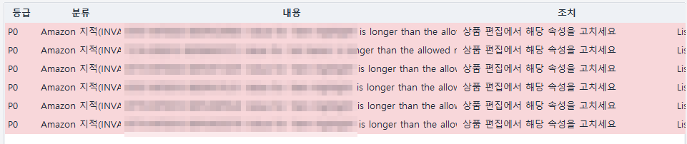
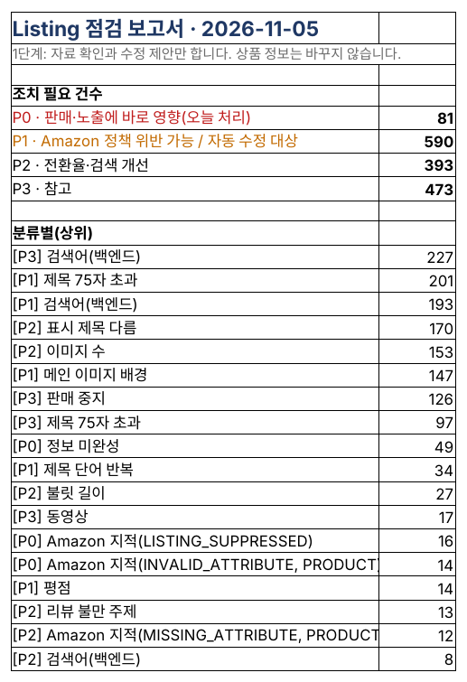
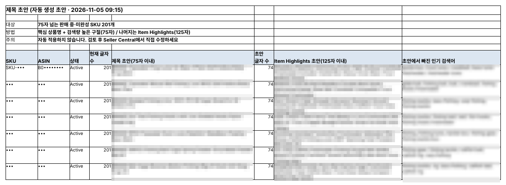
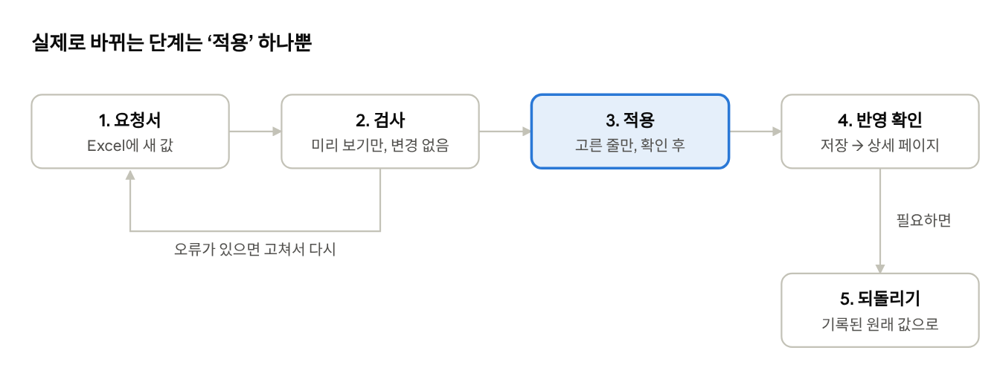
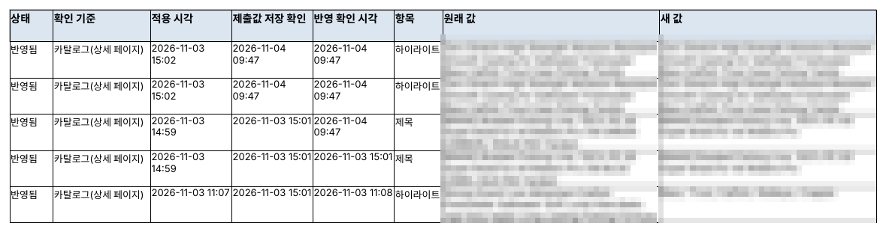

## 리스팅 규칙은 계속 바뀐다

2026년 7월 27일부터 아마존은 미디어를 제외한 모든 카테고리에서 상품 제목을 띄어쓰기 포함 75자 이내로 요구합니다. 넘치는 내용은 새 항목인 Item Highlights(125자)로 옮기고, 그래도 긴 제목은 아마존 AI가 순차적으로 고쳐 씁니다. 브랜드 등록(Brand Registry)을 한 브랜드 소유자는 적용 전 14일 동안 검토할 수 있습니다.

제목뿐이 아닙니다. 불릿, 검색어, Item Highlights, 이미지에도 길이·문자·배경 규칙이 있고, 어기면 검색에서 빠지거나 판매가 멈춥니다. 저희 상품만 해도 판매 중·미완성 262개 중 201개가 75자를 넘었습니다.

마지막 글에서는 리스팅을 점검하고, 고칠 내용을 확인한 뒤 안전하게 적용하는 방법을 소개합니다.

## Listing 점검: 수백 개 리스팅을 규칙대로 한 번에

Listing 점검은 네 가지 자료를 보기만 하고 비교합니다. 전체 상품 보고서(제목·상태), 카테고리 리스팅 보고서(불릿·검색어·Item Highlights), Seller Central 상품 관리 화면(검색 제한·수정 필요), 그리고 고객이 보는 amazon.com 상세 페이지입니다.

| 항목                   | 점검 기준                                                                   |
|------------------------|-----------------------------------------------------------------------------|
| 제목                   | 75자 이내, 같은 단어 2번까지, 금지 문자(! \$ ? \_ { } ^ ¬ ¦)·홍보 문구 없음 |
| 불릿                   | 5개, 각 10~255자, 이모지·™·®·링크·근거 없는 주장 없음                       |
| 검색어·Item Highlights | 검색어 249바이트, Item Highlights 125자 이내                                |
| 상세 페이지            | 이미지 7장 이상, 메인 이미지 흰 배경·1000px 이상, A+, 평점 4.0 이상         |
| 상태                   | 정보 미완성, 재고가 있는데 비활성, 검색 제한, 상세 페이지 삭제              |

결과는 P0(판매·노출에 바로 영향)부터 P3(참고)까지 등급으로 나뉘고, 상세 페이지는 광고비가 많은 상품부터 확인합니다. 아마존이 직접 지적한 문제(속성 값이 허용 길이를 넘는 경우 등)는 P0로 올라와 ‘오늘의 요약’ 맨 위에 나옵니다.

*‘오늘의 요약’에 올라온 P0 항목. Item Highlight 등 속성 값이 허용 길이를 넘었다는 아마존의 지적과, 상품 편집에서 해당 속성을 고치라는 조치가 함께 나옵니다(SKU·ASIN은 가림).*

*Listing 점검 보고서의 ‘요약’. 등급별 건수와 분류별 상위 문제를 보여 줍니다.*

## 고칠 내용까지 만들어 주는 기능들

- **제목 초안** — 75자를 넘는 제목마다 핵심 상품명과 검색량 높은 구절로 75자 초안을 만들고, 나머지는 Item Highlights(125자) 초안으로 옮깁니다. 초안에서 빠진 인기 검색어도 알려 줍니다.
- **Buy Box·합승 판매자** — 판매 중인 ASIN마다 Buy Box를 누가 가졌는지, 어제 없던 판매자가 내 페이지에 붙었는지 매일 확인합니다.
- **주간 ASIN 퍼널 진단** — Brand Analytics의 검색 노출·클릭·장바구니·구매를 지난 4주 평균과 비교해, 어느 단계에서 고객을 잃고 있는지 찾습니다. 수정 전후 2주를 비교해 고친 효과도 보여 줍니다.

*‘제목 초안’ 시트. 75자 제목 초안, Item Highlights 초안, 빠진 인기 검색어가 나란히 나옵니다(브랜드·SKU·ASIN은 가림).*

## 수정은 확인한 것만, 되돌릴 수 있게

제목·불릿·검색어·설명·Item Highlights·가격은 아마존 공식 API로 고칩니다. 다만 바로 바꾸지 않고 다섯 단계를 거칩니다.

*리스팅·가격 수정 흐름 · 5단계*

1. **요청서** — Excel 요청서에 SKU, 항목, 새 값을 적습니다. Listing 점검의 제목 초안을 미리 채울 수도 있습니다.
2. **검사** — 아마존에 ‘미리 보기’로만 보내 오류를 확인합니다. 실제로는 아무것도 바뀌지 않습니다. 가격 줄에는 새 가격의 수수료와 1개당 남는 금액이 함께 나옵니다.
3. **적용** — 셀러가 고른 줄만, 확인 창을 한 번 더 거쳐 적용합니다.
4. **반영 확인** — 아마존이 ‘접수됨’이라고 답해도 실제 반영은 몇 분에서 몇 시간 뒤입니다. 그래서 내 리스팅에 저장됐는지, 고객에게 보이는 상세 페이지까지 바뀌었는지 두 단계로 다시 읽어 확인합니다.
5. **되돌리기** — 모든 변경은 원래 값과 함께 기록되고, 기록에서 하나를 고르면 원래 값으로 되돌립니다.

안전 장치도 있습니다. 가격을 30% 넘게 바꾸거나 손해 보는 가격이면 따로 허용해야 적용되고, 한 번에 최대 50건, 적용한 줄은 ‘완료’로 바뀌어 두 번 적용되지 않습니다.

*실제 변경 기록. 적용 시각, 제출값 저장 확인, 상세 페이지 반영 확인 시각과 원래 값·새 값이 남습니다(브랜드·SKU·ASIN은 가림).*

## 시리즈를 마치며

아마존 셀러가 되는 것은 누구나 할 수 있지만, 상품이 늘수록 성패는 ‘매일 얼마나 빨리 문제를 찾는가’에서 갈립니다. SellerMorning은 데이터·광고·리스팅을 매일 대신 확인하고, 셀러는 아침에 ‘오늘의 요약’ 한 장을 보고 결정만 하면 되도록 만들었습니다.

| 이런 셀러에게               | 이유                                          |
|-----------------------------|-----------------------------------------------|
| 상품이 수십~수백 개인 셀러  | 상품이 많을수록 놓치는 문제가 많아집니다      |
| FBA로 미국에 파는 해외 셀러 | 미국 시간·보고서 대기를 프로그램이 대신합니다 |
| 광고비 비중이 큰 브랜드     | 매일 광고 제안과 효과 추적이 나옵니다         |

SellerMorning은 지금 저희가 매일 쓰면서 계속 다듬고 있는 프로그램입니다. 새 기능과 운영하며 배운 점은 이 블로그에 계속 기록하겠습니다.

---

**아마존 셀러 시리즈**

1. [누구나 아마존 셀러가 될 수 있다](../amazon-seller-1-getting-started/) — 등록, 상품 등록, 판매 시작
2. [셀러가 된 다음의 진짜 어려움](../amazon-seller-2-real-challenge/) — 모든 상품을 늘 지켜볼 수 없고, Seller Central은 복잡하다
3. [판매 데이터를 한눈에](../amazon-seller-3-sales-data/) — 재고·주문·매출 관리
4. [광고를 한눈에](../amazon-seller-4-ads/) — 광고 분석과 조치 제안
5. **리스팅을 한눈에** — 점검과 수정 (이 글)
