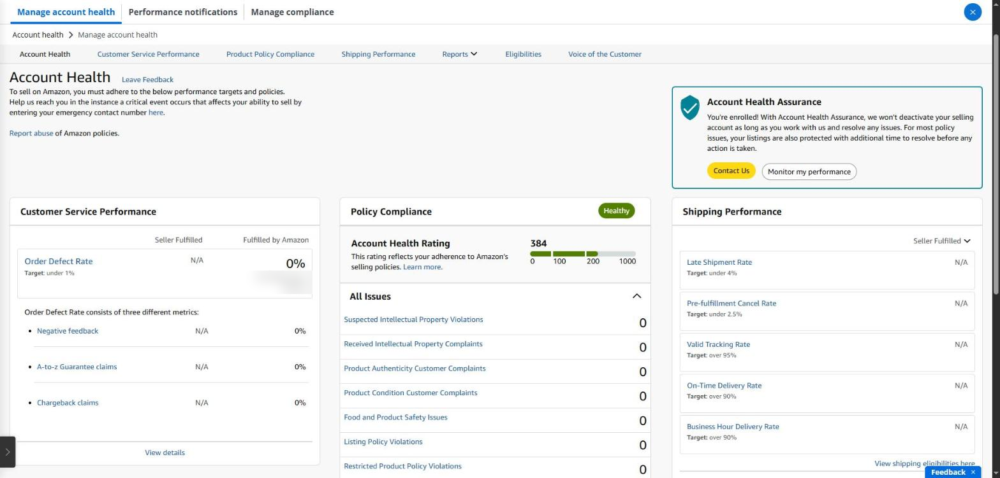
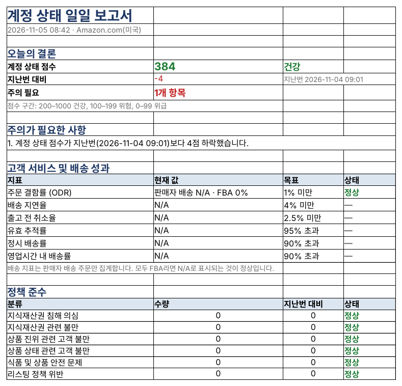

## 계정이 멈추면 모든 것이 멈춘다

아마존은 셀러 계정마다 **어카운트 헬스 등급**(Account Health Rating, AHR)을 0~1000점으로 매깁니다. 점수가 낮아지면 계정이 비활성화될 수 있고, 그러면 판매·광고·정산이 모두 멈춥니다 ([AHR 가이드](https://www.sellersprite.com/en/blog/amazon-account-health-rating-2026)).

| 점수     | 상태            | 뜻                           |
|----------|-----------------|------------------------------|
| 200~1000 | 건강(Healthy)   | 정상. 새 계정은 200에서 시작 |
| 100~199  | 위험(At risk)   | 곧 비활성화될 수 있음        |
| 0~99     | 위급(Unhealthy) | 바로 비활성화 대상           |

### Seller Central에서 보는 법

메뉴(☰) → **어카운트 헬스 → 어카운트 헬스 관리**에서 세 묶음을 봅니다.

- **고객 서비스 성과** — 주문 결함률(ODR, 부정 피드백·A-to-z 클레임·차지백) 1% 미만
- **정책 준수** — 지식재산권, 상품 진위, 상품 상태, 리스팅 정책 등. 하나라도 쌓이면 점수가 떨어집니다
- **배송 성과** — 셀러 배송(FBM) 주문의 배송 지연·취소·추적률. FBA만 한다면 N/A가 정상입니다

문제는 이 페이지를 매일 열어 ‘어제와 무엇이 달라졌는지’ 비교하는 일입니다. 새 정책 위반은 조용히 하나 더 늘어날 뿐이고, 대응 기한이 있는 것도 많습니다.

*Seller Central ‘어카운트 헬스’ 화면(영어 화면). 계정 상태 평가(AHR)와 주문 결함률 등을 한곳에서 봅니다. 주문 수는 가렸습니다.*

화면 오른쪽 위의 **Account Health Assurance**(계정 상태 보장)도 확인해 두세요. 자격이 되는 셀러는 여기에 등록되어, 아마존과 협력해 문제를 해결하는 동안에는 계정이 비활성화되지 않습니다. 등록되어 있다면 ‘You're enrolled!’라고 표시됩니다.

### SellerMorning의 ‘계정 상태’

- 점수와 지표를 매일 읽어 **지난번 대비 변화**를 보여 줍니다.
- 정책 이슈는 ‘이슈 대장’에 쌓아, 새로 생긴 것만 알려 주고 같은 이슈를 두 번 모으지 않습니다.
- 영향 받는 상품, 클레임(차지백·A-to-z·SAFE-T), 고객의 소리(VoC)까지 한 파일에 모읍니다.
- 점수가 떨어지거나 새 위반이 생기면 ‘오늘의 요약’ 맨 위(P0)에 올립니다.

*계정 상태 일일 보고서. 점수와 지난번 대비 변화, 지표별 목표와 상태, 정책 분류별 건수가 한 장에 나옵니다.*

### 점수가 떨어졌을 때 대응 순서

1. **무엇이 새로 생겼는지 확인** — ‘모든 이슈’에서 늘어난 항목과 영향 받는 상품을 찾습니다.
2. **기한 확인** — 정책 위반에는 대응 기한이 붙는 경우가 많고, 기한을 넘기면 리스팅이 내려가거나 점수가 더 떨어질 수 있습니다.
3. **원인을 고치고 대응** — 리스팅을 수정하거나 인보이스 같은 증빙을 준비해, 해당 이슈 화면에서 이의를 제기하거나 조치 계획을 제출합니다.
4. **며칠간 다시 확인** — 처리한 이슈가 목록에서 빠지고 점수가 회복되는지 지켜봅니다.

---

**아마존 셀러 시리즈**

1. [누구나 아마존 셀러가 될 수 있다](../amazon-seller-1-getting-started/)
2. [셀러가 된 다음의 진짜 어려움](../amazon-seller-2-real-challenge/)
3. [판매 데이터를 한눈에](../amazon-seller-3-sales-data/)
4. [광고를 한눈에](../amazon-seller-4-ads/)
5. [리스팅을 한눈에](../amazon-seller-5-listings/)
6. **계정 상태 지키기** (이 글)
7. [FBA 재고, 품절도 과재고도 없게](../amazon-seller-7-fba-inventory/)
8. [주문·반품 숫자에서 문제 찾기](../amazon-seller-8-orders-returns/)
9. [비즈니스 보고서로 전환율 읽기](../amazon-seller-9-business-reports/)
10. [Brand Analytics로 이탈 단계 찾기](../amazon-seller-10-brand-analytics/)
11. [Buy Box와 합승 판매자 지키기](../amazon-seller-11-buy-box/)
12. [잃어버린 FBA 재고 보상받기](../amazon-seller-12-fba-reimbursement/)
13. [가격을 바꾸기 전에 이익부터](../amazon-seller-13-fees-profit/)
14. [아침 15분 셀러 루틴](../amazon-seller-14-daily-routine/)
15. [공식 API로 안전한 자동화](../amazon-seller-15-safe-automation/)

*이 글은 개인 경험을 바탕으로 작성되었으며, Amazon.com, Inc. 및 그 계열사와 관련이 없습니다. 정책·수수료는 작성 시점 기준이니 최신 내용은 Seller Central에서 확인하세요.*
