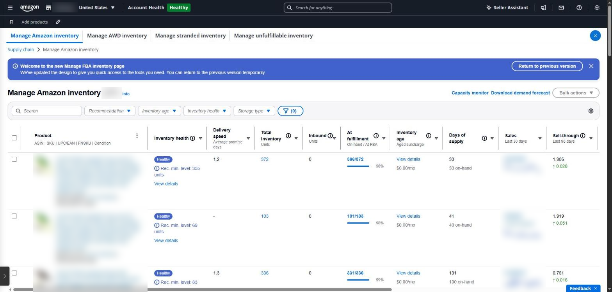
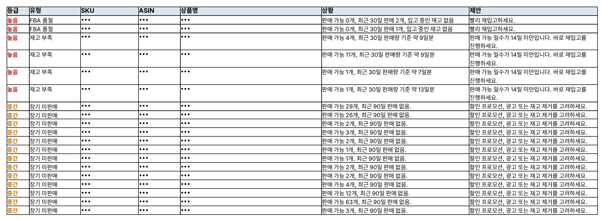

## 너무 적어도, 너무 많아도 돈이 나간다

FBA 재고는 양쪽에서 비용이 붙습니다. 품절되면 판매와 검색 순위를 잃고, 오래 쌓아 두면 추가 요금이 나갑니다 ([2026 장기 재고 추가요금 가이드](https://www.inventoryhero.ai/guides/amazon-aged-inventory-surcharge-2026)).

| 비용               | 언제 붙나                                                        |
|--------------------|------------------------------------------------------------------|
| 월 보관료          | 매달, 부피 기준(10~12월은 더 비쌓)                               |
| 장기 재고 추가요금 | 창고에 181일 넘게 있는 재고. 오래될수록 단계적으로 올라감        |
| 재고 부족 수수료   | 판매 속도에 비해 재고가 너무 적을 때(약 28일치 미만)             |
| 용량 한도          | 보낼 수 있는 양 자체가 제한됨(판매 예측·재고 성과 지수 IPI 반영) |

Seller Central 안내(2026년 11월 기준)에 따르면 **2027년 2월 1일부터** 월 보관료와 장기 재고 추가요금이 ‘통합 월 보관료(Unified Monthly Storage Fee)’ 하나로 합쳐지고, 재고 부족 수수료도 새로운 공급 일수 계산 방식을 씁니다. 정확한 요금과 구간은 자주 바뀌므로 Seller Central의 수수료 안내를 확인해야 합니다.

### Seller Central에서 보는 곳

- **공급망 → 아마존 재고 관리** — SKU별 판매 가능·입고 중·예약 재고
- **FBA 대시보드** — IPI와 영향 요인, 재고 점유율, 장기 재고 추가요금 예상
- **배송 관리** — 입고 배송별 수령 수량
- **공급망 보고서 → FBA 재고 보고서** — 위 내용을 SKU별 표로 내려받기

화면은 많지만 ‘어느 SKU를 언제 얼마나 보내야 하나’는 셀러가 직접 계산해야 합니다.

*Seller Central ‘아마존 재고 관리’ 화면(영어 화면). 재고 상태, 총재고, 공급 일수, 재고 연령이 상품마다 한 줄씩 나옵니다. 상품명·ASIN·판매액은 가렸습니다.*

### SellerMorning의 ‘FBA 재고’

- FBA 재고 보고서를 하루에 한 번 받아 SKU마다 **판매 가능 일수**를 계산합니다. 14일 미만은 ‘긴급 보충’, 30일 미만은 ‘보충 주의’입니다(설정에서 바꿀 수 있음).
- 품절, 재고는 있는데 판매 불가(비활성), 장기 미판매, 판매 불가 재고, 입고 수량 부족을 등급순으로 알려 줍니다.
- FBA 대시보드의 IPI·재고 점유율·추가요금 예상도 같이 읽어 요약에 넣습니다.
- 품절 직전 상품은 광고 기능에도 전달되어, 재고가 없는데 광고비만 쓰지 않도록 입찰 인하를 제안합니다.

*FBA 재고 보고서의 ‘확인 필요’ 시트(SKU·ASIN·상품명은 가림).*

### 언제, 얼마나 보낼까

보충 시점은 간단한 계산으로 잡을 수 있습니다.

- **하루 판매량** = 최근 30일 판매 수량 ÷ 30
- **판매 가능 일수** = (판매 가능 재고 + 입고 중 재고) ÷ 하루 판매량
- **보낼 때** = 판매 가능 일수가 ‘생산·배송·입고에 걸리는 날 + 여유분’보다 짧아지기 전

예를 들어 하루 4개씩 팔리고, 출고해서 FBA 창고에 입고되기까지 35일이 걸리며, 여유분을 14일로 잡는다면 재고가 196개(4개 × 49일) 아래로 내려가기 전에 다음 물량을 보내야 합니다.

반대로 지금 재고가 다 팔리기까지 180일 넘게 걸릴 것 같은 SKU는, 남는 물량이 장기 재고 추가요금 대상이 됩니다. 입고를 줄이거나 할인·프로모션으로 회전시키는 편이 낫습니다.

---

**아마존 셀러 시리즈**

1. [누구나 아마존 셀러가 될 수 있다](../amazon-seller-1-getting-started/)
2. [셀러가 된 다음의 진짜 어려움](../amazon-seller-2-real-challenge/)
3. [판매 데이터를 한눈에](../amazon-seller-3-sales-data/)
4. [광고를 한눈에](../amazon-seller-4-ads/)
5. [리스팅을 한눈에](../amazon-seller-5-listings/)
6. [계정 상태 지키기](../amazon-seller-6-account-health/)
7. **FBA 재고, 품절도 과재고도 없게** (이 글)
8. [주문·반품 숫자에서 문제 찾기](../amazon-seller-8-orders-returns/)
9. [비즈니스 보고서로 전환율 읽기](../amazon-seller-9-business-reports/)
10. [Brand Analytics로 이탈 단계 찾기](../amazon-seller-10-brand-analytics/)
11. [Buy Box와 합승 판매자 지키기](../amazon-seller-11-buy-box/)
12. [잃어버린 FBA 재고 보상받기](../amazon-seller-12-fba-reimbursement/)
13. [가격을 바꾸기 전에 이익부터](../amazon-seller-13-fees-profit/)
14. [아침 15분 셀러 루틴](../amazon-seller-14-daily-routine/)
15. [공식 API로 안전한 자동화](../amazon-seller-15-safe-automation/)

*이 글은 개인 경험을 바탕으로 작성되었으며, Amazon.com, Inc. 및 그 계열사와 관련이 없습니다. 정책·수수료는 작성 시점 기준이니 최신 내용은 Seller Central에서 확인하세요.*
