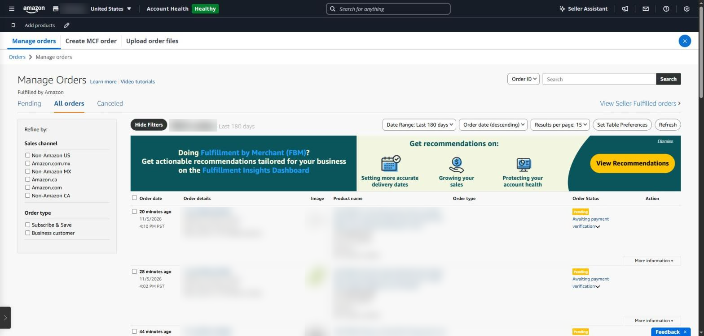
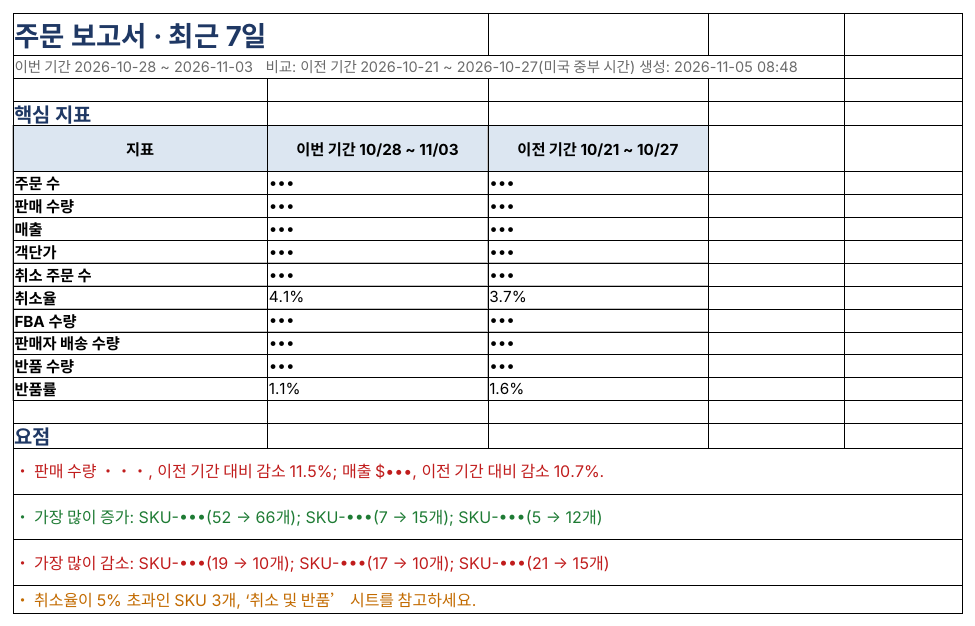

## ‘어제 얼마나 팔렸나’보다 ‘무엇이 달라졌나’

판매가 줄었을 때 필요한 것은 총액이 아니라 어느 SKU가, 어느 날부터, 어느 지역에서 줄었는지입니다. 반품도 마찬가지입니다. 반품률이 높은 SKU는 상품 설명이나 품질에 문제가 있다는 신호입니다.

### Seller Central에서 보는 곳

- **주문 → 주문 관리** — 주문 하나씩 확인(미발송·취소 요청 등)
- **주문 → 주문 보고서(All Orders)** — 기간을 골라 모든 주문을 파일로 받기
- **주문 → 반품 관리 → 반품 및 회수 인사이트** — 반품률과 반품 사유
- **주문 보고서 → FBA 고객 반품 보고서** — 반품 건별 사유와 상태

두 가지를 조심해야 합니다. 첫째, 보고서와 화면의 주문 시각은 미국 시간(파일에 따라 UTC)으로 기록되어 한국 날짜와 하루가 어긋나기 쉽습니다. 둘째, 북미 통합 계정이라면 All Orders에 미국·캐나다·멕시코 주문이 섞여 나옵니다.

*Seller Central ‘주문 관리’ 화면(영어 화면). 주문이 한 건씩 나열되어 전체 흐름을 보려면 따로 정리해야 합니다. 주문 번호·상품·금액은 가렸습니다.*

### SellerMorning의 ‘주문 보고서’

- 어제·최근 7일·최근 30일 중 골라, 같은 길이의 이전 기간과 자동으로 비교합니다.
- 모든 주문 시각을 **미국 중부 시간**으로 바꿔 날짜를 정하고, Amazon.com 주문만 남깁니다.
- 일별 추이, SKU 순위(가장 많이 늘고 줄어든 SKU), 주별 판매 분포를 보여 줍니다.
- 취소율 5%, 반품률 10%를 넘는 SKU와, 발송 기한이 가까운 셀러 배송 주문을 알려 줍니다(건수가 너무 적으면 비율 알림은 생략).
- 같은 날 이미 받은 데이터가 있으면 다시 받지 않습니다.

*주문 보고서 ‘요약’. 이번 기간과 이전 기간의 핵심 지표와 요점(주문 수·매출·SKU는 가림).*

### 반품 사유별로 먼저 고칠 곳

반품률이 높은 SKU는 반품 보고서의 사유를 함께 봐야 무엇을 고칠지 알 수 있습니다.

| 자주 나오는 반품 사유 | 먼저 볼 곳 |
|---|---|
| 사이즈·핏이 맞지 않음 | 사이즈 표, 상세 이미지의 치수 표기 |
| 설명과 다름 | 제목·불릿·이미지가 실제 상품과 맞는지 |
| 불량·파손 | 포장 방식, 출고 전 검수, 공급처 품질 |
| 더 이상 필요 없음·잘못 주문 | 대부분 정상 범위. 비율이 갑자기 늘 때만 확인 |

---

**아마존 셀러 시리즈**

1. [누구나 아마존 셀러가 될 수 있다](../amazon-seller-1-getting-started/)
2. [셀러가 된 다음의 진짜 어려움](../amazon-seller-2-real-challenge/)
3. [판매 데이터를 한눈에](../amazon-seller-3-sales-data/)
4. [광고를 한눈에](../amazon-seller-4-ads/)
5. [리스팅을 한눈에](../amazon-seller-5-listings/)
6. [계정 상태 지키기](../amazon-seller-6-account-health/)
7. [FBA 재고, 품절도 과재고도 없게](../amazon-seller-7-fba-inventory/)
8. **주문·반품 숫자에서 문제 찾기** (이 글)
9. [비즈니스 보고서로 전환율 읽기](../amazon-seller-9-business-reports/)
10. [Brand Analytics로 이탈 단계 찾기](../amazon-seller-10-brand-analytics/)
11. [Buy Box와 합승 판매자 지키기](../amazon-seller-11-buy-box/)
12. [잃어버린 FBA 재고 보상받기](../amazon-seller-12-fba-reimbursement/)
13. [가격을 바꾸기 전에 이익부터](../amazon-seller-13-fees-profit/)
14. [아침 15분 셀러 루틴](../amazon-seller-14-daily-routine/)
15. [공식 API로 안전한 자동화](../amazon-seller-15-safe-automation/)
