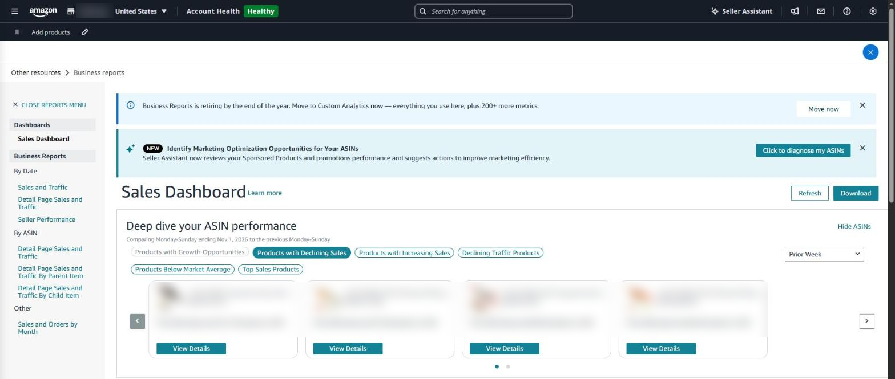
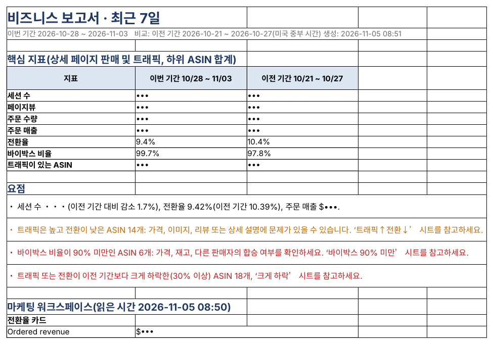

## 판매 = 방문 × 전환율

매출이 줄었다면 원인은 둘 중 하나입니다. 상세 페이지를 보러 오는 사람(세션)이 줄었거나, 보러 온 사람 중 사는 비율(전환율)이 떨어졌거나. 둘을 나눠 보면 해야 할 일이 보입니다.

| 세션 | 전환율 | 뜻 | 먼저 볼 곳 |
|---|---|---|---|
| ↓ | 그대로 | 찾아오는 사람이 줄었다 | 검색 순위, 광고 노출, 재고 |
| 그대로 | ↓ | 보러 와서 안 산다 | 가격, 리뷰·평점, 이미지, Buy Box |
| ↓ | ↓ | 둘 다 떨어졌다 | Buy Box와 재고부터(둘 다 영향을 줌) |
| ↑ | ↓ | 새로 온 방문자가 상품과 안 맞는다 | 광고 검색어·타깃이 상품과 맞는지 |

### Seller Central에서 보는 곳

사이트 맵 → **기타 리소스 → 비즈니스 보고서** → 왼쪽 ‘ASIN별’ → **하위 항목별 상세 페이지 판매 및 트래픽**.

| 지표                           | 뜻                                                       |
|--------------------------------|----------------------------------------------------------|
| 세션                           | 상세 페이지를 방문한 횟수(하루 안 여러 번 본 것은 한 번) |
| 페이지뷰                       | 상세 페이지가 표시된 전체 횟수                           |
| 주문 수량·매출                 | 그 기간 주문된 개수와 금액                               |
| 전환율(Unit Session %)         | 주문 수량 ÷ 세션                                         |
| Buy Box 비율(Featured Offer %) | 내 오퍼가 구매 버튼을 차지한 비율                        |

날짜 범위는 직접 고를 수 있지만, 이전 기간과 비교하려면 두 번 받아 맞춰 봐야 합니다. 최근 2~3일치는 아직 수치가 바뀌기도 합니다.

참고로 2026년 11월 현재 비즈니스 보고서 화면에는 **‘비즈니스 보고서가 연말에 종료되니 Custom Analytics로 옮기라’**는 안내가 나옵니다. 같은 지표를 계속 보려면 새 메뉴에서 어디에 있는지 미리 확인해 두는 것이 좋습니다.

*Seller Central ‘비즈니스 보고서’ 판매 대시보드(영어 화면). 왼쪽 메뉴에서 날짜별·ASIN별 보고서를 고릅니다. 상품 정보는 가렸습니다.*

### SellerMorning의 ‘비즈니스 보고서’

- 이번 기간과 이전 기간을 각각 받아 하위 ASIN별로 나란히 보여 줍니다(어제·7일·14일·30일).
- **트래픽↑전환↓** — 방문은 많은데 전환율이 매장 평균의 절반도 안 되는 ASIN. 가격·이미지·리뷰·설명을 볼 때입니다.
- **전환↑트래픽↓** — 잘 팔리는데 방문이 적은 ASIN. 광고를 늘릴 후보입니다.
- **Buy Box 90% 미만**, **30% 넘게 하락**한 ASIN을 따로 모읍니다.
- 마케팅 워크스페이스의 전환율 카드·인기 검색어도 같이 읽습니다.

*비즈니스 보고서 ‘요약’. 세션·전환율·Buy Box를 이전 기간과 비교하고, 확인할 ASIN 묶음을 알려 줍니다(세션·매출은 가림).*

---

**아마존 셀러 시리즈**

1. [누구나 아마존 셀러가 될 수 있다](../amazon-seller-1-getting-started/)
2. [셀러가 된 다음의 진짜 어려움](../amazon-seller-2-real-challenge/)
3. [판매 데이터를 한눈에](../amazon-seller-3-sales-data/)
4. [광고를 한눈에](../amazon-seller-4-ads/)
5. [리스팅을 한눈에](../amazon-seller-5-listings/)
6. [계정 상태 지키기](../amazon-seller-6-account-health/)
7. [FBA 재고, 품절도 과재고도 없게](../amazon-seller-7-fba-inventory/)
8. [주문·반품 숫자에서 문제 찾기](../amazon-seller-8-orders-returns/)
9. **비즈니스 보고서로 전환율 읽기** (이 글)
10. [Brand Analytics로 이탈 단계 찾기](../amazon-seller-10-brand-analytics/)
11. [Buy Box와 합승 판매자 지키기](../amazon-seller-11-buy-box/)
12. [잃어버린 FBA 재고 보상받기](../amazon-seller-12-fba-reimbursement/)
13. [가격을 바꾸기 전에 이익부터](../amazon-seller-13-fees-profit/)
14. [아침 15분 셀러 루틴](../amazon-seller-14-daily-routine/)
15. [공식 API로 안전한 자동화](../amazon-seller-15-safe-automation/)

*이 글은 개인 경험을 바탕으로 작성되었으며, Amazon.com, Inc. 및 그 계열사와 관련이 없습니다. 정책·수수료는 작성 시점 기준이니 최신 내용은 Seller Central에서 확인하세요.*
