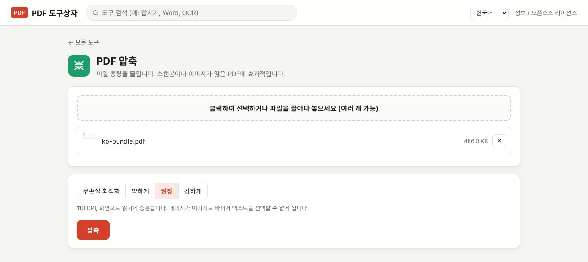

PDF 용량이 큰 이유는 대부분 안에 든 이미지 때문입니다. 스캔본이나 사진이 많은 PDF는 이미지 해상도를 낮추면 용량이 크게 줄고, 글자만 있는 PDF는 줄일 여지가 별로 없습니다. 이 글에서는 PDF Toolbox의 압축 단계 네 가지가 각각 무엇을 하는지, 어떤 단계를 골라야 하는지를 정리합니다. 파일은 내 컴퓨터 밖으로 나가지 않습니다.

> **준비물**: [PDF Toolbox 최신 버전 다운로드](https://github.com/toolboxnotes/pdf-toolbox/releases/latest) (무료, Windows·Mac). 설치 방법은 [PDF Toolbox 소개 글](../offline-pdf-toolbox/)의 "다운로드와 설치"를 참고하세요.

## 먼저 내 PDF가 왜 큰지 보기

| PDF 종류 | 용량이 큰 이유 | 압축 효과 |
|---|---|---|
| 복합기로 스캔한 문서 | 페이지마다 고해상도 사진 한 장 | 큼 |
| 사진·도면이 많은 보고서 | 들어 있는 이미지 | 큼 |
| Word에서 저장한 글자 위주 문서 | 글꼴 데이터, 파일 구조 | 작음 |
| 이미 한 번 압축한 PDF | 줄일 데이터가 별로 없음 | 거의 없음 |

글자 위주 문서가 몇 MB나 된다면 글꼴이 통째로 들어갔거나 고해상도 로고 이미지가 페이지마다 반복된 경우가 많습니다.

## PDF 용량 줄이는 순서

*PDF 압축 화면. 무손실 최적화, 약하게, 권장, 강하게 중에서 고르고 각 단계의 설명이 아래에 나옵니다.*

1. **PDF Toolbox에 파일을 끌어다 놓고 PDF 압축을 고릅니다.** 여러 파일을 한꺼번에 넣어도 됩니다.
2. **압축 단계를 고릅니다.** 처음이라면 **무손실 최적화**부터 해 보고, 부족하면 **권장**으로 올리세요. 단계별 차이는 아래 표에 정리했습니다.
3. **압축**을 누릅니다. 파일 이름 뒤에 `_압축.pdf`가 붙은 파일이 저장되고, 원본은 그대로 남습니다. 여러 파일은 `압축.zip`으로 묶여 저장됩니다.

압축 결과가 원본보다 오히려 크면 원본을 그대로 저장하고 "(이미 작아서 원본 유지)"라고 알려 줍니다. 이미 최적화된 PDF에서 이런 경우가 생깁니다.

## 압축 단계 고르는 기준

| 단계 | 하는 일 | 글자 선택·검색 | 이럴 때 |
|---|---|---|---|
| 무손실 최적화 | 파일 구조만 정리 | 그대로 유지 | 화질을 조금도 건드리고 싶지 않을 때. 줄어드는 양은 보통 작음 |
| 약하게 | 페이지를 150 DPI 이미지로 | 안 됨 | 인쇄도 할 수 있는 화질이 필요할 때 |
| 권장 | 페이지를 110 DPI 이미지로 | 안 됨 | 메일로 보내 화면으로 읽을 문서 |
| 강하게 | 페이지를 80 DPI 이미지로 | 안 됨 | 용량이 가장 중요할 때. 작은 글씨는 흐려질 수 있음 |

핵심은 **무손실 최적화를 뺀 세 단계는 페이지를 이미지로 바꾼다**는 점입니다. 용량은 크게 줄지만 결과 파일에서 글자를 드래그하거나 Ctrl+F로 검색할 수 없습니다. 받는 사람이 내용을 복사해야 하는 문서라면 무손실 최적화를 쓰거나, 압축 후 [OCR로 검색 기능을 되살리는](../scanned-pdf-searchable-ocr/) 방법이 있습니다.

## 스캔본이 크다면 처음부터 줄이는 방법

- **복합기 설정**: 스캔 해상도를 300 DPI에서 200 DPI로, 컬러를 흑백(또는 회색조)으로 바꾸면 압축 전부터 용량이 크게 줍니다. 글자 문서는 200 DPI 흑백이면 충분합니다.
- **휴대폰 촬영본**: 사진을 PDF로 만들 때 원본 사진 크기 그대로 들어가므로 용량이 큽니다. PDF로 만든 다음 "권장" 단계로 한 번 압축하면 됩니다.

## 알아 둘 한계

- **글자 위주 PDF는 많이 줄지 않습니다.** 이미지가 거의 없으면 무손실 최적화로 조금 줄이는 정도가 한계입니다.
- **이미지로 바뀐 페이지는 되돌릴 수 없습니다.** 원본을 따로 보관하세요.
- **책갈피나 양식 입력란**은 이미지로 바꾸는 단계에서 사라질 수 있습니다.
- **암호가 걸린 PDF**는 먼저 [PDF 암호 해제](../pdf-password-protect-unlock/)를 해야 압축할 수 있습니다.

## 자주 묻는 질문

### 얼마나 줄어드나요?

파일마다 다릅니다. 고해상도 스캔본은 "권장" 단계에서 크게 줄고, 글자만 있는 문서는 거의 줄지 않습니다. 원본 용량은 파일 목록에, 압축한 파일의 용량은 완료 메시지에 표시되니 두 숫자를 비교하며 몇 단계를 시험해 보고 고르면 됩니다.

### 압축하면 인쇄했을 때 흐려지나요?

"약하게"(150 DPI)는 일반 인쇄에 무리가 없습니다. "권장"(110 DPI)과 "강하게"(80 DPI)는 화면용이라 인쇄하면 작은 글씨가 흐릿할 수 있습니다.

### 메일 첨부 한도가 10 MB인데 어떤 단계를 고를까요?

먼저 "권장"으로 해 보세요. 그래도 크면 [PDF 나누기](../split-pdf-extract-pages/)로 파일을 두세 개로 나눠 보내는 방법이 있습니다.

### 온라인 압축 사이트와 결과가 같나요?

방식은 비슷합니다. 차이는 파일을 서버에 올리지 않는다는 점과, 파일 크기·횟수 제한이 없다는 점입니다.

## 함께 보면 좋은 글

- [PDF 합치기](../merge-pdf-offline/)
- [스캔 PDF 검색 가능하게 만들기 (무료 OCR)](../scanned-pdf-searchable-ocr/)
- [PDF 나누기·페이지 추출](../split-pdf-extract-pages/)
- [무료 오프라인 PDF 변환기 PDF Toolbox 전체 기능](../offline-pdf-toolbox/)
