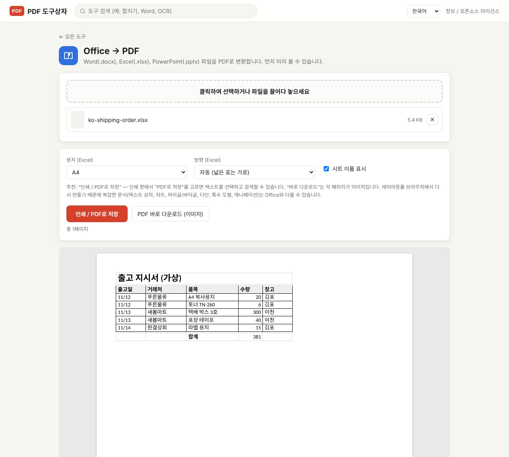

Excel 파일을 PDF로 바꾸는 가장 쉬운 방법은 Excel에서 "PDF로 저장"하는 것입니다. 그런데 Excel이 없는 컴퓨터이거나, 받은 `.xlsx`를 열어 보기만 하고 바로 PDF로 보내야 할 때가 있습니다. PDF Toolbox의 **Office → PDF**는 Excel 없이 `.xlsx`를 읽어 페이지로 배치하고, 미리 본 다음 PDF로 저장합니다. Word(.docx)와 PowerPoint(.pptx)도 같은 도구에서 됩니다.

> **준비물**: [PDF Toolbox 최신 버전 다운로드](https://github.com/toolboxnotes/pdf-toolbox/releases/latest) (무료, Windows·Mac). 설치 방법은 [PDF Toolbox 소개 글](../offline-pdf-toolbox/)의 "다운로드와 설치"를 참고하세요.

## Excel 파일을 PDF로 바꾸는 순서

*가상의 출고 지시서 `.xlsx`를 넣은 화면. 아래쪽에 실제로 저장될 페이지가 미리 보입니다.*

1. **PDF Toolbox에 `.xlsx` 파일을 끌어다 놓고 Office → PDF를 고릅니다.**
2. **용지와 방향을 정합니다.**
   - **용지 (Excel)**: A4 또는 Letter
   - **방향 (Excel)**: "자동 (넓은 표는 가로)"이 기본입니다. 열이 많은 시트는 알아서 가로로 놓습니다.
   - **시트 이름 표시**: 시트가 여러 개인 파일에서 각 시트 앞에 시트 이름을 넣습니다.
3. **미리 보기를 확인합니다.** 아래쪽에 페이지가 나오고, "총 N페이지"로 페이지 수를 알려 줍니다.
4. **저장 방식을 고릅니다.**
   - **인쇄 / PDF로 저장 (추천)**: 인쇄 창이 열리면 대상(프린터)에서 **PDF로 저장**을 고르세요. 글자를 선택하고 검색할 수 있는 PDF가 됩니다.
   - **PDF 바로 다운로드 (이미지)**: 인쇄 창 없이 바로 저장합니다. 각 페이지가 이미지라 글자 선택은 안 됩니다.

## 어떻게 옮겨지나

| 항목 | 결과 |
|---|---|
| 셀 값, 숫자 서식, 한글 | 그대로 |
| 셀 병합, 테두리, 배경색, 글자 굵기 | 그대로 |
| 수식 | Excel이 마지막으로 저장할 때 계산한 결과값으로 표시 |
| 숨긴 시트, 숨긴 열 | 나오지 않음 |
| 앞쪽의 빈 행·빈 열 | 건너뜀 (Excel 인쇄와 같이 내용이 있는 곳부터 시작) |
| 도형, 텍스트 상자, 차트 | 빈 상자로 표시 |

수식 결과는 파일 안에 저장된 값을 씁니다. Excel이나 Google 스프레드시트에서 저장한 파일은 문제없지만, 일부 프로그램이 자동으로 만든 파일은 계산 결과가 비어 있을 수 있습니다. 이럴 때는 Excel에서 한 번 열어 저장한 뒤 변환하세요.

## 인쇄 / PDF로 저장 vs 바로 다운로드

| | 인쇄 / PDF로 저장 | PDF 바로 다운로드 (이미지) |
|---|---|---|
| 글자 선택·검색 | 됨 | 안 됨 |
| 파일 용량 | 작음 | 큼 |
| 순서 | 인쇄 창에서 "PDF로 저장" 선택 필요 | 한 번에 저장 |
| 이럴 때 | 대부분의 경우 | 인쇄 창 설정이 번거로울 때, 받는 쪽에서 내용을 못 고치게 하고 싶을 때 |

## 알아 둘 한계

- **Excel의 인쇄 영역과 "한 페이지에 맞추기" 설정은 아직 반영되지 않습니다.** 시트 전체를 용지 폭에 맞춰 줄여서 배치합니다.
- **차트, 도형, 텍스트 상자는 빈 상자로 나옵니다.** 차트가 중요한 파일은 Excel에서 PDF로 저장하는 편이 정확합니다.
- **일부 이미지 형식(EMF/WMF 등)은 표시되지 않습니다.**
- 레이아웃을 브라우저에서 다시 만드는 방식이라, 복잡한 문서는 Excel에서 볼 때와 조금 다를 수 있습니다. 저장 전에 미리 보기로 꼭 확인하세요.

## 자주 묻는 질문

### Excel이 설치되어 있지 않아도 되나요?

됩니다. 파일을 직접 읽어서 페이지를 만들기 때문에 Excel이나 다른 Office 프로그램이 필요 없습니다.

### 시트가 여러 개면 어떻게 되나요?

숨기지 않은 시트를 모두 순서대로 넣습니다. 시트마다 새 페이지에서 시작합니다.

### Word, PowerPoint 파일도 되나요?

됩니다. `.docx`와 `.pptx`도 같은 도구에 넣으면 됩니다. PowerPoint는 슬라이드 하나가 한 페이지가 되고, 차트와 SmartArt는 빈 상자로 표시됩니다.

### PDF를 다시 Excel로 바꿀 수도 있나요?

**PDF → Office** 도구에서 Excel을 고르면 됩니다. [PDF 엑셀 변환](../pdf-to-excel-offline/) 글을 참고하세요.

## 함께 보면 좋은 글

- [PDF 엑셀 변환](../pdf-to-excel-offline/)
- [PDF 합치기](../merge-pdf-offline/)
- [PDF 용량 줄이기](../compress-pdf-offline/)
- [무료 오프라인 PDF 변환기 PDF Toolbox 전체 기능](../offline-pdf-toolbox/)
