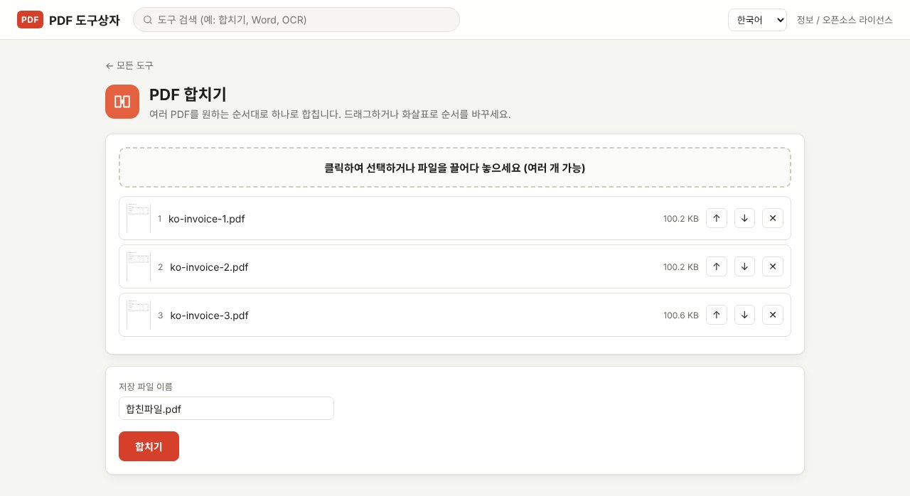

PDF 여러 개를 하나로 합치려면 파일을 순서대로 넣고 "합치기"를 누르면 됩니다. 온라인 사이트를 쓰면 모든 파일을 서버에 올려야 하지만, PDF Toolbox는 내 컴퓨터 안에서 합치기 때문에 거래처 서류나 개인 문서도 부담 없이 처리할 수 있습니다. 파일 개수와 용량 제한도 없습니다.

> **준비물**: [PDF Toolbox 최신 버전 다운로드](https://github.com/toolboxnotes/pdf-toolbox/releases/latest) (무료, Windows·Mac). 설치 방법은 [PDF Toolbox 소개 글](../offline-pdf-toolbox/)의 "다운로드와 설치"를 참고하세요.

## 이럴 때 PDF 합치기를 씁니다

- 한 달 치 거래명세서·세금계산서를 파일 하나로 묶어 경리 담당자에게 보낼 때
- 지원서, 경력증명서, 자격증 사본을 제출용 PDF 한 개로 만들 때
- 스캔하다 나뉜 계약서 앞뒷면을 한 파일로 정리할 때
- 메일 첨부 개수 제한 때문에 파일을 하나로 줄여야 할 때

## PDF 합치는 순서

*가상의 거래명세서 세 개를 넣은 PDF 합치기 화면. 파일 옆의 ↑ ↓ 버튼으로 순서를 바꿉니다.*

1. **PDF Toolbox를 열고 합칠 PDF를 모두 끌어다 놓습니다.** PDF를 두 개 이상 놓으면 추천 도구 맨 앞에 **PDF 합치기**가 나옵니다. 위쪽 검색창에 "합치기"를 입력해도 됩니다.
2. **순서를 정합니다.** 목록의 번호가 합쳐질 순서입니다. 파일을 드래그하거나 오른쪽 **↑ ↓** 버튼으로 옮기고, 빼고 싶은 파일은 **✕**를 누릅니다. 파일마다 첫 페이지 썸네일이 보여서 어떤 문서인지 바로 알 수 있습니다.
3. **저장 파일 이름을 바꿉니다.** 기본값은 `합친파일.pdf`입니다. `2026-11 거래명세서.pdf`처럼 내용을 알 수 있게 바꿔 두면 나중에 찾기 쉽습니다.
4. **합치기**를 누르면 다운로드 폴더에 저장됩니다.

PDF는 최소 두 개 이상 넣어야 합니다. 개수 제한은 없지만, 수백 페이지짜리 파일을 여러 개 합치면 컴퓨터 메모리를 많이 쓰니 나눠서 합치는 편이 안정적입니다.

## 파일이 아니라 페이지 단위로 섞고 싶다면

"합치기"는 파일을 통째로 이어 붙입니다. A 파일 2페이지와 B 파일 1페이지 사이에 끼워 넣는 식으로 페이지를 섞어야 한다면 **페이지 정리** 도구를 쓰세요.

| 하고 싶은 일 | 쓸 도구 |
|---|---|
| 파일 여러 개를 순서대로 이어 붙이기 | PDF 합치기 |
| 페이지 순서를 바꾸거나 일부 페이지 삭제 | 페이지 정리 |
| 다른 PDF의 페이지를 중간에 끼워 넣기 | 페이지 정리 (다른 PDF 페이지 추가) |
| 필요한 페이지만 골라 새 파일로 만들기 | PDF 나누기의 "페이지 추출" |

페이지 정리 도구는 모든 페이지를 썸네일로 보여 주고, 드래그로 순서를 바꾸거나 회전·삭제·복제·빈 페이지 삽입을 할 수 있습니다.

## 합친 뒤 확인할 것

- **페이지 수**: 합친 파일의 페이지 수가 원본 페이지 수의 합과 같은지 봅니다.
- **방향**: 가로로 스캔된 페이지가 섞여 있으면 합친 뒤에도 옆으로 누워 있습니다. **PDF 회전** 도구에서 썸네일을 클릭해 바로잡으세요.
- **용량**: 스캔본을 여러 개 합치면 메일 첨부 한도를 넘기 쉽습니다. 이럴 때는 [PDF 용량 줄이기](../compress-pdf-offline/)를 이어서 하면 됩니다.

## 알아 둘 한계

- **책갈피(목차)와 일부 링크는 유지되지 않습니다.** 페이지 내용만 옮겨 붙이는 방식이라 원본 PDF의 책갈피 목록은 합친 파일에 들어가지 않습니다.
- **암호가 걸린 PDF는 합칠 수 없습니다.** "암호로 보호된 PDF입니다"라는 안내가 나오면 먼저 [PDF 암호 해제](../pdf-password-protect-unlock/)로 암호를 없앤 다음 합치세요.
- **양식(입력란)이 있는 PDF**는 합친 뒤 입력란이 제대로 동작하지 않을 수 있습니다. 입력을 모두 마친 뒤 합치는 것이 안전합니다.

## 왜 온라인 사이트 대신 오프라인인가

합치는 파일은 대개 여러 사람의 정보가 함께 들어 있는 서류 묶음입니다. 온라인 PDF 합치기 사이트는 파일을 서버에 올려 처리하고 일정 시간 뒤 지운다고 안내합니다. PDF Toolbox는 처음부터 파일을 내보내지 않기 때문에 그 시간을 신경 쓸 필요가 없습니다. 인터넷이 끊겨도 똑같이 동작하고, 하루 사용 횟수 제한도 없습니다.

## 자주 묻는 질문

### 몇 개까지 합칠 수 있나요?

정해진 개수 제한은 없습니다. 컴퓨터 메모리가 허락하는 만큼 가능하고, 일반적인 서류 수십 개는 문제없이 합쳐집니다.

### 합치면 화질이 떨어지나요?

떨어지지 않습니다. 페이지를 이미지로 바꾸지 않고 원래 내용 그대로 이어 붙입니다. 글자 선택과 검색도 원본처럼 됩니다.

### JPG 사진도 같이 합칠 수 있나요?

PDF 합치기에는 PDF만 넣을 수 있습니다. 사진은 먼저 **이미지를 PDF로** 도구로 PDF로 만든 다음 함께 합치세요.

### Mac에서도 되나요?

됩니다. Windows와 Mac 모두에서 같은 화면으로 동작합니다.

## 함께 보면 좋은 글

- [PDF 용량 줄이기](../compress-pdf-offline/)
- [PDF 나누기·페이지 추출](../split-pdf-extract-pages/)
- [PDF 비밀번호 설정과 해제 방법](../pdf-password-protect-unlock/)
- [무료 오프라인 PDF 변환기 PDF Toolbox 전체 기능](../offline-pdf-toolbox/)
