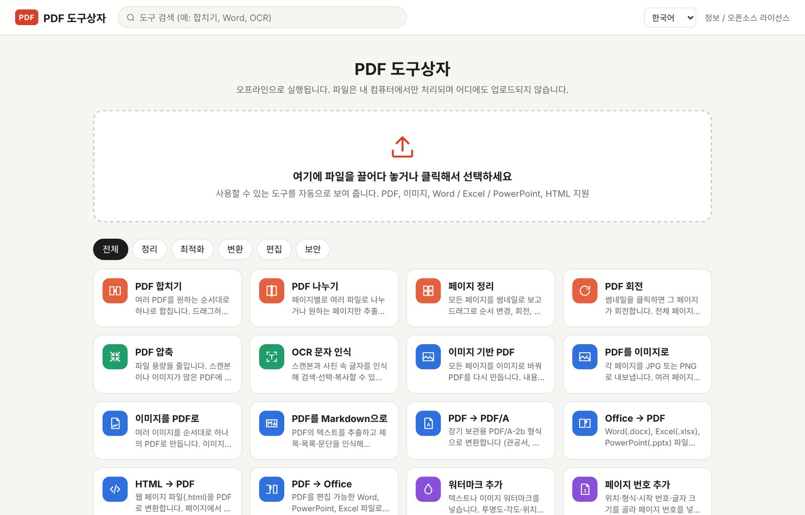
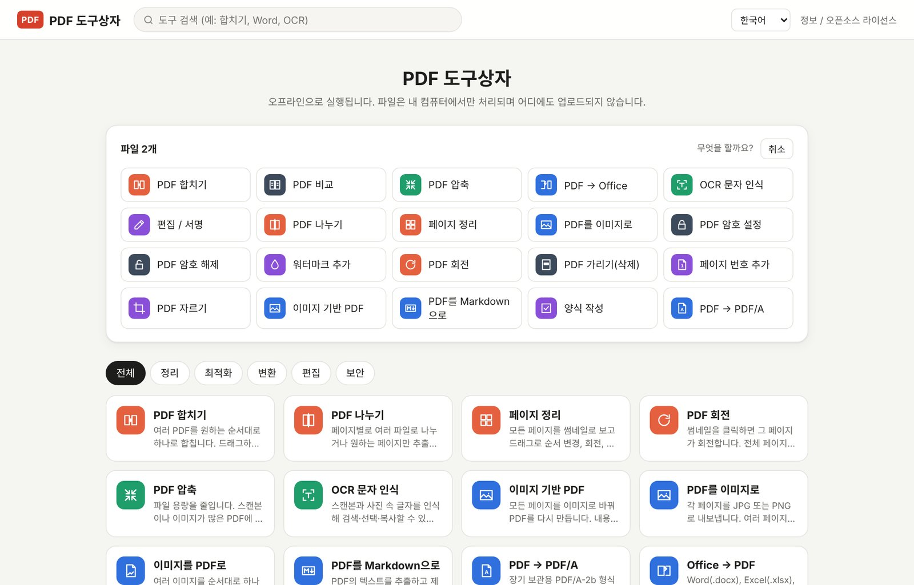
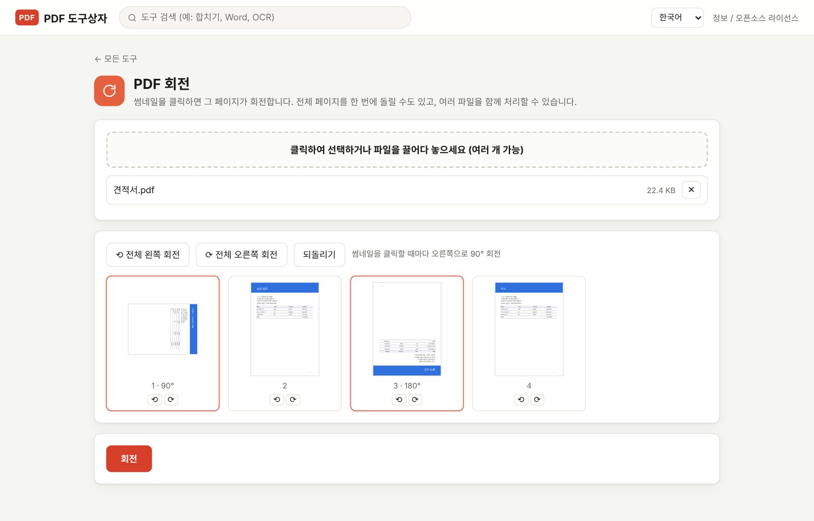
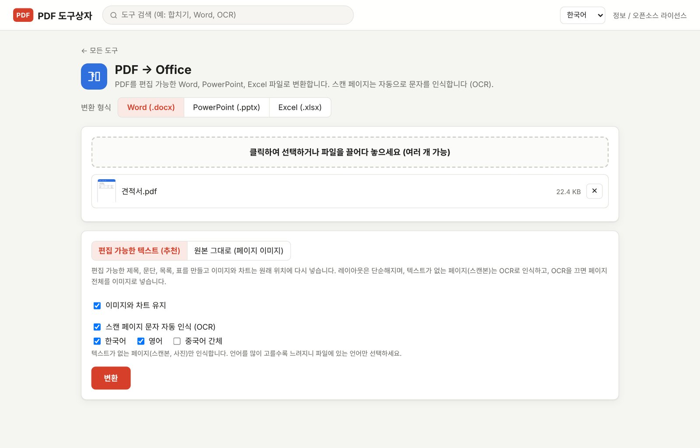
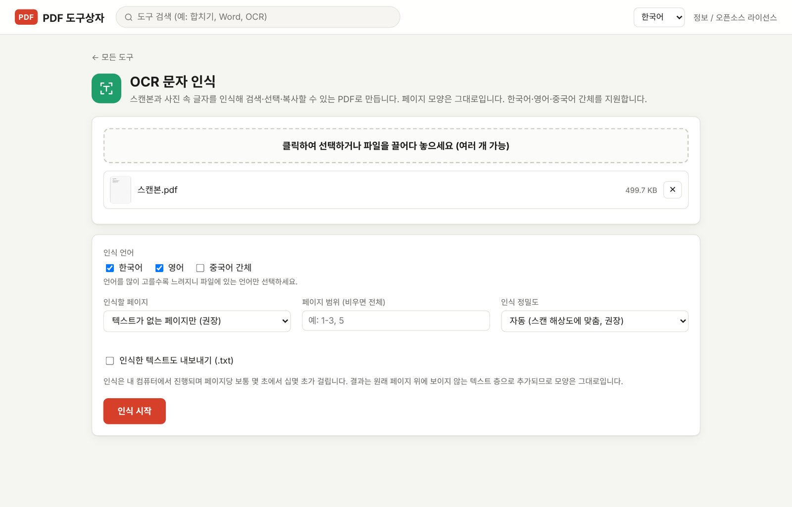
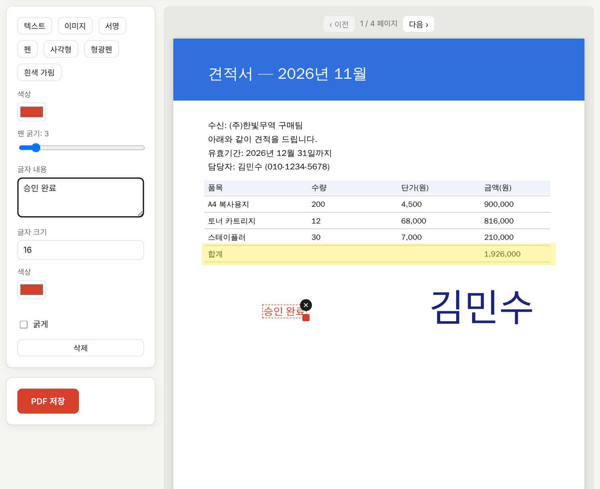
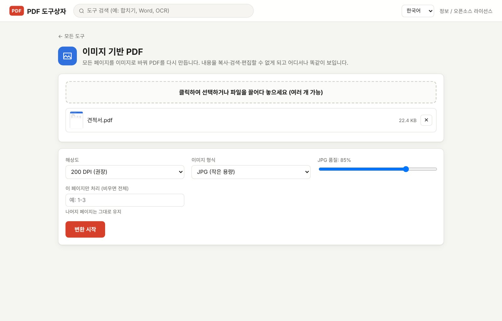

"PDF 합치기"를 검색하면 무료 사이트가 줄줄이 나옵니다. 편리하긴 한데, 업로드 버튼을 누르기 직전에 손이 한 번씩 멈춥니다. 지금 올리려는 파일이 거래처 계약서이고, 단가가 다 적힌 견적서이고, 물류 창고에 보낼 출고 지시서라면 더 그렇습니다.

> 이 파일, 지금 지구 반대편 어느 서버에 잠깐 들렀다 오는 거겠지?

"잠깐"이 정말 잠깐인지는 저도 확인할 방법이 없습니다. 그래서 결론을 내렸습니다. **파일이 내 컴퓨터 밖으로 한 발짝도 나가지 않는 PDF 변환기**를 직접 만들자. 그렇게 나온 프로그램이 **PDF 도구상자(PDF Toolbox)** 입니다.

이 글에서는 PDF 도구상자로 무엇을 할 수 있는지, 실제 화면과 함께 소개합니다. 써 보고 싶다면 글 마지막의 방법으로 연락 주세요.

## 한 줄 요약

**설치 없이, 인터넷 없이, 업로드 없이** 쓰는 PDF 만능 도구입니다.

- **오프라인으로 동작합니다.** 모든 처리는 내 컴퓨터 안에서 끝나고 어떤 서버에도 파일이 올라가지 않습니다. 와이파이를 꺼도 똑같이 돌아갑니다.
- **설치가 필요 없습니다.** 프로그램 전체가 HTML 파일 하나(약 19 MB)입니다. Windows는 `PDF Toolbox.exe`, Mac은 `PDF Toolbox.app`을 더블클릭하면 별도 창으로 열립니다.
- **자주 쓰는 기능이 한곳에 있습니다.** 합치기·나누기·압축부터 PDF ↔ Office 변환, OCR 문자 인식, 서명, 암호 설정까지 23가지 도구가 들어 있습니다. 화면은 한국어·영어·중국어를 지원합니다.

## 온라인 PDF 변환기, 뭐가 불편했나

온라인 변환 사이트가 나쁘다는 이야기는 아닙니다. 다만 매일 문서를 다루다 보니 아래 같은 순간이 쌓였습니다.

| 상황 | 온라인 변환기 | PDF 도구상자 |
|---|---|---|
| 민감한 문서(계약서, 견적서, 신분증 사본) | 서버에 업로드해야 함 | 내 컴퓨터에서만 처리 |
| 100 MB짜리 스캔 파일 | 업로드·다운로드를 기다려야 함 | 업로드 시간 0초 |
| 인터넷이 느리거나 끊겼을 때 | 사용 불가 | 그대로 사용 |
| 하루에 여러 번 변환 | 횟수 제한이나 유료 전환이 있는 경우가 많음 | 횟수 제한 없음 |
| 광고, 팝업 | 사이트마다 다름 | 없음 |

특히 첫 번째 줄이 컸습니다. 온라인 셀러로 일하다 보면 공급처 단가표, 송장, 통관 서류처럼 "남이 보면 곤란한" PDF가 생각보다 많습니다.

## 이런 분께 잘 맞습니다

- **온라인 셀러**: 송장 여러 장을 한 PDF로 합치고, 견적서에 서명해서 보내고, 공급처에서 받은 스캔본을 Excel로 옮길 때
- **회사원**: 보고서를 PDF/A로 보관하고, 회의 자료에 워터마크와 페이지 번호를 넣을 때
- **프리랜서**: 계약서에 손글씨 서명을 넣고, 포트폴리오 용량을 줄여 메일로 보낼 때
- **학생**: 스캔한 논문을 검색 가능한 PDF로 만들고, 필요한 페이지만 뽑아낼 때

## 기능 둘러보기

### 1. 일단 파일부터 끌어다 놓으세요

홈 화면의 큰 상자에 파일을 놓으면, 그 파일로 할 수 있는 도구를 알아서 골라 줍니다. PDF 두 개를 놓으면 "합치기"와 "비교"가 맨 앞에, 이미지를 놓으면 "이미지를 PDF로"가 먼저 나옵니다. 도구를 고르면 파일을 다시 선택할 필요 없이 바로 작업을 시작합니다.

어떤 도구를 써야 할지 몰라도 괜찮다는 뜻입니다. 파일이 먼저 말해 줍니다.

*그림 1. 홈 화면: 분류별 도구 목록과 검색창*

*그림 2. PDF 두 개를 놓으면 합치기·비교 같은 도구가 먼저 추천됩니다*

### 2. 페이지를 보면서 회전

스캔하다 보면 꼭 한두 장씩 옆으로 누운 페이지가 생깁니다. PDF 회전 도구는 모든 페이지를 썸네일로 보여 주고, 썸네일을 클릭할 때마다 그 페이지가 오른쪽으로 90°씩 돌아갑니다. "전체 왼쪽으로", "전체 오른쪽으로", "되돌리기"도 있어서 저장하기 전에 결과를 눈으로 확인할 수 있습니다.

*그림 3. PDF 회전: 1페이지는 90°, 3페이지는 180° 회전한 상태*

### 3. PDF를 Word·PowerPoint·Excel로

가장 많이 쓰는 기능입니다. Word, PowerPoint, Excel 중 하나를 고르면 편집 가능한 파일로 바꿔 줍니다.

- **Word**: 제목·문단·목록·표를 인식하고, 그림과 차트도 원래 위치에 다시 넣습니다.
- **PowerPoint**: 페이지 배경 위에 글자를 편집 가능한 텍스트 상자로 올립니다. 위치, 글자 크기, 굵기, 색이 유지됩니다.
- **Excel**: 글자 사이 간격으로 열을 나누고, 숫자·천 단위 쉼표·괄호 음수·퍼센트를 **계산 가능한 숫자**로 넣습니다. PDF로 받은 정산서를 엑셀에서 바로 SUM 할 수 있다는 뜻입니다.

반대 방향인 "Office → PDF"도 있어서 Word·Excel·PowerPoint 파일을 PDF로 바꿀 수 있습니다.

*그림 4. PDF → Office: 변환 형식과 모드 선택*

### 4. 스캔본도 검색되는 PDF로 (OCR)

종이를 스캔하거나 휴대폰으로 찍은 PDF는 겉보기엔 글자지만, 컴퓨터 입장에서는 그냥 그림입니다. Ctrl+F로 검색이 안 되고 복사도 안 됩니다.

OCR 문자 인식은 그림 속 글자를 읽어서 **눈에 보이지 않는 텍스트 층**을 덧입혀 줍니다. 페이지 모양은 그대로인데 검색·복사가 됩니다. 한국어·영어·중국어 간체를 지원하고, 테스트에서는 4페이지에 약 4초가 걸렸습니다. 인식 엔진과 언어 데이터까지 프로그램 안에 들어 있어서 OCR도 인터넷 없이 동작합니다.

PDF → Word·Excel 변환에도 "스캔 페이지 자동 OCR" 옵션이 있어서, 스캔본을 바로 엑셀 표로 옮길 수 있습니다.

*그림 5. OCR 문자 인식: 인식 언어와 정밀도 설정*

### 5. 편집·서명: 프린트하고 서명하고 다시 스캔하는 건 이제 그만

PDF 위에 텍스트, 이미지, 손글씨 서명, 형광펜, 흰색 가림을 올리고 드래그로 위치와 크기를 조절합니다. "승인 완료" 도장 같은 문구를 넣고 마우스로 서명하면, 출력하고 서명하고 다시 스캔하던 세 단계가 한 화면에서 끝납니다.

*그림 6. 편집 / 서명: 견적서에 문구와 손글씨 서명을 넣은 예*

### 6. 이미지 기반 PDF: 복사·수정이 어려운 PDF 만들기

모든 페이지를 이미지로 바꿔 PDF를 다시 만듭니다. 글자를 복사하거나 내용을 고치기 어려워지므로, 견적서나 디자인 시안처럼 "보기만 해 주세요" 하고 보내야 하는 문서에 유용합니다. 해상도와 이미지 형식(JPG/PNG)을 고를 수 있습니다.

*그림 7. 이미지 기반 PDF: 해상도와 형식 선택*

## 23가지 도구 전체 목록

| 분류 | 도구 |
|---|---|
| 정리 | PDF 합치기, PDF 나누기, 페이지 정리(순서 변경·삭제·복제·빈 페이지 추가), PDF 회전 |
| 최적화 | PDF 압축, OCR 문자 인식 |
| 변환 | PDF → Office(Word·PowerPoint·Excel), Office → PDF, 이미지 → PDF, PDF → 이미지, 이미지 기반 PDF, PDF → Markdown·TXT, PDF → PDF/A, HTML → PDF |
| 편집 | 편집·서명, 워터마크, 페이지 번호, 자르기, 양식 작성 |
| 보안 | 암호 설정(AES-256), 암호 해제, 가리기(완전 삭제), PDF 비교 |

## 알아 두면 좋은 팁 4가지

**1. "흰색 가림"과 "가리기(완전 삭제)"는 다릅니다.**
편집 도구의 흰색 가림은 위에 흰 상자를 덮는 것이라, 아래 글자는 여전히 파일 안에 남아 있습니다. 복사하면 그대로 나옵니다. 주민등록번호나 계좌번호처럼 **정말 지워야 하는 정보**는 보안 메뉴의 "가리기"를 쓰세요. 해당 페이지를 이미지로 바꿔서 글자 자체를 없앱니다.

**2. 압축은 "무손실"부터 시도하세요.**
압축에는 무손실 최적화, 가벼움, 권장, 강력의 네 단계가 있습니다. 무손실은 화질을 건드리지 않고 파일 구조만 정리합니다. 그래도 크면 단계를 올리세요. 위의 세 단계는 페이지를 이미지로 바꾸기 때문에 용량은 크게 줄지만 글자 선택은 안 됩니다.

**3. 오래 보관할 문서는 PDF/A로.**
PDF/A는 수십 년 뒤에도 똑같이 열리도록 만든 보관용 표준입니다. 글꼴과 색 정보를 파일 안에 넣고 외부 의존성을 없앱니다. 계약서, 세금 관련 서류 보관에 좋습니다.

**4. 두 버전이 뭐가 다른지 궁금하면 "PDF 비교".**
계약서 수정본을 받았을 때 어디가 바뀌었는지 일일이 읽지 않아도 됩니다. 글자 차이 또는 화면 차이로 달라진 부분을 표시해 줍니다.

## 만들면서 재미있었던 것들

- **19 MB 안에 다 들어 있습니다.** OCR 엔진, 한국어·영어·중국어 인식 데이터, Word·Excel·PowerPoint 생성 라이브러리, 암호화 기능까지 HTML 파일 하나에 들어 있습니다. 그래서 USB에 넣어 다니며 써도 됩니다.
- **암호화는 직접 구현했습니다.** AES-256 암호 설정과, 오래된 RC4 방식부터 AES-256까지의 암호 해제를 브라우저 기능만으로 처리합니다.
- **한국어 OCR의 띄어쓰기 문제.** 인식 엔진이 한국어 단어 하나를 여러 조각으로 나누는 경우가 많아서, 줄 전체의 띄어쓰기를 기준으로 다시 묶었습니다. 덕분에 복사한 글자의 띄어쓰기가 자연스럽습니다.
- **33페이지 PDF → PowerPoint가 약 4초.** 생각보다 빨라서 저도 놀랐습니다.

## 솔직한 한계

- 텍스트 상자, 차트, 다단 편집이 많은 복잡한 문서는 Office에서 보는 것과 조금 다르게 변환될 수 있습니다.
- OCR은 깨끗한 스캔에서는 정확하지만, 잡티가 많거나 글씨가 아주 큰 제목에서는 오타가 생길 수 있습니다. 중요한 문서는 한 번 확인해 주세요.
- PowerPoint → PDF에서 차트와 SmartArt는 빈 상자로 표시됩니다.
- Chrome 또는 Edge가 설치된 컴퓨터를 권장합니다.

## 사용 방법

| 환경 | 실행 방법 |
|---|---|
| Windows | `PDF Toolbox.exe`를 더블클릭합니다. Chrome(없으면 Edge)으로 주소창 없는 별도 창이 열립니다. `PDF-Toolbox.html`과 같은 폴더에 두세요. |
| Mac | `PDF-Toolbox-Mac.zip`의 압축을 풀고 `PDF Toolbox.app`을 응용 프로그램 폴더로 옮깁니다. 처음에는 마우스 오른쪽 버튼 → "열기"를 누르세요. |
| 그 밖의 환경 | `PDF-Toolbox.html`을 Chrome이나 Edge로 엽니다. |

언어는 오른쪽 위에서 바꿀 수 있고, 처음에는 브라우저 언어에 맞춰 자동으로 선택됩니다.

## 자주 묻는 질문

**정말 파일이 업로드되지 않나요?**
네. 프로그램을 연 뒤 와이파이를 끄고 써 보시면 확인할 수 있습니다. 모든 기능이 그대로 동작합니다.

**Mac에서도 되나요?**
됩니다. Apple 개발자 서명이 없어서 처음 열 때만 마우스 오른쪽 버튼 → "열기"를 한 번 눌러 주면 됩니다.

**한글 파일(HWP)도 되나요?**
아직은 지원하지 않습니다. 필요하신 분이 많으면 우선순위를 올리겠습니다.

**휴대폰에서도 쓸 수 있나요?**
지금은 PC용입니다. 웹 버전을 준비하고 있습니다.

## PDF 도구상자를 써 보고 싶다면

PDF 도구상자는 아직 정식 배포 전입니다. 써 보고 싶으신 분은 아래 메일로 연락 주세요. 아래 세 가지를 같이 적어 주시면 더 빨리 답장드릴 수 있습니다.

1. 사용하는 컴퓨터(Windows / Mac)
2. 주로 하고 싶은 작업(예: 스캔본을 엑셀로, 계약서 서명)
3. 있으면 좋겠는 기능

메일: [toolbox@toolboxnotes.com](mailto:toolbox@toolboxnotes.com)

---

**함께 읽으면 좋은 글**

- [Toolbox Notes를 시작합니다](../hello-toolbox-notes/)
- [아마존 셀러 하루 루틴: 아침 15분으로 끝내는 매일 점검 리스트](../amazon-seller-14-daily-routine/)
