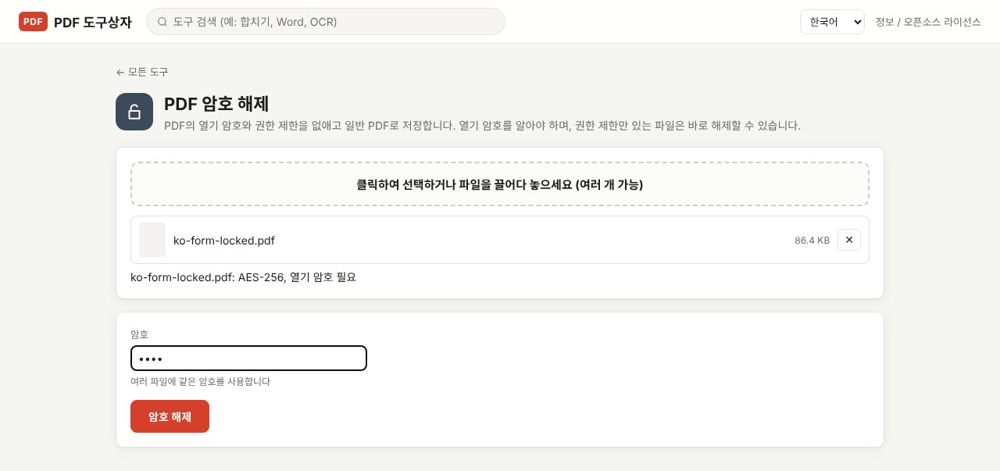
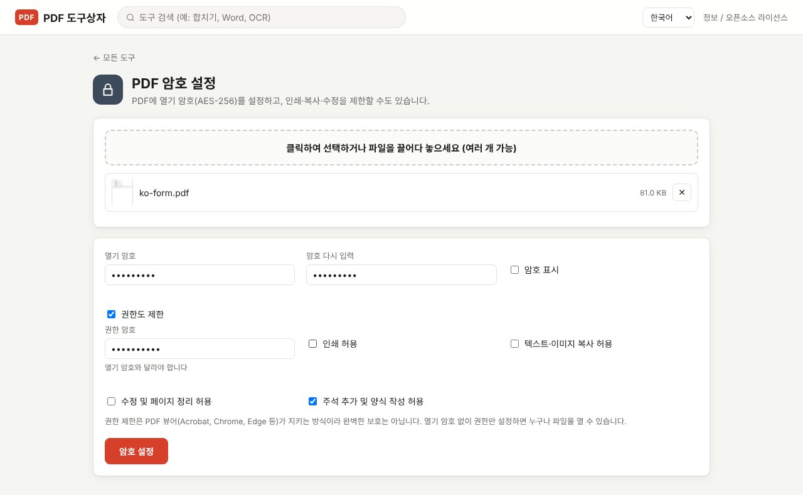

PDF 비밀번호는 두 종류입니다. 파일을 열 때 묻는 **열기 암호**와, 인쇄·복사·수정을 막는 **권한 암호**입니다. 열기 암호는 알고 있어야만 해제할 수 있고, 권한 제한만 걸린 파일은 바로 해제할 수 있습니다. 이 글에서는 두 암호의 차이, 암호를 거는 방법, 알고 있는 암호를 없애 일반 PDF로 저장하는 방법을 정리합니다.

> **준비물**: [PDF Toolbox 최신 버전 다운로드](https://github.com/toolboxnotes/pdf-toolbox/releases/latest) (무료, Windows·Mac). 파일과 암호 모두 내 컴퓨터 밖으로 나가지 않습니다.

## 열기 암호와 권한 암호의 차이

| | 열기 암호 | 권한 암호 |
|---|---|---|
| 언제 묻나 | 파일을 열 때 | 권한 설정을 바꿀 때 |
| 막는 것 | 내용을 보는 것 자체 | 인쇄, 복사, 수정, 주석·양식 작성 |
| 내용 암호화 | 암호 없이는 풀 수 없음 | 뷰어 프로그램이 제한을 지키는 방식 |
| 해제 조건 | 암호를 알아야 함 | 암호 없이 해제 가능 |

핵심은 마지막 두 줄입니다. 권한 제한은 PDF 뷰어(Acrobat, Chrome, Edge 등)가 "지켜 주는" 약속이라 완벽한 보호가 아닙니다. 남이 내용을 보지 못하게 하려면 반드시 열기 암호를 걸어야 합니다.

## PDF 비밀번호 해제: 매번 입력하지 않게 저장하기

급여명세서, 카드 이용대금 명세서, 보험 서류처럼 열 때마다 생년월일을 넣어야 하는 PDF가 있습니다. 내 컴퓨터에 보관할 용도라면 암호를 없앤 사본을 만들어 두면 편합니다.

*파일을 넣으면 바로 아래에 "AES-256, 열기 암호 필요"처럼 암호화 방식과 상태가 표시됩니다.*

1. **PDF Toolbox에 파일을 끌어다 놓고 "PDF 암호 해제"를 고릅니다.** 보안 분류 안에 있습니다.
2. **파일 상태를 확인합니다.** 파일마다 암호화 방식과 함께 "열기 암호 필요" 또는 "권한 제한만 있음 — 바로 해제 가능"이 표시됩니다.
3. **열기 암호를 입력합니다.** 권한 제한만 있는 파일이면 비워 둡니다.
4. **암호 해제**를 누릅니다. 파일 이름 뒤에 `_해제.pdf`가 붙은 일반 PDF가 저장됩니다.

여러 파일을 한꺼번에 넣을 수 있고, 이때 모든 파일에 같은 암호를 사용합니다. 매달 같은 암호로 오는 명세서를 한 번에 정리할 때 유용합니다.

지원하는 암호화 방식은 RC4 40/128비트, AES-128, AES-256입니다. 인증서로 암호화된 PDF는 지원하지 않습니다.

## PDF 비밀번호 설정: 보내기 전에 암호 걸기

*열기 암호를 두 번 입력하고 "권한도 제한"을 켠 모습. 권한 암호는 열기 암호와 달라야 합니다.*

1. **파일을 끌어다 놓고 "PDF 암호 설정"을 고릅니다.**
2. **열기 암호를 입력하고 한 번 더 입력합니다.** "암호 표시"를 켜면 입력한 글자를 볼 수 있습니다.
3. **필요하면 "권한도 제한"을 켭니다.** 권한 암호를 따로 정하고(열기 암호와 달라야 합니다), 허용할 항목을 고릅니다.
   - 인쇄 허용
   - 텍스트·이미지 복사 허용
   - 수정 및 페이지 정리 허용
   - 주석 추가 및 양식 작성 허용
4. **암호 설정**을 누릅니다. `_암호.pdf`가 붙은 파일이 저장됩니다.

암호화 방식은 AES-256입니다. 최근의 Acrobat, Chrome, Edge, Mac 미리보기에서 열리지만, 아주 오래된 뷰어에서는 열리지 않을 수 있습니다.

이미 암호가 걸린 파일에 새 암호를 걸려면 먼저 "PDF 암호 해제"로 기존 암호를 없애야 합니다.

## 암호를 정하고 전달할 때

- **암호를 잊으면 복구할 수 없습니다.** 열기 암호는 내용을 실제로 암호화하므로, 암호 없이는 만든 사람도 열지 못합니다. 원본을 따로 보관하세요.
- **파일과 암호는 다른 경로로 보냅니다.** 메일에 파일을 첨부했다면 암호는 문자나 메신저로 보냅니다. 같은 메일에 암호를 적으면 암호를 건 의미가 없습니다.
- **생년월일이나 전화번호 뒷자리는 피합니다.** 받는 사람을 아는 누구나 짐작할 수 있습니다.
- **암호를 건다고 내용 일부가 가려지는 것은 아닙니다.** 받는 사람에게도 보이면 안 되는 정보가 있다면 [개인정보 가리기](../redact-pdf-permanently/)를 먼저 하세요.

## 열기 암호를 잊어버렸다면

이 도구는 암호를 알아내는(크랙하는) 기능이 없고, 앞으로도 넣을 계획이 없습니다. 할 수 있는 일은 다음 정도입니다.

- 파일을 보낸 곳(회사, 카드사, 보험사)의 안내를 다시 확인합니다. 대개 생년월일 6자리나 사업자등록번호 같은 규칙이 메일 본문에 적혀 있습니다.
- 암호를 걸기 전의 원본이 있는지 찾아봅니다.
- 보낸 사람에게 다시 요청합니다.

그리고 암호 해제는 본인 문서이거나 해제할 권한이 있는 문서에만 사용하세요.

## 자주 묻는 질문

### 암호를 모르는데 해제할 수 있나요?

권한 제한만 걸린 파일(열 때는 암호를 묻지 않고 인쇄나 복사만 막힌 파일)은 암호 없이 해제됩니다. 열 때 암호를 묻는 파일은 암호를 알아야 합니다.

### 온라인 사이트로 해제하면 안 되나요?

암호가 걸린 문서는 대개 그만큼 민감한 문서입니다. 온라인 서비스를 쓰면 파일과 암호를 함께 서버로 보내게 됩니다. 내 컴퓨터에서 처리하면 그럴 필요가 없습니다.

### 해제한 파일은 원본과 내용이 같은가요?

같습니다. 암호화만 풀어서 저장하며 페이지 내용은 바꾸지 않습니다.

### Chrome의 "PDF로 인쇄"로도 암호를 없앨 수 있다던데요?

암호를 입력해 연 뒤 "PDF로 저장"으로 인쇄하면 암호 없는 사본이 만들어집니다. 다만 인쇄가 제한된 파일에서는 안 되고, 책갈피나 양식 같은 요소가 빠질 수 있으며, 여러 파일을 한 번에 처리할 수 없습니다.

### 권한 제한만 걸어 두면 안전한가요?

아닙니다. 열기 암호 없이 권한만 설정하면 누구나 파일을 열 수 있고, 권한 제한은 위에서 본 것처럼 바로 해제할 수 있습니다.

## 함께 보면 좋은 글

- [PDF 개인정보 가리기: 검은 칠만으로는 지워지지 않는 이유](../redact-pdf-permanently/)
- [스캔 PDF 검색 가능하게 만들기 (무료 OCR)](../scanned-pdf-searchable-ocr/)
- [무료 오프라인 PDF 변환기 PDF Toolbox 전체 기능](../offline-pdf-toolbox/)
