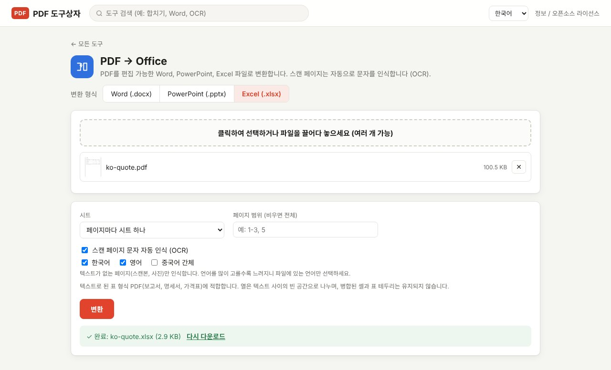
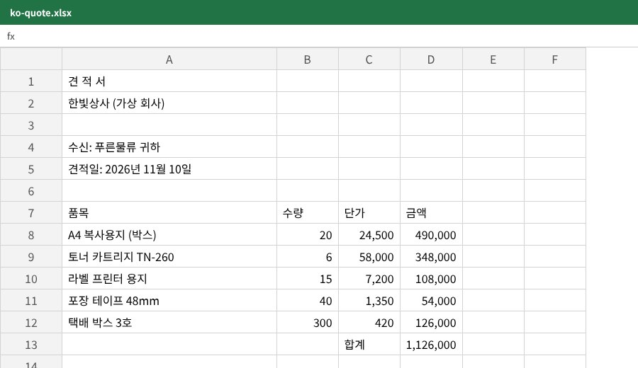

PDF의 표를 Excel로 옮길 때 가장 귀찮은 건 숫자입니다. 그냥 복사해 붙이면 `1,126,000`이 글자로 들어가거나 한 칸에 몰려서 SUM이 안 됩니다. PDF Toolbox의 **PDF → Office**에서 Excel을 고르면 표를 행과 열로 나누고, 쉼표·괄호 음수·퍼센트가 붙은 숫자를 **계산 가능한 숫자**로 넣어 줍니다. 파일은 내 컴퓨터 안에서만 처리됩니다.

> **준비물**: [PDF Toolbox 최신 버전 다운로드](https://github.com/toolboxnotes/pdf-toolbox/releases/latest) (무료, Windows·Mac). 설치 방법은 [PDF Toolbox 소개 글](../offline-pdf-toolbox/)의 "다운로드와 설치"를 참고하세요.

## 잘 되는 PDF, 어려운 PDF

| PDF | 결과 |
|---|---|
| 프로그램에서 저장한 견적서, 정산서, 가격표, 거래내역 | 잘 됨. 이 도구가 가장 잘하는 종류 |
| 스캔한 표 | OCR로 인식해서 변환. 인식 오류가 있을 수 있음 |
| 셀 병합이 많은 복잡한 양식 | 열이 어긋날 수 있음 |
| 표 없이 글만 있는 문서 | Excel보다 Word 변환이 맞음 |

이 도구는 글자 사이의 빈 공간으로 열을 나눕니다. 그래서 줄 맞춰 정리된 표일수록 결과가 깔끔하고, 표 테두리나 셀 병합 모양은 그대로 옮겨지지 않습니다.

## PDF를 Excel로 바꾸는 순서

*가상의 견적서 PDF를 Excel로 변환한 화면. 위쪽 "변환 형식"에서 Excel (.xlsx)을 고릅니다.*

1. **PDF Toolbox에 PDF를 끌어다 놓고 PDF → Office를 고릅니다.**
2. **위쪽 "변환 형식"에서 Excel (.xlsx)을 누릅니다.** 한 번 고르면 다음에도 Excel이 선택된 상태로 열립니다.
3. **시트 나누는 방식을 고릅니다.**
   - **페이지마다 시트 하나**: 페이지별로 다른 표일 때
   - **모두 한 시트에**: 여러 페이지에 걸친 긴 표를 이어 붙일 때
4. **필요하면 페이지 범위를 적습니다.** 비워 두면 전체를 변환합니다. 예: `2-4`
5. **스캔한 PDF라면 "스캔 페이지 문자 자동 인식 (OCR)"이 켜져 있는지 확인합니다.** 기본으로 켜져 있고, 글자가 없는 페이지만 인식합니다.
6. **변환**을 누르면 `.xlsx` 파일이 저장됩니다.

## 결과: 숫자가 숫자로 들어갑니다

*위 견적서를 변환한 결과. 수량·단가·금액이 오른쪽 정렬된 숫자 값으로 들어가 바로 합계를 낼 수 있습니다.*

숫자 변환 규칙은 다음과 같습니다.

| PDF에 적힌 모양 | Excel에 들어가는 값 |
|---|---|
| `1,126,000` | 1126000 (숫자) |
| `(3,500)` | -3500 (회계식 음수) |
| `12.5%` | 0.125 (퍼센트 서식) |
| `010-1234-5678`, `00123` | 글자 그대로 (앞자리 0이 사라지지 않음) |
| `A4 복사용지` | 글자 그대로 |

그래서 변환하자마자 `=SUM(D8:D12)` 같은 수식을 쓸 수 있습니다. 정산서를 매달 Excel로 옮겨 대조하는 일이 있다면 이 차이가 큽니다.

## 변환 후 확인할 것

- **합계 대조**: PDF의 합계와 Excel에서 계산한 합계가 같은지 먼저 봅니다. 열이 한 칸 밀리면 바로 드러납니다.
- **제목 줄**: 표 위의 회사명, 날짜 같은 글자도 위쪽 행에 들어옵니다. 필요 없는 행은 지우세요.
- **스캔본**: OCR 결과의 숫자는 꼭 원본과 눈으로 비교하세요. `8`과 `3`, `0`과 `6`이 바뀌는 경우가 있습니다.

## 알아 둘 한계

- **표 테두리, 셀 병합, 글자 색은 옮겨지지 않습니다.** 값만 옮기는 도구입니다.
- **열 구분은 빈 공간 기준**이라, 칸 사이가 아주 좁은 표는 두 열이 한 칸에 합쳐질 수 있습니다.
- **암호가 걸린 PDF**는 먼저 [PDF 암호 해제](../pdf-password-protect-unlock/)를 해야 합니다.

## 자주 묻는 질문

### Word나 PowerPoint로도 바꿀 수 있나요?

같은 도구에서 "변환 형식"만 Word (.docx)나 PowerPoint (.pptx)로 바꾸면 됩니다. 글 위주 문서는 Word가 맞습니다.

### 여러 PDF를 한꺼번에 변환할 수 있나요?

됩니다. 파일을 여러 개 넣으면 각각 Excel 파일로 만들어 `Excel.zip`으로 묶어 줍니다.

### 은행 거래내역 PDF도 되나요?

텍스트로 된 거래내역이라면 대부분 잘 됩니다. 암호가 걸려 오는 경우가 많으니 암호 해제를 먼저 하세요.

### 반대로 Excel을 PDF로 바꾸려면?

**Office → PDF** 도구를 쓰면 됩니다. [엑셀 PDF 변환](../excel-to-pdf-offline/) 글에 정리했습니다.

## 함께 보면 좋은 글

- [엑셀 PDF 변환](../excel-to-pdf-offline/)
- [스캔 PDF 검색 가능하게 만들기 (무료 OCR)](../scanned-pdf-searchable-ocr/)
- [PDF 비밀번호 설정과 해제 방법](../pdf-password-protect-unlock/)
- [무료 오프라인 PDF 변환기 PDF Toolbox 전체 기능](../offline-pdf-toolbox/)
